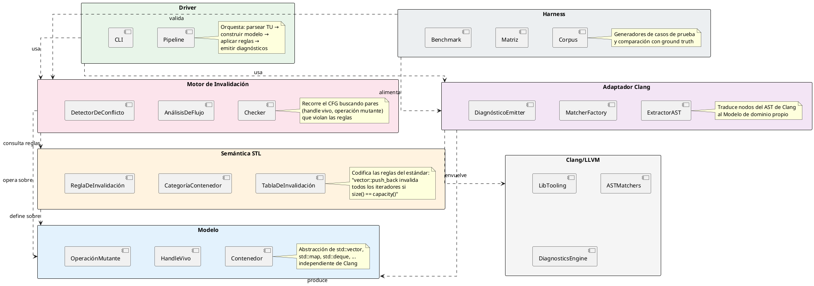
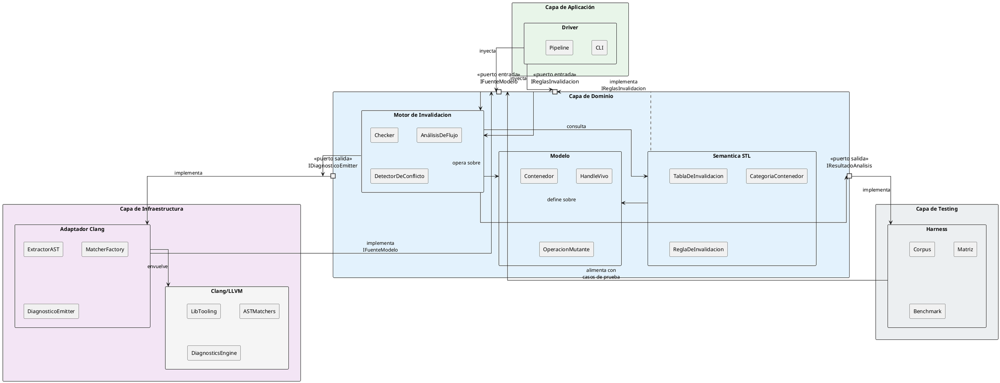
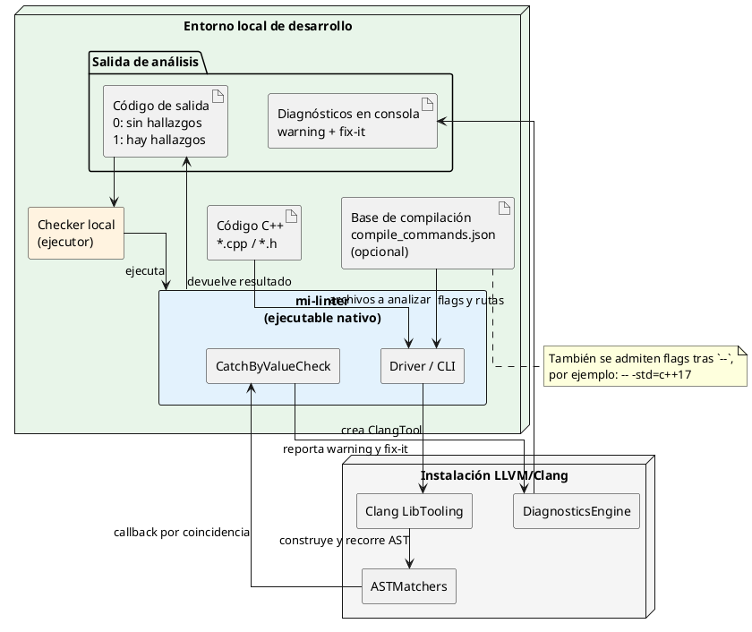
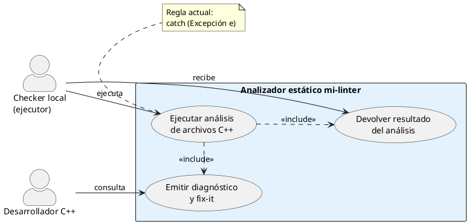
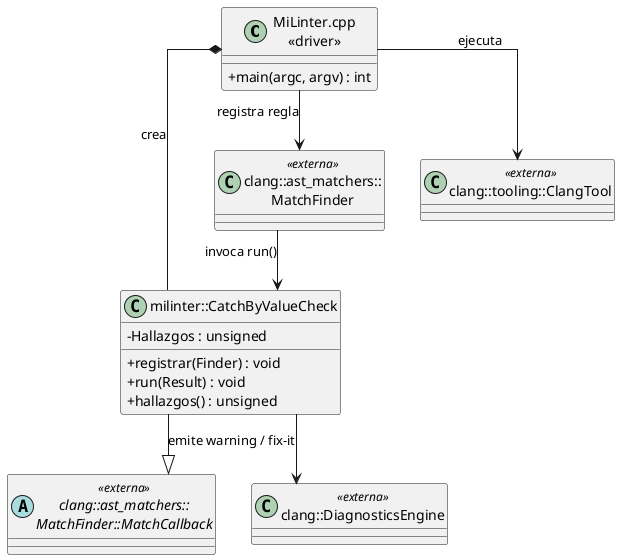
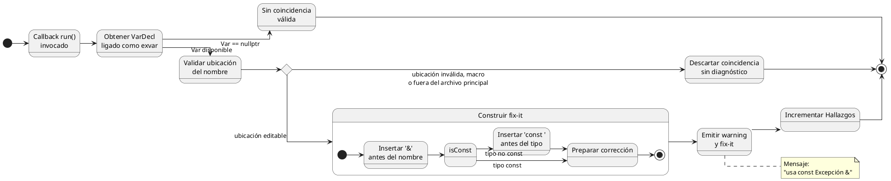
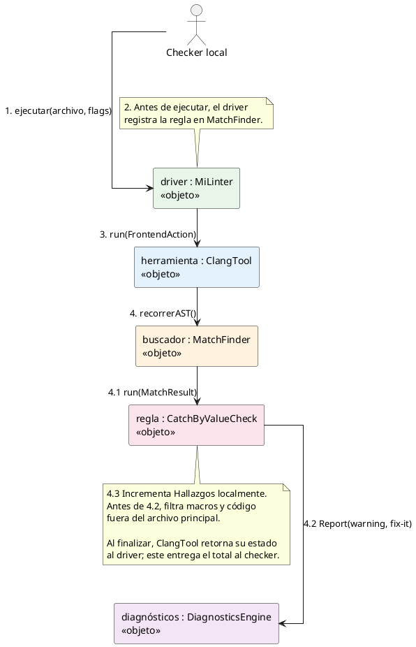

# Arquitectura

## Diagrama de Paquetes

### Descripción de los paquetes

| Paquete | Responsabilidad | Principio DDD |
|---------|----------------|---------------|
| **Driver** | Punto de entrada CLI, orquesta el pipeline de análisis | Capa de Aplicación |
| **Modelo** | Value objects puros: `Contenedor`, `HandleVivo`, `OperaciónMutante` | Capa de Dominio — entidades y value objects |
| **Semántica STL** | Codifica las reglas del estándar C++ sobre invalidación | Capa de Dominio — servicio de dominio |
| **Motor de Invalidación** | Análisis de flujo + detección de conflictos handle/mutación | Capa de Dominio — lógica central |
| **Adaptador Clang** | Capa anti-corrupción: traduce AST de Clang al modelo propio | Anti-Corruption Layer |
| **Harness** | Corpus de pruebas, matrices de cobertura, benchmarks | Infraestructura de testing |
| **Clang/LLVM** | Dependencia externa: parsing, AST, diagnósticos | Externo |

### Principios de diseño

1. **El Modelo y la Semántica STL no dependen de Clang.** Esto permite probarlos unitariamente sin compilar C++ real.

2. **El Adaptador Clang es la única frontera con LibTooling.** Actúa como capa anti-corrupción: extrae nodos del AST y los traduce a los value objects del Modelo.

3. **El Motor de Invalidación es agnóstico a la fuente.** Recibe el modelo ya construido y aplica las reglas de la Semántica STL. Podría alimentarse desde otro frontend (no solo Clang).

4. **El Driver solo orquesta.** No contiene lógica de dominio; conecta las piezas y configura la CLI.

---

## Arquitectura Lógica

La arquitectura lógica organiza los mismos paquetes del diagrama anterior en **capas DDD**
con **puertos** (interfaces) que desacoplan los contextos. La regla de dependencia es
estricta: las capas internas definen los puertos, las externas los implementan.

### Puertos del dominio

| Puerto | Tipo | Definido en | Implementado por | Responsabilidad |
|--------|------|-------------|------------------|-----------------|
| **IFuenteModelo** | Entrada | Motor de Invalidación | Adaptador Clang, Harness | Proveer instancias de `Contenedor`, `HandleVivo` y `OperacionMutante` extraídas del código fuente |
| **IReglasInvalidacion** | Entrada | Motor de Invalidación | Semántica STL | Consultar si una operación mutante invalida un handle según el estándar C++ |
| **IDiagnosticoEmitter** | Salida | Motor de Invalidación | Adaptador Clang | Emitir warnings y fix-its al usuario a través del `DiagnosticsEngine` de Clang |
| **IResultadoAnalisis** | Salida | Motor de Invalidación | Harness | Exportar resultados estructurados para comparación con ground truth |

### Relación con el diagrama de paquetes

Los paquetes son los mismos en ambos diagramas. La diferencia es la perspectiva:

- El **diagrama de paquetes** muestra *qué* módulos existen y *qué* depende de *qué*.
- La **arquitectura lógica** muestra *por qué*: las capas DDD, los puertos que desacoplan, y la dirección de la regla de dependencia.

Los puertos garantizan que:

1. **El Motor de Invalidación nunca importa Clang.** Recibe datos a través de `IFuenteModelo` y emite resultados a través de `IDiagnosticoEmitter` — ambos son interfaces que él define.
2. **El Adaptador Clang es reemplazable.** Cualquier frontend que implemente `IFuenteModelo` puede alimentar el motor (útil para testing con el Harness).
3. **La Semántica STL es inyectable.** El motor consulta las reglas a través de `IReglasInvalidacion`, lo que permite intercambiar tablas de reglas sin tocar el análisis de flujo.

---

## Diagrama físico (despliegue)

Este diagrama muestra los artefactos y recursos que participan al ejecutar el
analizador. Representa la implementación actual: `mi-linter` se compila como
un ejecutable nativo, utiliza las bibliotecas de Clang/LLVM y analiza cada
unidad de traducción con sus mismas opciones de compilación. La regla de
captura de excepciones por valor es la primera regla instalada en el driver.

El *checker local* interpreta el resultado de la ejecución y presenta los
diagnósticos al desarrollador. De ese modo, `mi-linter` permanece concentrado
en analizar el código y reportar sus hallazgos.

---

## Diagrama de casos de uso

El *checker local* es quien ejecuta el analizador. El desarrollador proporciona
el código y consulta los diagnósticos resultantes; ninguno interactúa
directamente con el AST ni con las reglas.

El caso de uso central es ejecutar el análisis. Emitir el diagnóstico y
devolver el resultado son sus dos resultados obligatorios. La resolución de
opciones y la detección son detalles internos de implementación, por lo que no
se representan como casos de uso. Aplicar la corrección sugerida es una
decisión posterior del desarrollador y queda fuera de la frontera del
analizador.

---

## Diagrama de clases (preliminar)

El diseño de clases del analizador todavía está en definición. Por ello, este
diagrama no anticipa clases para reglas futuras: documenta únicamente las
clases y colaboraciones que ya existen en la primera regla implementada. Se
ampliará cuando se definan las abstracciones comunes para más *checks*.

---

## Diagrama de estados: procesamiento de una coincidencia

Este es el flujo relevante de la regla `CatchByValueCheck`. Empieza cuando el
`MatchFinder` encuentra una variable de excepción capturada por valor y llama
a `run()`. Los filtros de contexto evitan reportar código en macros, *headers*
de terceros o ubicaciones inválidas; solo una coincidencia válida termina en
un hallazgo y su corrección sugerida.

El estado final no detiene el recorrido global del AST: indica que terminó el
tratamiento de esa coincidencia. El `MatchFinder` continúa llamando a la regla
para las demás coincidencias encontradas en la unidad de traducción.

---

## Diagrama de colaboración

El diagrama de colaboración muestra qué objetos cooperan en una ejecución del
*checker local*. Los números indican el orden de los mensajes; la repetición
`4.*` ocurre por cada nodo del AST que coincide con el patrón de la regla.

La colaboración concentra la orquestación en el `driver`, delega el recorrido
del AST a Clang y mantiene la regla aislada como responsable de reconocer el
patrón y emitir el diagnóstico.
