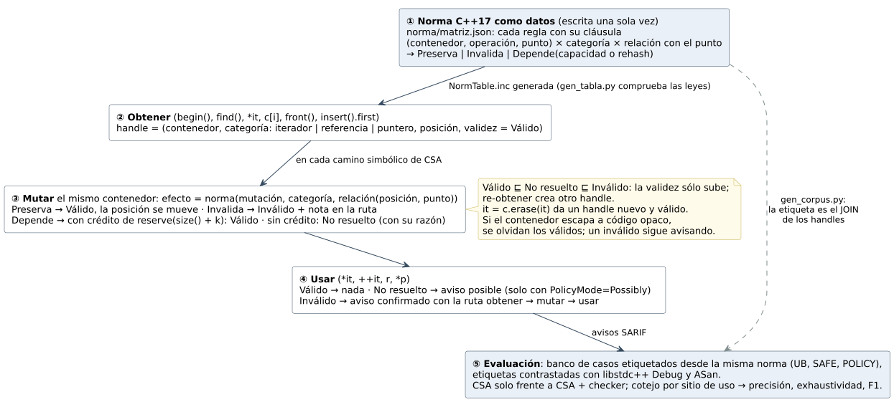

# El modelo de invalidación en una figura

Esta figura es la que pide la profesora para el apartado **III.B** del
artículo: un solo diagrama que explique **cómo se modela la invalidación** y
cómo ese modelo se conecta con la comparación de precisión, exhaustividad y F1.
No reemplaza a los diagramas del capítulo 5, que siguen sirviendo para diseñar
y construir. Esta figura es para que un lector entienda el mecanismo completo
de un vistazo.

> **La figura es metodología: no lleva resultados.** Va en III.B, así que no
> muestra cifras que salen de ejecutar algo: ni el tamaño de la tabla
> normativa (101 mutaciones, 348 reglas), ni el banco (750 casos), ni la
> validación (852 ejecuciones, 0 contradicciones). Esas cifras van en la
> sección IV del artículo. Una versión anterior las tenía; se quitaron
> porque un revisor puede rechazar una metodología que adelanta resultados.

## Cómo se lee

**① La norma como datos.** Las reglas de invalidación de C++17 están escritas
una sola vez en `norma/matriz.json`, cada una con su cláusula. Una regla dice qué le pasa a un handle de cierta **categoría**
(iterador, referencia o puntero) cuando su elemento está en cierta
**relación** con el punto de la mutación (antes, el mismo, después,
cualquiera). Hay tres efectos: **Preserva**, **Invalida** o **Depende** de una
condición (capacidad agotada o *rehash*). Por ejemplo, `vector::erase` preserva
lo anterior al punto e invalida el punto y lo posterior; `deque::push_front`
invalida los iteradores y preserva las referencias.

**② Obtener.** Cuando el programa obtiene un handle (`begin()`, `find()`,
`*it`, `c[i]`, `front()`, `insert().first`…), el checker lo registra en el
estado del camino simbólico de CSA: a qué contenedor pertenece, su categoría,
su **posición** (desde el primero, desde el último, relativa a un ancla o
desconocida) y su validez, que empieza en **Válido**.

**③ Mutar.** Cuando el mismo contenedor cambia, el núcleo calcula la relación
entre la posición del handle y el punto de la mutación, y le pregunta a la
norma el efecto. Si preserva, el handle sigue válido y su posición se mueve (un
`insert` antes de él lo corre un lugar). Si invalida, pasa a **Inválido** y
queda una nota en la ruta. Si depende del estado, el checker no inventa la
capacidad: mira si el código dio una **garantía**. `reserve(size() + k)`
concede `k` inserciones sin reubicar. Con crédito el handle sigue Válido; sin
crédito queda **No resuelto**, con la razón (`DependsOnState`) y la condición
que faltó.

**④ Usar.** Al desreferenciar o avanzar el handle, el veredicto sale de su
validez. Válido no da nada. No resuelto da un aviso **posible** solo si se
pidió (`PolicyMode=Possibly`), y el aviso nombra la garantía que falta.
Inválido da un aviso **confirmado** con la ruta completa: dónde se obtuvo, qué
mutación lo invalidó y dónde se usó.

**⑤ Evaluación.** El banco sale de la **misma** norma: cada caso lleva la
etiqueta que la norma deduce (`UB`, `SAFE` o `POLICY`, el máximo de la validez
de los handles que usa). Las etiquetas se contrastan con dos oráculos dinámicos (libstdc++
*Debug Mode* y ASan/UBSan). Después se corre CSA solo y CSA con el checker, cada
aviso se atribuye a su sitio y se calculan precisión, exhaustividad y F1.

## Las tres leyes que sostienen el modelo (la nota de la figura)

1. **La validez solo sube.** `Válido ⊑ No resuelto ⊑ Inválido`. Ninguna
   operación devuelve la validez a un handle. Volver a obtenerlo crea **otro**
   handle.
2. **Las garantías vienen del código.** `reserve(size() + k)` y el handle que
   devuelve la propia mutación (`it = c.erase(it)`) son las dos garantías que
   se reconocen.
3. **Lo opaco se olvida, lo inválido no.** Si el contenedor pasa a una función
   que no se ve, los handles válidos dejan de seguirse (no se puede saber qué
   les hizo). Uno ya inválido sigue avisando, porque ninguna llamada lo revive.

## Resultado que la figura explica (va en la sección IV, no en la figura)

| Configuración | UB detectados | Sobre el handle sostenido | FP en 306 `SAFE` | `POLICY` con aviso posible | Precisión | Exhaustividad | F1 |
|---|---:|---:|---:|---:|---:|---:|---:|
| CSA (referencia) | 80/342 | 48/328 | 0 | 0/102 | 1.000 | 0.234 | 0.379 |
| CSA + checker, `Silent` | 342/342 | 328/328 | 0 | 0/102 | 1.000 | 1.000 | 1.000 |
| CSA + checker, `Possibly` | 342/342 | 328/328 | 0 | 102/102 | 1.000 | 1.000 | 1.000 |

Antes de citar el 1.000, lee la amenaza de circularidad en
[Trabajos relacionados y aporte §3](aportes.md#3-lo-que-no-se-puede-afirmar-amenazas-a-la-validez).
