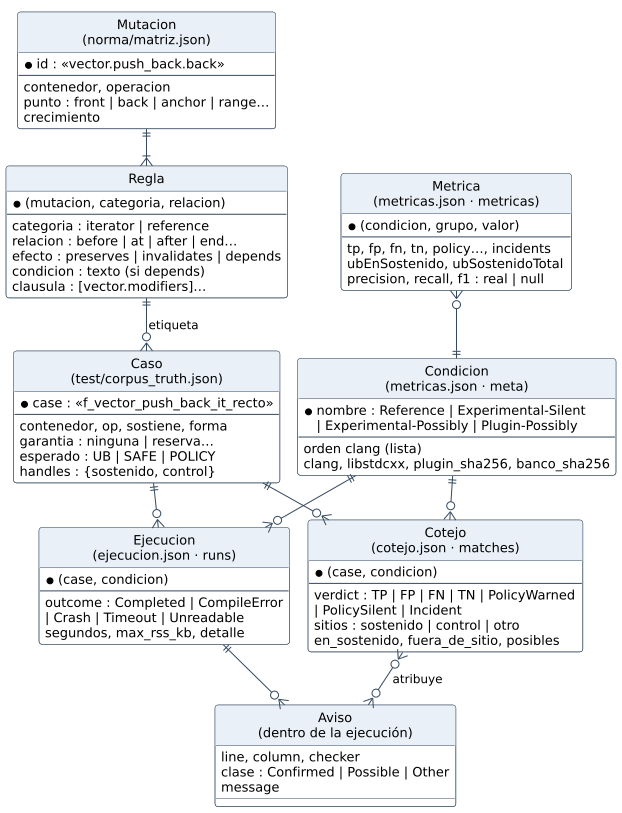

# 7.2 Construcción de la base de datos

> **No hay un SGBD**, y es una decisión, no una omisión. Los datos del
> proyecto se escriben una vez por ejecución y se leen para cotejar. No hay
> usuarios concurrentes ni transacciones. Lo que importa es que sean
> **versionables, auditables y reproducibles**. Por eso son archivos JSON en
> el repositorio, con claves estables e integridad comprobada por programa.
> Las etapas de la práctica se aplican igual.

## a) Análisis de requisitos

| Dato | Para qué | Volumen hoy | Restricción |
|---|---|---|---|
| reglas de la norma | generar la tabla del plugin y las etiquetas | 101 mutaciones, 348 reglas | cada regla cita su cláusula C++17 |
| casos del banco | ejecutar y cotejar | 750 casos (342 UB, 306 SAFE, 102 POLICY) | la etiqueta sale de la norma, nunca a mano |
| validación dinámica | comprobar las etiquetas | 852 ejecuciones | 0 contradicciones |
| ejecuciones | evidencia | 750 × 4 condiciones = 3 000 | toda ejecución tiene un `outcome` |
| cotejos y métricas | resultados | uno por caso y condición | reconstruibles desde las ejecuciones |
| código real | evidencia fuera del banco | 4 proyectos, 781 unidades | se guardan avisos y *commit*, no el código |

## b) Diseño conceptual



`Mutacion` y `Regla` son la raíz: cada caso instancia una regla y su etiqueta
sale de ella. `Ejecucion` registra cómo terminó `clang`; `Cotejo` admite el
veredicto `Incident` y separa los avisos posibles (`PolicyWarned`).

## c) Diseño lógico

| Entidad | Archivo | Clave | Integridad |
|---|---|---|---|
| Mutación y Regla | `norma/matriz.json` | `id` de la mutación + (`categoria`, `relacion`) | `efecto ∈ {preserves, invalidates, depends}`; `clausula` no vacía; `condicion` sólo si `depends` (`gen_tabla.py` lo comprueba) |
| Caso | `test/corpus_truth.json` | nombre de la función | `esperado` = peor efecto de `handles` (RN-001) |
| Validación | `test/runtime_validation_results.json` | caso + escenario | ninguna contradicción con la etiqueta |
| Condición | `test/experimento/metricas.json` → `meta.condiciones` | nombre | las condiciones experimentales difieren de `Reference` sólo en el checker (RN-002) |
| Ejecución | `test/experimento/ejecucion.json` → `runs` | caso + condición | `outcome` es uno de cinco |
| Aviso | dentro de cada ejecución (`warnings`) | ejecución + línea + columna | `clase` es `Confirmed`, `Possible` u `Other` |
| Cotejo | `test/experimento/cotejo.json` → `matches` | caso + condición | un `Incident` nunca es `TN` (RN-005) |
| Métrica | `test/experimento/metricas.json` → `metricas` | condición + grupo + valor | `null` cuando el denominador es 0 |
| Código real | `test/codigo_real/avisos.json`, `inyeccion.json` | proyecto + archivo | `commit` del proyecto registrado |

**Normalización.** La etiqueta vive **sólo** en el caso; el cotejo la
consulta por nombre. Tipos: enteros para conteos, texto controlado para
clases, `null` explícito para lo no definido, UTF-8.

## d) Diseño físico

```
norma/matriz.json                       la norma (fuente única)
test/
├── corpus.cpp, corpus_truth.json       el banco y sus etiquetas
├── runtime_validation_results.json     validación dinámica
├── experimento/
│   ├── ejecucion.json                  meta + runs (3 000)
│   ├── cotejo.json                     matches + no_atribuidos
│   └── metricas.json                   meta + tiempos + métricas por grupo
└── codigo_real/
    ├── avisos.json                     ninja, leveldb, yaml-cpp, RocksDB
    └── inyeccion.json                  defectos sembrados
```

`meta` lleva la versión de `clang` y de libstdc++, el sha256 del plugin, del
banco y de las etiquetas, y la orden exacta de cada condición (RN-007). Los
«índices» son diccionarios por clave que el arnés construye al cargar; con
este volumen no hace falta más.

## e) Implementación

- `bench/gen_corpus.py` + `bench/etiquetar.py`: escriben el banco y sus
  etiquetas desde la norma.
- `bench/experimento.py`: escribe `ejecucion.json`, `cotejo.json` y
  `metricas.json`.
- `bench/codigo_real.py` y `bench/inyeccion.py`: escriben `test/codigo_real/`.
- `bench/gen_book.py`: lee esos archivos y genera las tablas del libro. Ninguna
  cifra se escribe a mano.

## f) Pruebas de los datos

| Prueba | Comprueba | Dónde |
|---|---|---|
| leyes de la norma | cláusula presente, efecto válido, tabla total | `gen_tabla.py`, gtests `Norma.*` |
| coherencia norma–banco | la etiqueta de cada caso es la que da su regla | gtest `Banco.ElVeredictoDelNucleoEsLaEtiqueta` |
| conteos | las métricas son la suma de los cotejos (monoide) | `bench/pruebas_evaluacion.py` |
| incidentes visibles | ningún `Crash` o `Timeout` figura como `TN` | `bench/pruebas_evaluacion.py` |
| métricas indefinidas | 0/0 es `null`, no 0 % | `bench/pruebas_evaluacion.py` |

## g) Despliegue y mantenimiento

- Cada experimento que va al informe se publica con un **tag** y sus archivos
  de `test/experimento/`.
- Un cambio de forma en los archivos se hace junto con el cambio del arnés y
  del generador del libro, en el mismo *commit*.
- Respaldo: el remoto de GitHub.
