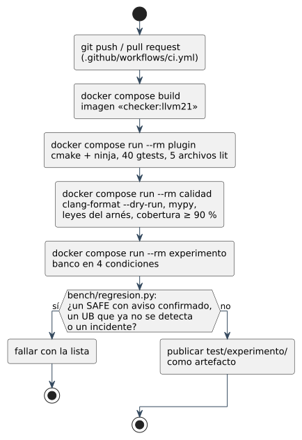

# 7.3 Control de versiones

## a) Sistema elegido

**Git** (distribuido) con remoto en **GitHub**
(`github.com/jasrod12ucsm/checker`). Cada integrante trabaja con su copia
completa; el remoto es el punto de integración y el que corre el CI. Un solo
repositorio guarda el servicio, el motor, la norma, el banco y el libro, para
que una versión del servicio fije también la versión exacta del checker que
usa.

## b) Configuración del repositorio

| Carpeta | Contiene |
|---|---|
| `sistema/` | el servicio Centinela C++ (paquetes, pruebas, demostración, `Dockerfile`) |
| `plugin/`, `norma/` | el motor: el checker y la norma de C++17 como datos |
| `bench/`, `test/` | el banco, el arnés y los resultados de la evaluación |
| `libro/` | las páginas del libro y los `.puml` con sus SVG y PNG |
| `docker-compose.yml`, `Dockerfile`, `.github/workflows/` | entorno, servicios y CI |

**Se versiona** el código, `norma/`, el banco congelado, `libro/` y los
diagramas. `test/experimento/` y `test/codigo_real/` se versionan solo cuando
cambian por un experimento que va al informe.

**No se versiona** (`.gitignore`): `build/`, `__pycache__/`, `.mypy_cache/`,
los `*.plist` que deja `clang --analyze`, `corpus_book/book/` (el libro
compilado), `node_modules/`, `sistema/coverage/`, `sistema/datos/`, las bases
`*.db` y el archivo `.env`, que guarda el token de GitHub del servicio.

## c) Ramas

Hasta el 21-10-2026 todo se hizo directamente en `main`. Desde el incremento
I7 se sigue **GitHub Flow**, porque el equipo es de dos personas y el CI corre
las pruebas del servicio y el banco completo:

| Rama | Para | Vida |
|---|---|---|
| `main` | lo que compila, pasa las pruebas y tiene el banco medido | permanente; se integra solo por *pull request* |
| `feat/<incremento>-<tema>` | un cambio del plan (`feat/I7-centinela`, `feat/I7-panel`) | días |
| `fix/<tema>` | corregir un error del servicio o un FN/FP del motor | horas |
| `norma/<tema>` | cambio en `matriz.json` | días |
| `hotfix/<versión>` | corregir una versión publicada (sección g) | horas |

## d) Commits

El historial empezó sin convención: `first commit` y dos *commits* llamados
`cambios` (17-10-2026), y un *commit* grande con el motor, el banco, el
artículo y la guía de uso (`685c123`, 21-10-2026). Desde I7 cada *commit* es
pequeño, en español, en imperativo y con su ámbito:

- `centinela: registrar sin usuarios predefinidos`
- `norma: deque::push_front preserva referencias [deque.modifiers]/1`
- `núcleo: transportar posición en mutaciones que preservan`

## e) Revisión y fusión

Desde I7, *pull request* hacia `main` con la lista de revisión de la sección
7.1.4, el CI en verde y, si el cambio toca el motor, la tabla del banco antes
y después. La revisión cruzada entre integrantes del equipo es la política desde
I7; los *commits* anteriores a esa fecha no la tuvieron. La fusión es con
*squash*, para que cada cambio sea un *commit* legible en `main`.

## f) Versionado y etiquetas

| Tag | Qué marca | Dónde |
|---|---|---|
| `banco-1` | el banco congelado de 750 casos, con el que se midió el experimento del informe; el sello `test/banco-1.json` guarda el sha256 del banco y de sus etiquetas, y `bench/experimento.py` se detiene si no coinciden | `685c123` (21-10-2026) |
| `v1.0.0` | la primera versión de Centinela C++ con el checker que usa | el *merge* que incorpora el servicio |
| `vMAJOR.MINOR.PATCH` | las versiones siguientes del servicio | cada *merge* que cambia lo que ve el cliente |

MAJOR sube si cambia la API o algo que el cliente debe reconfigurar (por
ejemplo la ruta del *webhook*); MINOR, si agrega una función o cubre reglas
nuevas de la norma; PATCH, si corrige.

## g) Mantenimiento y gestión de incidentes

| Situación | Qué se hace |
|---|---|
| Un error en la versión publicada | se crea `hotfix/<versión>` desde el tag, se corrige con su prueba, se fusiona por *pull request* y se etiqueta la versión PATCH siguiente |
| Un cambio en `main` rompe algo | `git revert` del *commit* de *squash*: deshace el cambio entero sin reescribir la historia |
| Una versión desplegada falla | se vuelve a la imagen anterior: `git checkout v<anterior>` y `docker compose up -d --build sistema`; la base no se toca, porque un binario no arranca sobre una base de otra versión (`user_version`) y el respaldo se restaura antes si hubo migración |
| Una revisión quedó a medias por una caída | al arrancar, el servicio la marca como fallida y el usuario la reintenta (RNF-S04) |
| Un falso positivo o negativo del checker reportado por un equipo | rama `fix/`, primero el caso `lit` mínimo que lo reproduce, después la corrección y el banco completo |

## h) Integración y entrega continuas



El CI (`.github/workflows/ci.yml`, detalle en 7.1.5) prueba el servicio y el
motor en cada *push* y en cada *pull request*, y publica `test/experimento/`
como artefacto.

Los entregables son **el servicio Centinela C++ y su imagen Docker**, el
plugin (`libContainerInvalidation.so`), la norma, el banco y el informe. El
despliegue del servicio es una orden sobre el servidor del cliente:

```bash
git checkout v1.0.0
docker compose up -d --build sistema   # servicio en el puerto 8080, base en el volumen centinela-datos
```

La entrega es continua hasta la imagen: cada versión etiquetada se construye
y se prueba igual en el CI. El paso de esa imagen al servidor de un cliente
lo hace el administrador con la orden de arriba.
