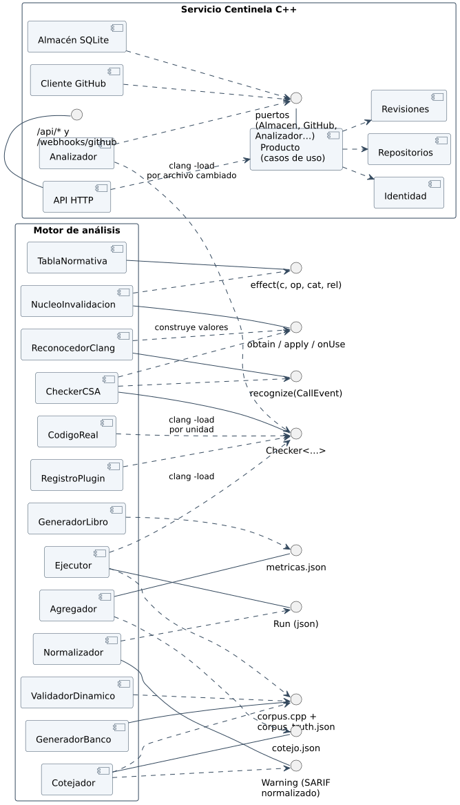

# 7.5 Desarrollo de componentes

| Componente | Responsabilidad única | Interfaz que ofrece | Depende de | Se prueba con |
|---|---|---|---|---|
| **Identidad** (servicio) | usuarios, roles, sesiones, permisos | `ingresar`, `validarSesion`, `crearUsuario`, `Autorizado.para` | kernel | `identidad.test.ts` |
| **Repositorios** (servicio) | repositorios conectados y su política | `conectar`, `configurar`, `desconectar` | identidad | `repositorios.test.ts` |
| **Revisiones** (servicio) | estados de la revisión, hallazgos, veredicto, estado del commit | `solicitar`, `iniciar`, `publicar`, `fallar`, `reintentar`, `clasificar` | repositorios, identidad | `revisiones.test.ts` |
| **Producto** (servicio) | casos de uso: cargar, decidir, efectos | `producto(dependencias)` | contextos y puertos | `casos.test.ts` |
| **API HTTP** (servicio) | rutas, sesión, *webhook*, errores HTTP | `crearServidor(producto, opciones)` | producto, Fastify | `api.test.ts` |
| **Almacén SQLite** (servicio) | persistencia y cola | `abrirAlmacen(ruta)` | better-sqlite3 | `almacen.test.ts` |
| **Cliente GitHub** (servicio) | PR, archivos, *tarball*, revisión y estado | `clienteGitHub(opciones)` | API REST de GitHub | `cliente.test.ts` |
| **Analizador** (servicio) | correr `clang` con el plugin y leer sus avisos | `analizadorClang(opciones)`, `leerSalida(texto)` | `clang`, **RegistroPlugin** | `salida.test.ts`, `clang.test.ts` |
| **TablaNormativa** | decir el efecto de la norma | `effect(c, op, cat, rel) → Effect` (`constexpr`) | `matriz.json` (al generar) | leyes de la norma |
| **NucleoInvalidacion** | decidir la validez | `obtain`, `apply`, `onUse`, `escape`, `transport` | TablaNormativa | leyes de la detección |
| **ReconocedorClang** | traducir Clang al lenguaje ubicuo | `recognize(CallEvent, State) → Recognized` | AST/SVal de Clang, Núcleo (tipos) | `lit` |
| **CheckerCSA** | conectar callbacks con el núcleo | `Checker<…>` | Reconocedor, Núcleo, CSA | `lit` + banco |
| **RegistroPlugin** | registrar el checker y sus opciones | `clang_registerCheckers` | CheckerCSA | `lit` `registro.cpp` (RF-01) |
| **GeneradorBanco** | escribir casos y etiquetas desde la norma | `corpus.cpp`, `corpus_truth.json` | `matriz.json` | coherencia norma–banco |
| **Ejecutor** | correr un caso en una condición y registrar su `Outcome` | `Run` | `clang`, plugin (como proceso) | leyes del arnés |
| **Normalizador** | SARIF → `Warning` (confirmado, posible u otro) | `Warning` en memoria | Ejecutor | clase por el texto del aviso |
| **Cotejador** | `Warning` → función y sitio → veredicto | `cotejo.json` | Normalizador, GeneradorBanco | un veredicto por caso y condición; acierto sólo en sitio inválido |
| **Agregador** | conteos y métricas por grupo | `metricas.json` | Cotejador | monoide; `Undefined` |
| **ValidadorDinamico** | confirmar etiquetas ejecutando | `runtime_validation_results.json` | GeneradorBanco | 0 contradicciones |
| **CodigoReal** | correr el checker sobre un proyecto desde su `compile_commands.json` | `test/codigo_real/avisos.json` | `clang`, plugin (como proceso) | 0 caídas; defectos sembrados detectados (`inyeccion.py`) |
| **GeneradorLibro** | publicar todo en el mdbook | `corpus_book/` | `test/experimento/`, `test/codigo_real/` | se construye sin errores |

Cómo se cumplen las características de la práctica:

| Característica | Servicio Centinela C++ | Motor de análisis |
|---|---|---|
| **Modularidad** | un paquete de npm por contexto y por adaptador (`@centinela/identidad`, `@centinela/sqlite`, …), cada uno con una sola responsabilidad | cada componente tiene una sola responsabilidad y su propio *target* o módulo |
| **Reutilización** | el servicio no reimplementa el análisis: invoca el mismo `clang` con el mismo plugin que se midió en el banco; los contextos del dominio no dependen de HTTP ni de SQLite, así que sirven igual para otra interfaz (una CLI, otro proveedor de repositorios) | el núcleo no sabe de CSA y podría alimentarse desde otro motor; la tabla normativa la usan el checker y el generador del banco |
| **Desacoplamiento** | el producto habla con el exterior solo por puertos (`Almacen`, `GitHub`, `Fuentes`, `Analizador`, `Claves`, `Secretos`, `Bitacora`, `Reloj`, `GeneradorIds`); cambiar SQLite por PostgreSQL o GitHub por otro proveedor es escribir otro adaptador; `pruebas/arquitectura.test.ts` impide que una capa importe la de afuera | la evaluación no enlaza el plugin y el checker no sabe que existe un banco |
| **Escalabilidad** | el *webhook* solo encola: el análisis lo hace un trabajador aparte, que toma los trabajos de la cola de la base uno por vez; dentro de una revisión, el analizador corre `clang` sobre `CENTINELA_PARALELO` archivos a la vez (4 por omisión, hasta 64), con un tiempo máximo por archivo de `CENTINELA_TIEMPO_MAXIMO_S` (120 s). Más carga se atiende subiendo el paralelismo; varios trabajadores necesitarían una base con bloqueo por fila (PostgreSQL), que es un adaptador nuevo | una invocación de `clang` por unidad; el arnés corre los casos en paralelo (`--jobs`) y `bench/codigo_real.py` usa 12 procesos (RocksDB) |
| **Interoperabilidad** | API HTTP con JSON y errores de forma única (sección 6.5); *webhooks* y API REST v3 de GitHub; los avisos se publican como comentarios de *pull request* y como estado de commit, que la protección de rama de GitHub entiende | la salida es la estándar de CSA (texto, plist, SARIF); SARIF lo leen GitHub y los IDE |
| **Encapsulamiento** | tipos con marca (`Email`, `NombreRepo`) que solo crean sus constructores validados; `Autorizado
` con constructor privado; las vistas de la API deciden qué sale (nunca el hash de la clave) | los valores del dominio tienen campos privados y constructores que validan; el estado del checker sólo se toca con `addTransition` |
