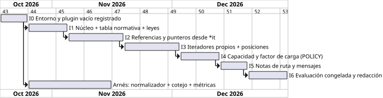

# 7.6 Plan de incrementos

Cada incremento dice **qué celda del banco ataca** y se cierra cuando su
efecto se **mide**. La última columna es lo medido al cerrarlo
(detalle en [7.7](7-7-estado.md)).

| Inc. | Entrega | Celda del banco | Criterio de cierre | Resultado |
|---|---|---|---|---|
| **I0** | imagen Docker con `libclang-dev`; plugin vacío registrado; `lit` funcionando | — | el checker aparece en `-analyzer-checker-help`; una prueba `-verify` pasa | **hecho** (RF-01, RF-16) |
| **I1** | `matriz.json` + `gen_tabla.py`; núcleo con sus tipos; leyes de la norma y de la detección en verde | — | todas las leyes pasan; el núcleo compila sin Clang | **hecho**: 101 mutaciones, 348 reglas (RF-08, RF-17) |
| **I2** | iteradores desde `begin()`; referencias y punteros desde `*it`, `c[i]`, `front()`; uso por `checkLocation` | `ref` y `ptr` (CSA: 0 % sobre el handle sostenido) | ningún `SAFE` con aviso; cobertura medida por forma | **hecho**: 214/214 UB con referencia o puntero (RF-06) |
| **I3** | posiciones (`++it`, `begin()+n`), `transport`, `it = c.erase(it)`, `erase(first, last)` | formas `bucle` y `llamada` | cobertura por forma sin pérdida frente a I2 | **hecho**: 342/342 UB, 0 FP (RF-05, RF-07) |
| **I4** | crédito de `reserve`, `PolicyMode`, escape | los 102 `POLICY` | posibles separados de confirmados | **hecho**: 102/102 posibles con `Possibly`, 0 en `Silent` (RF-04, RF-09, RF-10) |
| **I5** | notas de ruta (`NoteTag`), mensajes con categoría y operación | RF-11, RF-12 | cada aviso trae obtención → mutación → uso | **hecho**: notas de obtención y de mutación; `lit` `rutas.cpp` (RF-12) |
| **I6** | banco congelado (`banco-1`), experimento final, código real | todo | sello `test/banco-1.json` y capítulo de resultados | **hecho**: `banco-1` sellado; experimento final con `banco-1` (3 000 ejecuciones, 0 incidentes) y 781 unidades reales; falta el visto bueno del asesor a D-18 y D-20 |

En paralelo a I1–I3, el **arnés** pasó de `run_corpus.py` (atribución por
línea en un solo archivo) a la tubería ejecutar → normalizar → cotejar →
agregar de `bench/experimento.py`, con SARIF y registro de ejecución
(**hecho**, 2026-10-20).

## Lo que queda fuera, a propósito

- `std::string`, `std::array`, adaptadores (`stack`, `queue`).
- Operaciones de C++20/23 (`erase_if`, `append_range`).
- Invalidación por *alias* entre contenedores distintos (`swap`, `splice` de
  `list`).
- Análisis entre unidades de traducción (CTU).

Cada una es una fila nueva en `matriz.json` con su caso, si el tiempo
alcanza. Ninguna cambia la arquitectura.
