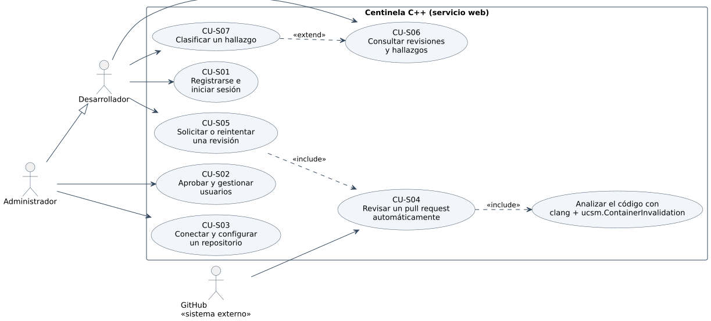

# 5.1 Casos de uso

Hay **tres partes** (el checker dentro de `clang`, el banco y el arnés, la
construcción y la norma) y tres actores. El checker no es un actor: es parte
del sistema que analiza. Cada caso de uso se ejecuta hoy con una orden
concreta y cubre los requisitos del capítulo 4.

| Caso | Actor | Flujo principal | Requisitos |
|---|---|---|---|
| **CU-01** Analizar un archivo | Desarrollador | 1. ejecuta `clang++ --analyze -Xclang -load -Xclang libContainerInvalidation.so -Xclang -analyzer-checker=ucsm.ContainerInvalidation archivo.cpp`; 2. CSA explora cada función y el checker sigue los iteradores, referencias y punteros; 3. ante cada mutación aplica la regla de la norma; 4. al usar un handle inválido emite el aviso en consola (o en plist/SARIF) | RF-01, RF-02, RF-05 a RF-11 |
| **CU-02** Analizar un proyecto | Desarrollador | 1. genera `compile_commands.json` con CMake; 2. ejecuta `bench/codigo_real.py` (o su propio bucle) que invoca CU-01 una vez por unidad de traducción, con `inlining-mode=all`; 3. recibe los avisos por unidad y la lista de unidades que no compilaron | RF-03 |
| **CU-03** Elegir la política ante lo que depende del estado | Desarrollador | agrega `-analyzer-config ucsm.ContainerInvalidation:PolicyMode=Possibly`; en las mutaciones que dependen de la capacidad o del factor de carga recibe un aviso **posible** que dice qué garantía falta; con `Silent` (por omisión) sólo ve confirmados | RF-04, RF-09 |
| **CU-04** Seguir la ruta de un diagnóstico | Desarrollador | abre la salida `-analyzer-output=text` o SARIF y sigue las notas del checker: *obtención → mutación → uso* | RF-11, RF-12 |
| **CU-05** Generar y validar el banco | Evaluador | 1. `bench/gen_corpus.py` escribe `test/corpus.cpp` y `test/corpus_truth.json` desde `norma/matriz.json`; 2. `bench/run_runtime_validation.py` ejecuta cada caso con libstdc++ Debug y ASan/UBSan; 3. una contradicción entre la etiqueta y la ejecución detiene el proceso | RF-15 |
| **CU-06** Ejecutar el experimento | Evaluador | 1. `bench/experimento.py` comprueba versiones y sha256 del plugin y del banco; 2. corre cada caso en las cuatro condiciones (una invocación por caso); 3. normaliza el SARIF, atribuye cada aviso a su sitio y coteja con la etiqueta; 4. escribe `test/experimento/{ejecucion,cotejo,metricas}.json`; 5. `bench/gen_book.py` publica las tablas | RF-13, RF-14 |
| **CU-07** Construir y verificar el plugin | Mantenedor | `docker compose run --rm plugin`: CMake genera la tabla desde la norma, compila el núcleo y el plugin, corre los gtests y las pruebas `lit` | RF-16 |
| **CU-08** Corregir o ampliar la norma | Mantenedor | 1. edita una regla en `norma/matriz.json` (con su cláusula); 2. ejecuta CU-07: `gen_tabla.py` comprueba las leyes de la norma y regenera `NormTable.inc`; 3. regenera el banco (CU-05) y repite el experimento (CU-06) | RF-17 |

## Relaciones

| Relación | Por qué |
|---|---|
| CU-02 incluye CU-01 | un proyecto se analiza archivo por archivo |
| CU-03 y CU-04 extienden CU-01 | son opciones de la misma invocación |
| CU-06 incluye CU-01 y CU-05 | el experimento ejecuta el checker sobre el banco generado |
| CU-08 incluye CU-07 | una regla nueva sólo existe después de construir |

## Criterios de aceptación

| Caso de uso | Criterio (dado, cuando, entonces) | Comprobado |
|---|---|---|
| CU-01 | Dado un caso `UB` del banco, cuando se analiza con el checker, entonces hay un aviso confirmado sobre el handle inválido; dado un caso `SAFE`, ninguno | 342/342 UB; 0/306 SAFE |
| CU-02 | Dado un proyecto con `compile_commands.json`, cuando se analiza unidad por unidad, entonces ninguna unidad aborta `clang` y las que no compilan quedan registradas | 781 unidades de 4 proyectos, 0 caídas |
| CU-03 | Dado un caso `POLICY`, cuando se analiza con `PolicyMode=Possibly`, entonces hay un aviso posible; con `Silent`, ninguno | 102/102 y 0/102 |
| CU-04 | Dado un aviso, cuando se pide `-analyzer-output=text` o SARIF, entonces la ruta trae la nota de la obtención y la de la mutación que invalidó | `lit` `rutas.cpp` (9 notas) |
| CU-05 | Dado el banco generado, cuando se ejecuta cada caso con libstdc++ Debug y ASan/UBSan, entonces ninguna ejecución contradice su etiqueta | 852 ejecuciones, 0 contradicciones |
| CU-06 | Dado el banco y las cuatro condiciones registradas, cuando el arnés termina, entonces los conteos se reconstruyen desde los cotejos y los incidentes van aparte | 3 000 ejecuciones; 11 leyes |
| CU-07 | Dada la imagen `checker:llvm21`, cuando se ejecuta `docker compose run --rm plugin`, entonces el plugin se construye y las pruebas pasan | 40 gtests, 5 `lit` |
| CU-08 | Dada una regla sin cláusula en la norma, cuando se construye, entonces `gen_tabla.py` termina con error | leyes de la norma |

## Excepciones relevantes

| Caso | Excepción | Qué pasa |
|---|---|---|
| CU-01 | `clang` no carga el plugin (versión de API distinta) | error al cargar; el análisis **no** corre en silencio sin el checker |
| CU-01 | el uso depende del estado (capacidad, factor de carga) | ningún aviso confirmado; aviso **posible** sólo con `PolicyMode=Possibly` (CU-03) |
| CU-01 | el contenedor escapa a una función opaca | el checker olvida los handles válidos; uno ya inválido sigue avisando |
| CU-02 | una unidad no compila fuera de su sistema de construcción | se registra como fallo de la unidad, no como «sin avisos» |
| CU-05 | la ejecución contradice la etiqueta | el banco no se publica hasta corregir la norma o el caso |
| CU-06 | compilación fallida, caída o tiempo agotado | incidente registrado; **no** cuenta como verdadero negativo (RN-005) |
| CU-08 | la norma nueva rompe una ley (falta la cláusula, efecto fuera del dominio) | `gen_tabla.py` termina con error y no se genera la tabla |
