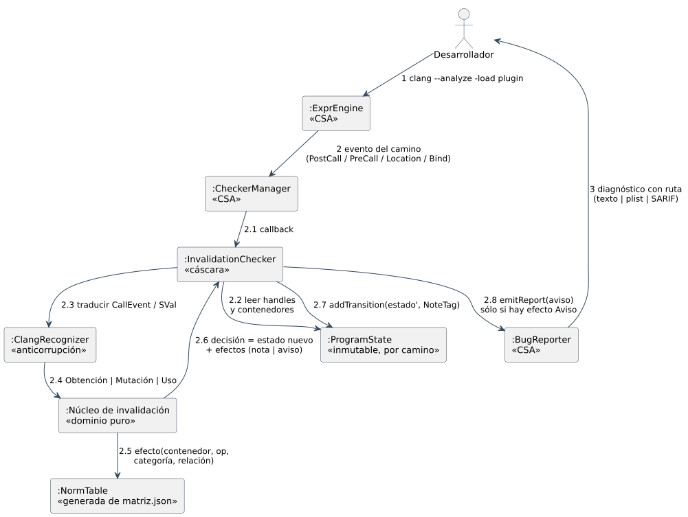
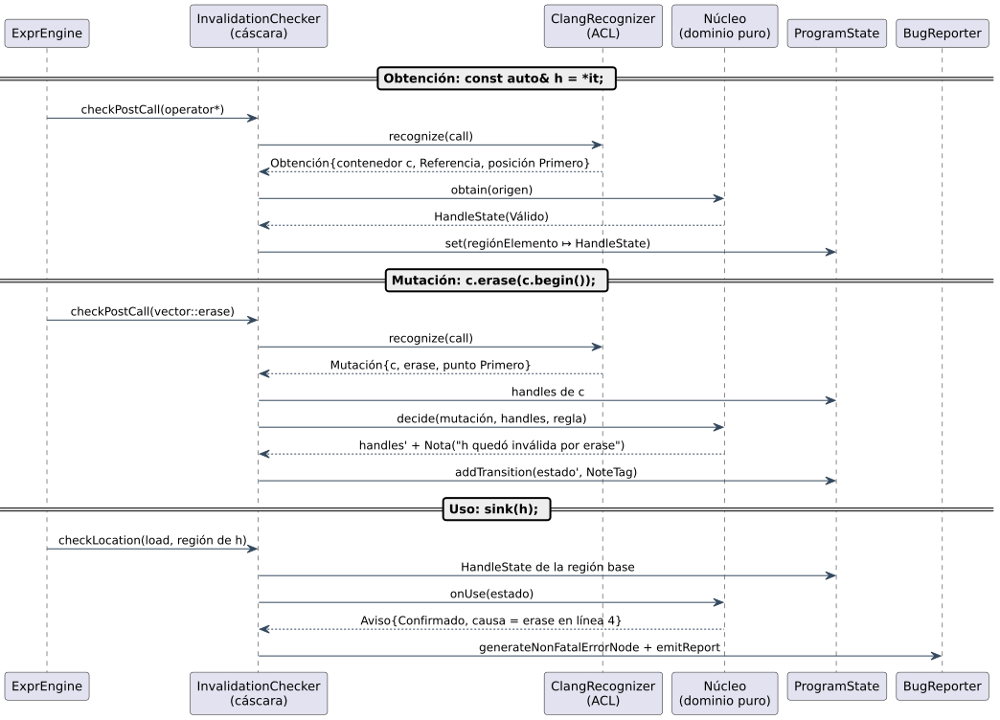

# 5.2 Colaboración

## Diagrama de comunicación



El **motor de CSA conserva el control**. El checker no recorre el programa:
recibe eventos de un camino y responde con un estado nuevo. Lo que el
diagrama del informe anterior no decía es **qué eventos** y **qué hace cada
capa** con ellos:

| Mensaje | De → a | Qué es en la API de CSA |
|---|---|---|
| 2 | `ExprEngine` → `CheckerManager` | el motor llega a una llamada, una carga/almacenamiento o un enlace (`bind`) |
| 2.1 | `CheckerManager` → cáscara | `checkPostCall`, `checkPreCall`, `checkLocation`, `checkBind`, `checkDeadSymbols`, `checkPointerEscape` |
| 2.2 | cáscara → `ProgramState` | `State->get<HandleMap>()`, `State->get<IteratorMap>()` |
| 2.3–2.4 | cáscara → anticorrupción → núcleo | `CallEvent` → `Obtention` │ `Mutation` │ `IteratorMove` │ `NotOurs` |
| 2.5 | núcleo → tabla | `NormTable::effect(contenedor, op, categoría, relación)` |
| 2.6 | núcleo → cáscara | un **valor**: estado nuevo + lista de efectos (nota, aviso) |
| 2.7 | cáscara → `ProgramState` | `C.addTransition(State', NoteTag)`: el estado nunca se muta en el sitio |
| 2.8 | cáscara → `BugReporter` | `C.generateNonFatalErrorNode()` + `emitReport(PathSensitiveBugReport)` |

## Secuencia de un caso del banco

`f_vector_erase_begin_ref_recto`:

```cpp
auto it = c.begin();          // IteratorMap: it ↦ {c, First, Valid}
const auto& h = *it;          // HandleMap: región(*it) ↦ {c, Element, First, Valid}
c.erase(c.begin());           // vector::erase en First, relación Same → Invalidates
sink(h);                      // checkLocation(load, región de h) → Invalidated → aviso
```



Tres hechos de CSA que el diseño aprovecha:

- `std::vector::operator*` y `begin` **no se inlinean** por defecto
  (`c++-container-inlining=false`). Su resultado es un símbolo conjurado: una
  **región nueva por cada obtención**. Ese es el handle (D-06).
- Usar `h` es **cargar** su región. `checkLocation` lo ve aunque no haya
  ninguna llamada. Por eso un AST matcher o un checker sólo de llamadas no
  basta para referencias y punteros.
- En la forma `llamada` (`mutar_vector_erase_begin(c)`) el motor **sí inlinea**
  la función del usuario. Dentro, `this` es la misma región que `c` en el
  llamador, y el `ContainerId` coincide.
