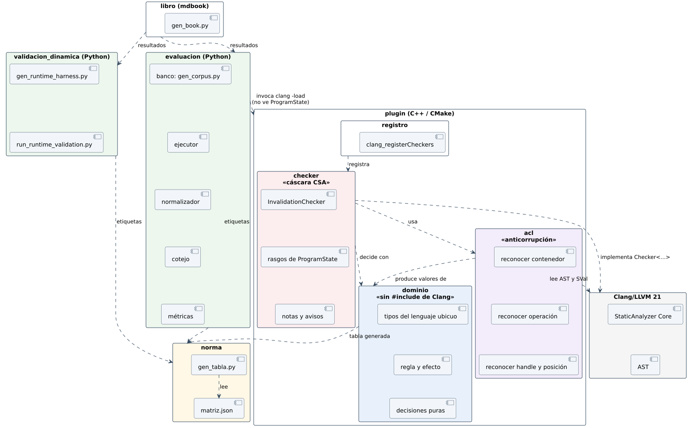

# 5.3 Paquetes



| Paquete | Contiene | Depende de | No puede depender de |
|---|---|---|---|
| `norma` | `matriz.json`, `gen_tabla.py` | nada | — |
| `plugin/dominio` | tipos y decisiones puras; `NormTable.inc` generado | `norma` (sólo por el archivo generado) | **Clang** (el target no tiene sus include dirs) |
| `plugin/acl` | reconocimiento de contenedores, operaciones, handles y posiciones | `dominio`, AST y SVal de Clang | `checker` |
| `plugin/checker` | `InvalidationChecker`, rasgos de `ProgramState`, mensajes | `acl`, `dominio`, CSA Core | `bench` |
| `plugin/registro` | `clang_registerCheckers`, versión de la API, opciones | `checker` | — |
| `evaluacion` | banco, ejecutor, normalizador, cotejo, métricas | `norma` (etiquetas); la **salida** de `clang` | `plugin` como código: lo invoca como proceso |
| `validacion_dinamica` | arnés de ejecución con libstdc++ Debug y ASan | `norma` | `plugin` |
| `libro` | `gen_book.py`, `render_diagramas.py` | resultados de `evaluacion` y `validacion_dinamica` | — |

**Regla de dependencias:** todas las flechas van hacia el centro: `norma` y
`dominio`. Ninguna sale de ellos. Es la misma regla de la skill
`bodega-arquitectura` (§2.1), con un *target* de CMake en el papel de un crate
de Cargo:

```cmake
add_library(invalidacion_dominio STATIC dominio/Decisions.cpp …)
# SIN target_include_directories(${CLANG_INCLUDE_DIRS}):
# un #include "clang/…" en dominio/ no compila. La frontera se cumple sola.
add_library(ContainerInvalidation MODULE acl/… checker/… registro/Plugin.cpp)
target_link_libraries(ContainerInvalidation PRIVATE invalidacion_dominio)
```
