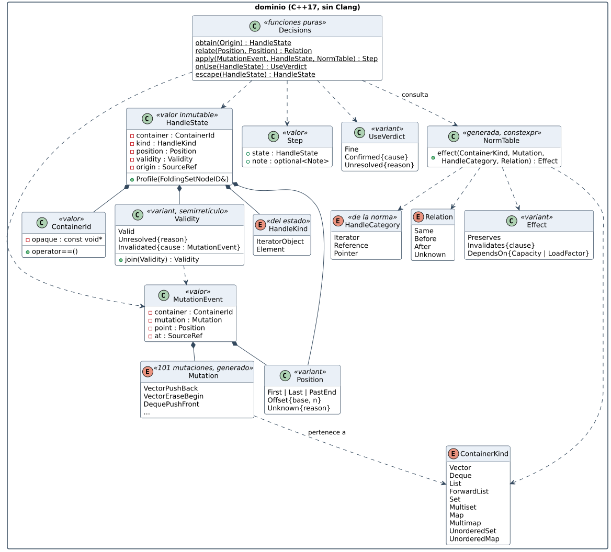
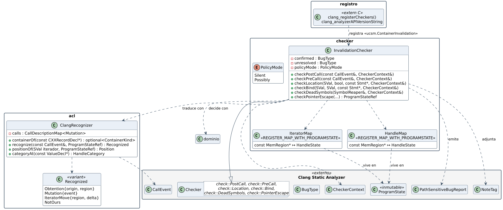
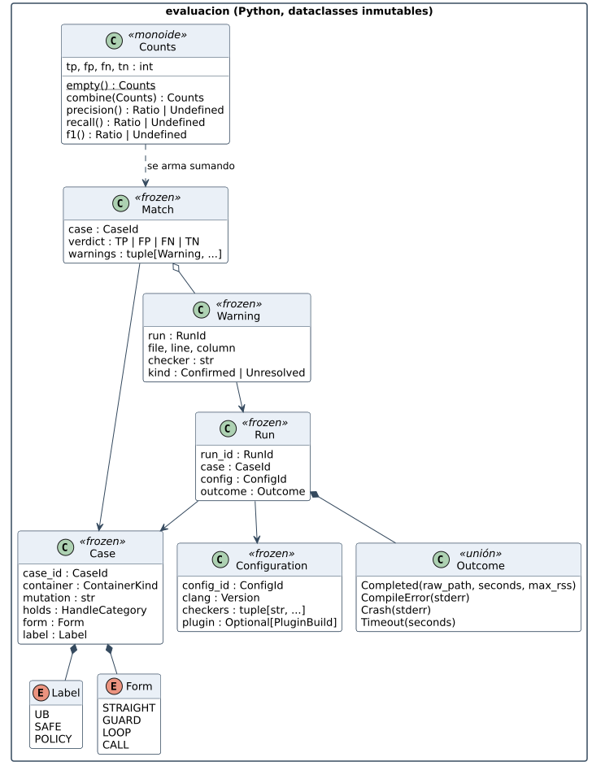

# 5.4 Clases

Tres diagramas, uno por capa, porque cada una obedece a reglas distintas.

## Dominio: tipos que no admiten estados ilegales

| Regla (de `rust-trinity` y `modelado-funcional`, traducida a C++) | Cómo se ve aquí |
|---|---|
| Nada de primitivos sueltos ni texto para estados | `enum class` para `ContainerKind`, `HandleKind`, `Relation`; `std::variant` para `Position`, `Effect`, `Validity`, `UseVerdict` |
| Un tipo OR se recorre entero | `std::visit` con un *overload* por alternativa; `switch` **sin `default:`** y `-Werror=switch` para que agregar una variante rompa la compilación donde falte |
| Valores inmutables | `HandleState` sólo tiene getters `const` y `Profile()`, como exige `ProgramState` (`FoldingSet`) |
| La causa viaja con el estado | `Invalidated{cause: MutationEvent}`: la nota y el mensaje no se reconstruyen después |
| Funciones puras para decidir | `Decisions` no recibe `CheckerContext` ni `ProgramState`: recibe valores y devuelve valores |
| Lo generado no se escribe a mano | `Mutation` y `NormTable` salen de `matriz.json` (`constexpr`, sin tablas en tiempo de ejecución) |
| Sin excepciones ni RTTI (convención LLVM) | errores como valores (`std::optional`, `llvm::Expected` en la cáscara) |

`ContainerId` envuelve la región del contenedor como un **puntero opaco**
(`const void*`). El dominio puede comparar identidades sin saber que existe
`MemRegion`.

## Cáscara y anticorrupción: lo que toca CSA

- `InvalidationChecker` hereda de
  `Checker<check::PostCall, check::PreCall, check::Location, check::Bind, check::DeadSymbols, check::PointerEscape>`.
  Cada callback hace lo mismo: **cargar** del estado → **traducir** (ACL) →
  **decidir** (núcleo) → **aplicar** (`addTransition` / `emitReport`).
- Dos mapas en el `ProgramState`, registrados con
  `REGISTER_MAP_WITH_PROGRAMSTATE`:
  - `IteratorMap`: región del **objeto iterador** ↦ `HandleState`. Hace falta
    porque toda referencia del banco sale de un iterador.
  - `HandleMap`: región del **elemento** ↦ `HandleState`. Es la que ve
    `checkLocation` cuando se usa una referencia o un puntero.
- `ClangRecognizer` usa `CallDescriptionMap` para reconocer
  `{"std", "vector", "push_back"}` y similares. Es el único sitio que sabe
  cómo se llaman las cosas en la STL.
- Dos `BugType`: *uso de handle invalidado* y *uso de handle posiblemente
  invalidado*.

## Evaluación: el arnés como modelo

`dataclass(frozen=True)` para todo. `Outcome` es una **unión**: una ejecución
completa, un error de compilación, una caída o un *timeout*. No hay
`ok: bool` con un `error: str` al lado. `Counts` es un monoide; las métricas
devuelven `Ratio | Undefined`.
