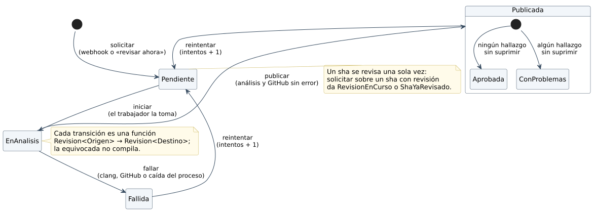
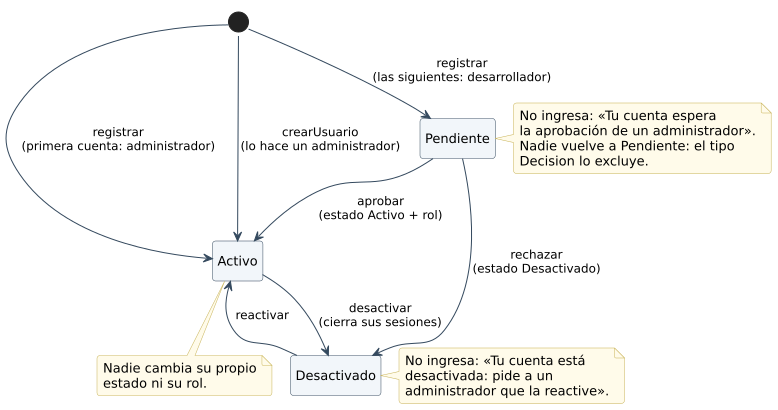
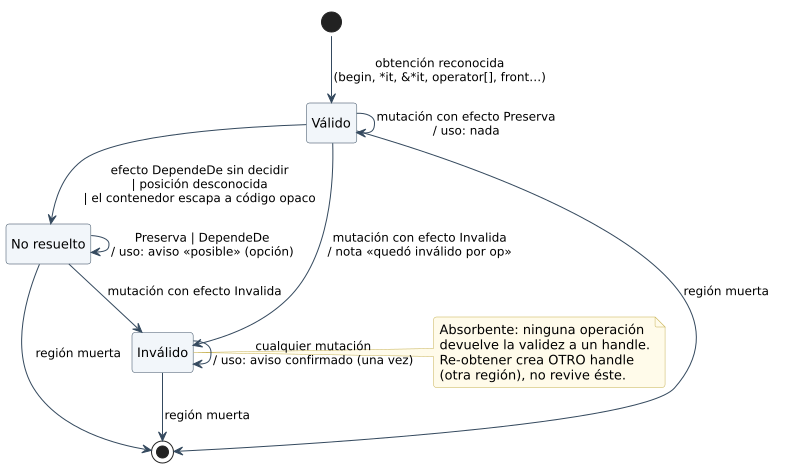
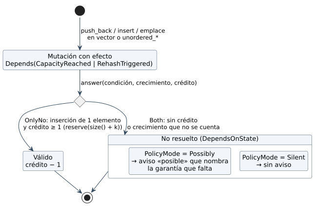

# 5.5 Estados

## Servicio: ciclo de vida de una revisión

Tabla: Estados de una revisión

| Estado | Significa | Sale por |
|---|---|---|
| `Pendiente` | en la cola, esperando al trabajador | `iniciar` |
| `EnAnalisis` | el trabajador descargó el código y corre `clang` | `publicar` o `fallar` |
| `Publicada` | comentarios y estado del commit en GitHub; veredicto `Aprobada` o `ConProblemas` | `reintentar` |
| `Fallida` | `clang`, GitHub o el proceso fallaron; guarda el motivo | `reintentar` |

## Servicio: estados de un usuario

Tabla: Estados de un usuario

| Estado | Significa | Sale por |
|---|---|---|
| `Pendiente` | se registró y espera la aprobación de un administrador; no ingresa | aprobar (`Activo`, con su rol) o rechazar (`Desactivado`) |
| `Activo` | ingresa y hace lo que su rol permite | desactivar (se cierran sus sesiones) |
| `Desactivado` | rechazado o desactivado; no ingresa | reactivar (`Activo`) |

Nadie vuelve a `Pendiente`, y nadie cambia su propio estado ni su rol.

## Motor: ciclo de vida de un handle (en un camino)

| Desde | Evento | Decisión (núcleo) | Hacia | Efecto |
|---|---|---|---|---|
| — | obtención reconocida | `obtain` | Válido | — |
| Válido | mutación, efecto `Preserves` | `apply` + `transport` de la posición | Válido | — |
| Válido | mutación, efecto `Invalidates` | `apply` | Inválido | **nota** «`h` quedó inválido por `erase` (línea N)» |
| Válido | `DependsOn` sin decidir, posición desconocida o escape a código opaco | `apply` / `escape` | No resuelto | — |
| No resuelto | mutación, efecto `Invalidates` | `apply` | Inválido | nota |
| Inválido | cualquier mutación | absorbente | Inválido | — |
| Válido | uso | `onUse` → `Fine` | Válido | — |
| No resuelto | uso | `onUse` → `Possibly` | No resuelto | aviso **posible** sólo con `PolicyMode=Possibly` |
| Inválido | uso | `onUse` → `Confirmed` | Inválido | aviso **confirmado**, una vez por handle |
| cualquiera | la región muere | `checkDeadSymbols` | — | se borra del mapa |

**Re-obtener no revive.** `h = *c.begin()` después de un `clear` crea otra
región y, por lo tanto, otro handle (leyes, contradicción 2).

## Motor: lo que depende del estado

Los 102 casos `POLICY` son los que la norma deja al estado: `vector::push_back`
invalida **sólo si** `size() == capacity()`, y una inserción en un contenedor
`unordered` sólo si supera el factor de carga. CSA no guarda la capacidad como
número, y el checker tampoco la inventa (D-16). Lo que sí registra es una
**garantía** que el propio código da (D-19):

1. `c.reserve(c.size() + k)` deja al contenedor un **crédito** de `k`
   inserciones sin reubicar ni *rehash* (`CreditMap` en el estado del camino).
2. En una mutación cuyo efecto es `Depends(CapacityReached)` o
   `Depends(RehashTriggered)`, el núcleo responde con `answer(condición,
   crecimiento, crédito)`: si la inserción es de un elemento y queda crédito,
   la respuesta es `OnlyNo` y el handle sigue **Válido**. Cada inserción gasta
   uno; una mutación que no se puede contar borra el crédito.
3. Sin crédito, la respuesta es `Both`: el handle queda **No resuelto**, con
   razón `DependsOnState` y la condición que faltó. `PolicyMode` decide si su
   uso produce un aviso **posible** que nombra la garantía que falta
   («use `reserve(size() + n)` antes»).

La otra garantía es el **handle devuelto**: `it = c.erase(it)` o
`it = c.insert(it, x)` obtiene un handle nuevo y válido en la posición del
punto, mientras el viejo sigue la regla de la norma.

> La alternativa «nativa» de CSA es **bifurcar** el camino en dos estados
> (reubicó / no reubicó) y avisar en el primero. Convierte todo `POLICY` sin
> contexto en un aviso confirmado, por eso no se usó (D-09 reemplazada por
> D-16 y D-19).
