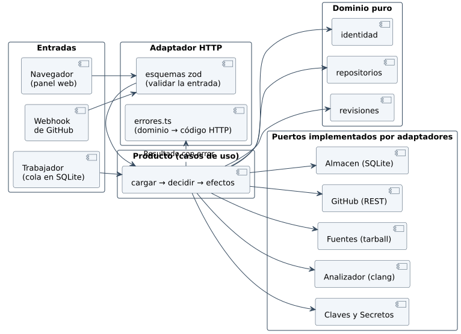
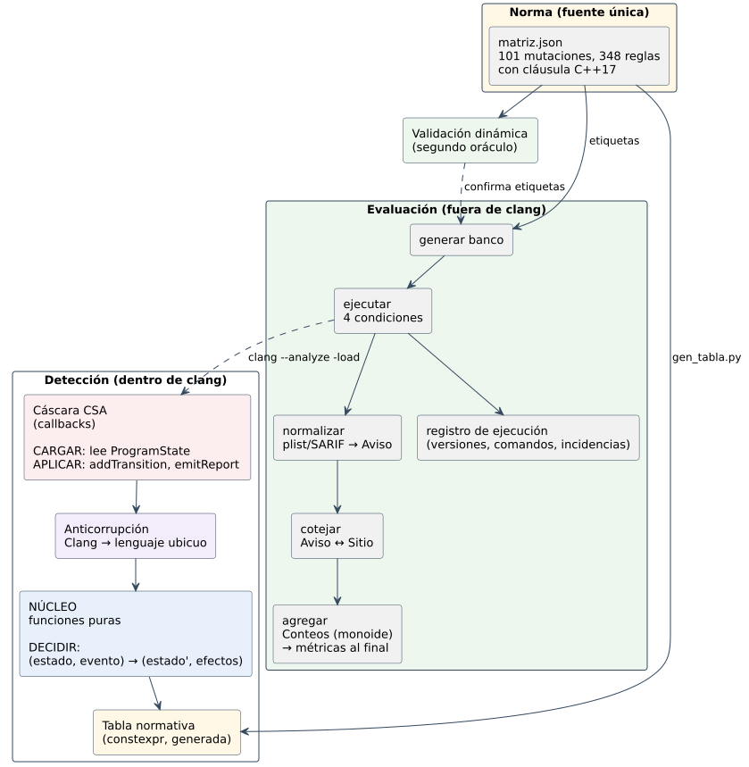

# 5.6 Arquitectura lógica

## Servicio: núcleo funcional y adaptadores



Es la misma idea que el motor (núcleo funcional, cáscara imperativa)
llevada al servicio:

1. **Dominio puro** (`contextos/*`): decisiones `(estado, orden) →
   Resultado<estado', error>`, sin reloj, sin azar y sin E/S.
2. **Producto**: cada caso de uso carga, decide y aplica los efectos por
   medio de puertos (interfaces).
3. **Adaptadores**: implementan los puertos. Lo que entra se valida con
   esquemas `zod` y lo que se lee de la base pasa por un esquema antes de
   volverse un tipo del dominio. `adaptadores/http/src/errores.ts` es el
   único lugar donde un error del dominio se vuelve un código HTTP.

| Ruta | Método | Caso de uso |
|---|---|---|
| `/api/registro` | `GET`, `POST` | CU-S01 |
| `/api/sesion` | `POST`, `GET`, `DELETE` | CU-S01 |
| `/api/usuarios`, `/api/usuarios/:id` | `GET`, `POST`, `PATCH` | CU-S02 |
| `/api/repositorios`, `/api/repositorios/:id` | `GET`, `POST`, `PATCH`, `DELETE` | CU-S03 |
| `/webhooks/github` | `POST` | CU-S04 |
| `/api/revisiones`, `/api/revisiones/:id/reintento` | `GET`, `POST` | CU-S05, CU-S06 |
| `/api/revisiones/:id` | `GET` | CU-S06 |
| `/api/hallazgos/:id` | `PATCH` | CU-S07 |

## Motor de análisis: arquitectura lógica



## Motor: núcleo funcional, cáscara imperativa

CSA ya está construido como pide el diseño funcional de dominio (Wlaschin, 2018): el `ProgramState` es
**inmutable** y un checker **no ejecuta** cambios, devuelve un estado nuevo.
El diseño lo lleva hasta el final:

```
callback de CSA
   │  CARGAR    leer HandleMap / IteratorMap del ProgramState
   │  TRADUCIR  acl: CallEvent, SVal → Obtención | Mutación | Uso | NotOurs
   │  DECIDIR   núcleo: (estado, evento) → (estado', [Nota | Aviso])     ← puro, probado sin Clang
   ▼  APLICAR   addTransition(estado', NoteTag) ; emitReport(aviso)
```

| Capa | Sabe de | No sabe de | Se prueba con |
|---|---|---|---|
| Núcleo | la norma, la validez, las posiciones | Clang, CSA, archivos | GoogleTest, una prueba por ley |
| Anticorrupción | AST y `SVal` de Clang, nombres de la STL | métricas, la norma | pruebas `lit` (`-verify`) |
| Cáscara | callbacks, `ProgramState`, `BugReporter` | la norma (la consulta por el núcleo) | pruebas `lit` + el banco |

## Motor: la evaluación es una tubería de funciones

```
generar banco → ejecutar (4 condiciones) → normalizar → cotejar → agregar → informe
                      └──────── registro de ejecución (versiones, comandos, incidencias) ────────┘
```

- Cada paso **recibe datos y devuelve datos**, y el anterior queda en disco
  (`test/experimento/ejecucion.json`). Se puede re-cotejar sin re-ejecutar.
- El arnés **no enlaza** el plugin: invoca `clang` como un proceso, con los
  argumentos en una lista (sin intérprete de órdenes). Lo único que ve del
  checker es su salida.
- Las métricas se calculan **en el arnés**, nunca en el checker.
