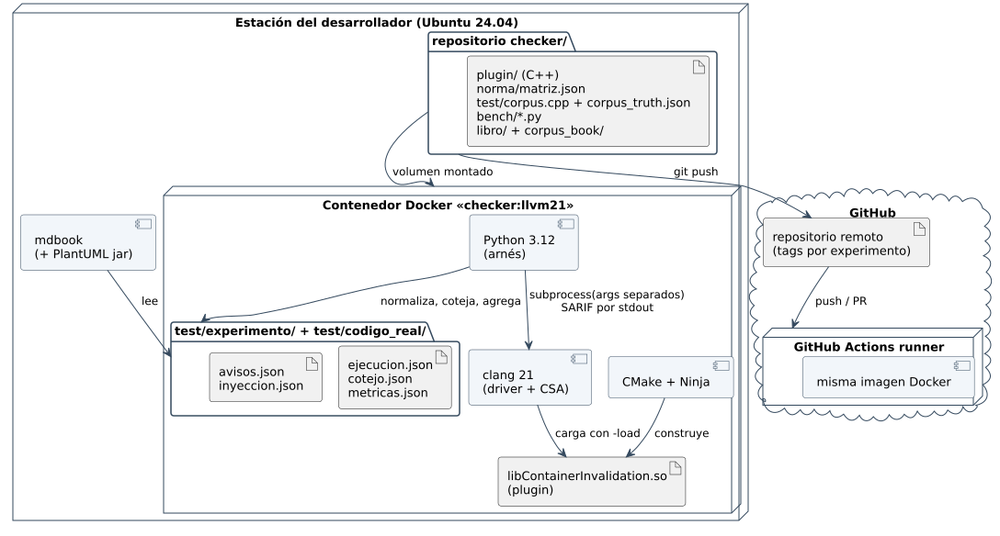

# 5.7 Arquitectura física

## Servicio: despliegue


Centinela corre en un contenedor construido sobre la imagen del checker:
Node 22 y el servicio, más `clang` 21.1.8 y `libContainerInvalidation.so`
compilado en la misma imagen (el plugin solo funciona con el Clang contra el
que se construyó). La base SQLite vive en un volumen. El servicio necesita
una URL pública con HTTPS para que GitHub le envíe los *webhooks*; el
navegador usa la misma URL.

| Nodo | Software | Se comunica con |
|---|---|---|
| Navegador | panel web | API por HTTPS con cookie de sesión |
| Contenedor `centinela:local` | Node 22, Fastify, trabajador, `clang` + plugin | GitHub por HTTPS con un token; SQLite en `/datos` |
| GitHub | repositorio con protección de rama, API REST | el servicio, por el *webhook* firmado |

## Motor de análisis: arquitectura física



| Nodo / artefacto | Qué es | Por qué así |
|---|---|---|
| Imagen Docker `checker:llvm21` | Ubuntu 24.04 + LLVM/Clang 21 de apt.llvm.org + CMake/Ninja + Python 3.12 | La API de CSA **no es estable** entre versiones: la versión se fija en la imagen y se registra en cada ejecución |
| `libContainerInvalidation.so` | el plugin; exporta `clang_registerCheckers` y `clang_analyzerAPIVersionString` | Se carga con `-Xclang -load`, sin recompilar LLVM (D-02) |
| `clang 21` | el driver con CSA | El mismo binario en las cuatro condiciones: la diferencia es sólo `-load` + `-analyzer-checker` + `PolicyMode` |
| `test/experimento/` | `ejecucion.json`, `cotejo.json`, `metricas.json` (con versiones, sha256 y órdenes en `meta`) | El experimento del informe corresponde al *tag* `banco-1`; el SARIF se normaliza al vuelo |
| `test/codigo_real/` | `avisos.json`, `inyeccion.json` | Avisos sobre proyectos reales, con el *commit* analizado |
| Estación del desarrollador | edita en el host; el repositorio se monta en el contenedor | El `.so` enlaza contra el LLVM de la imagen: no sirve en el host |
| GitHub + Actions | repositorio remoto, *tags* `banco-1` y `v1.0.0`, CI con la **misma** imagen | El CI prueba el servicio y repite el experimento; no es necesario para analizar |
| mdbook + PlantUML | el libro del proyecto | Los diagramas son texto versionado; las figuras del informe salen de los mismos `.puml` |

**Invocación de la condición `Experimental-Possibly`** (la que registra
`test/experimento/metricas.json`, una por caso):

```bash
clang++ --analyze --analyzer-output sarif -std=c++17 \
  -Xclang -load -Xclang /work/build/plugin/libContainerInvalidation.so \
  -Xclang -analyzer-checker=core,cplusplus,alpha.cplusplus.IteratorModeling,alpha.cplusplus.ContainerModeling,alpha.cplusplus.InvalidatedIterator,alpha.cplusplus.IteratorRange,alpha.cplusplus.MismatchedIterator,ucsm.ContainerInvalidation \
  -Xclang -analyzer-config -Xclang aggressive-binary-operation-simplification=true \
  -Xclang -analyzer-config -Xclang ucsm.ContainerInvalidation:PolicyMode=Possibly \
  <caso>.cpp
```

`Reference` es **la misma línea** sin `-load`, sin `ucsm.ContainerInvalidation`
y sin `PolicyMode` (RN-002). `Experimental-Silent` cambia sólo
`PolicyMode=Silent`. `Plugin-Possibly` quita además los `alpha.cplusplus.*`.
