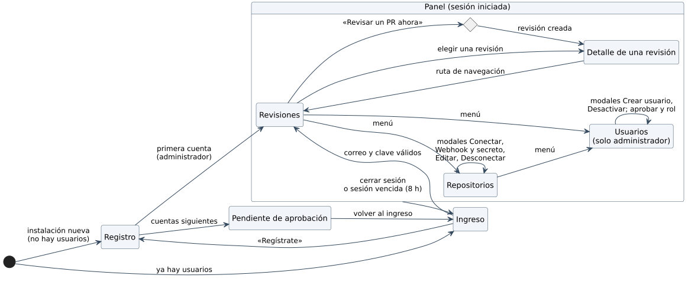

# 6.2 Diagrama de navegación del sistema

La entrada depende de si ya hay usuarios: en una instalación nueva se abre el
registro y la primera cuenta entra directo al panel como administradora
(RN-S01); después, el registro deja la cuenta pendiente y la persona vuelve al
ingreso. Dentro del panel, el menú lateral lleva a Revisiones, Repositorios y
(solo el administrador) Usuarios; las acciones que cambian datos se hacen en
modales que vuelven a la misma pantalla. Cerrar sesión, o que la sesión
venza a las 8 horas, regresa al ingreso con un aviso.
