# 6.3 Esquemas de interfaz: *mockups* y *wireframes*

Los *mockups* son de alta fidelidad, se diseñaron con Claude Design sobre los casos de uso de la sección 5.1 y la API de la sección 6.5, y usan los datos que esa API devuelve: cada campo que aparece en una pantalla existe en la respuesta JSON correspondiente. El lienzo completo tiene 26 tableros: las pantallas, sus estados (vacío, carga, error, tema oscuro, tableta), los modales y el sistema de diseño (colores, tipografía y componentes). Aquí están los principales; el resto está en `libro/mockups/`.

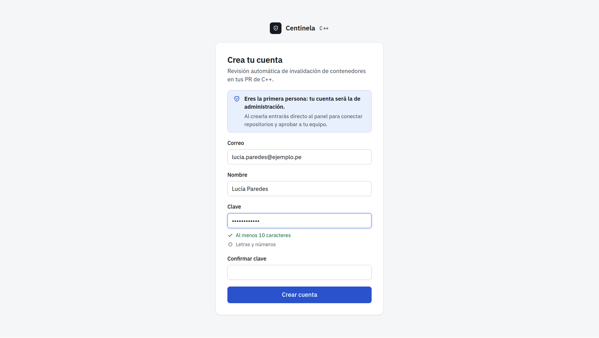

Pide correo, nombre, clave y su confirmación. Las reglas de la clave (al menos 10 caracteres, letras y números) se marcan mientras se escribe, las mismas que valida el dominio (`claveNueva`).

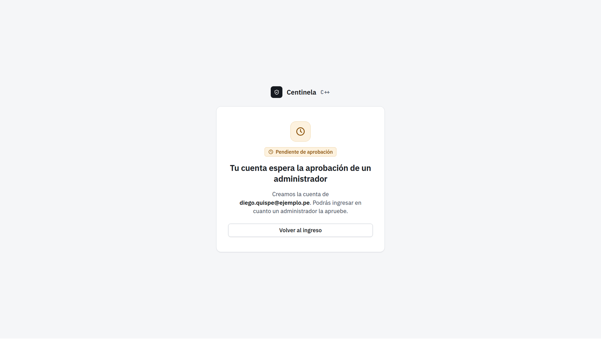

Las cuentas que no son la primera no entran: el sistema dice a quién se creó la cuenta y que un administrador debe aprobarla.

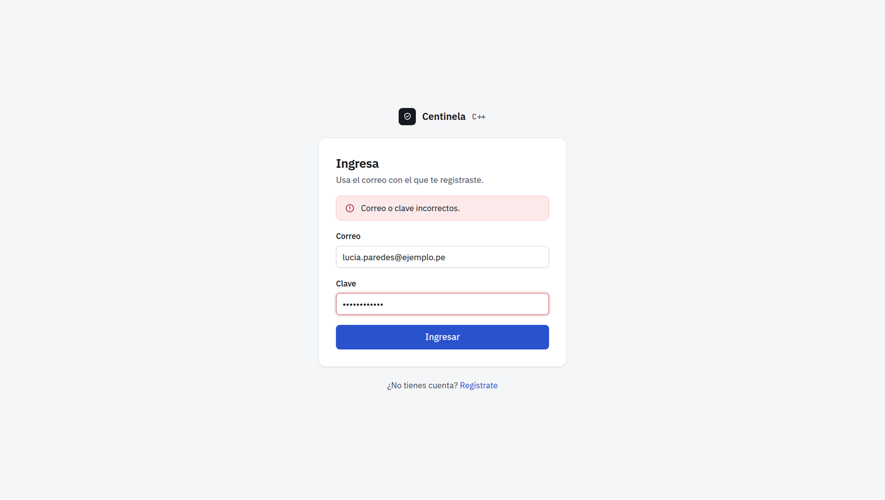

El mensaje no dice si el correo existe. Variantes del mismo diseño: cuenta pendiente de aprobación, cuenta desactivada (cada una con su mensaje), 10 intentos fallidos (espera de 15 minutos) y sesión vencida.

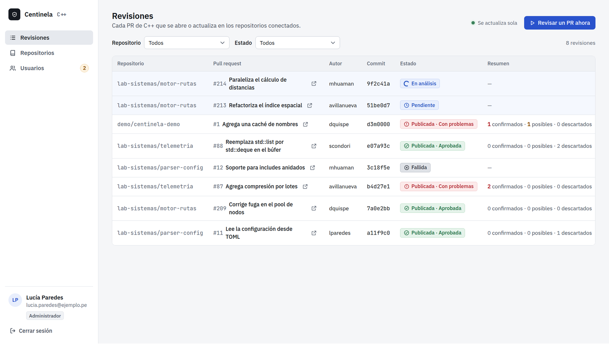

Lista cada revisión con repositorio, *pull request*, autor, commit, estado, resumen (confirmados, posibles y descartados), origen (*webhook* o manual), intentos y fecha. Se filtra por repositorio y estado y se actualiza sola mientras hay revisiones en curso.

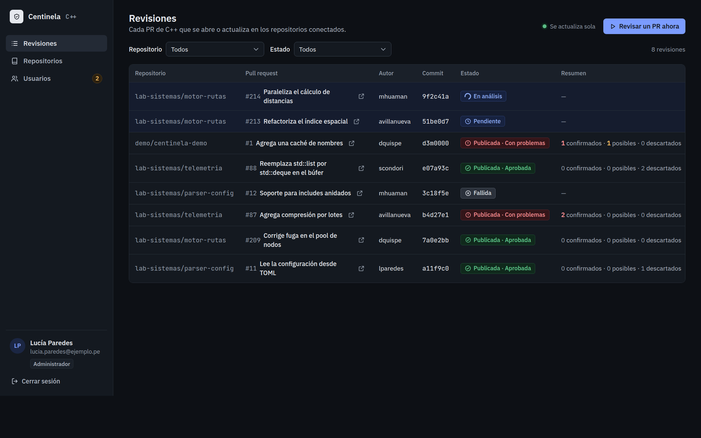

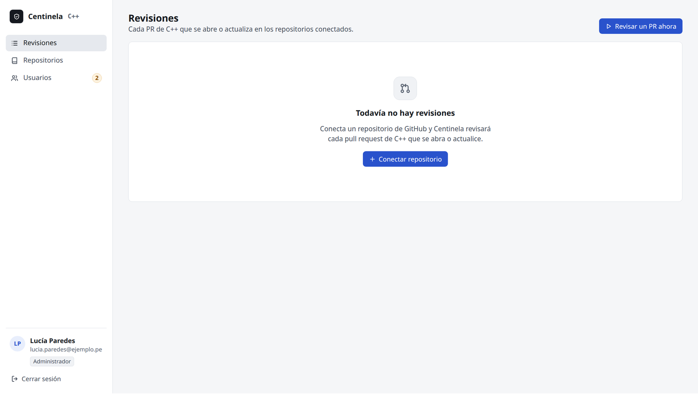

Sin repositorios no hay revisiones: el administrador ve el botón para conectar uno; el desarrollador, que debe pedírselo a un administrador. Hay diseños también para la carga y para el error del servidor.

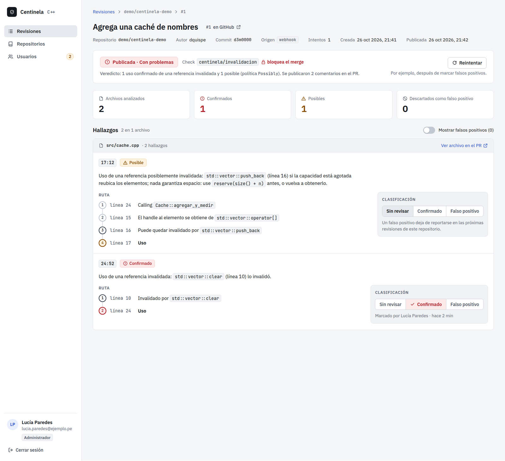

Muestra el veredicto, el check `centinela/invalidacion` y si bloquea el merge, el resumen en números y los hallazgos agrupados por archivo. Cada hallazgo trae su línea y columna, su clase (Confirmado o Posible), el mensaje del checker, la ruta paso a paso (de dónde sale el handle, qué lo invalida, dónde se usa) y su clasificación, con quién la hizo y cuándo («Marcado por …»).

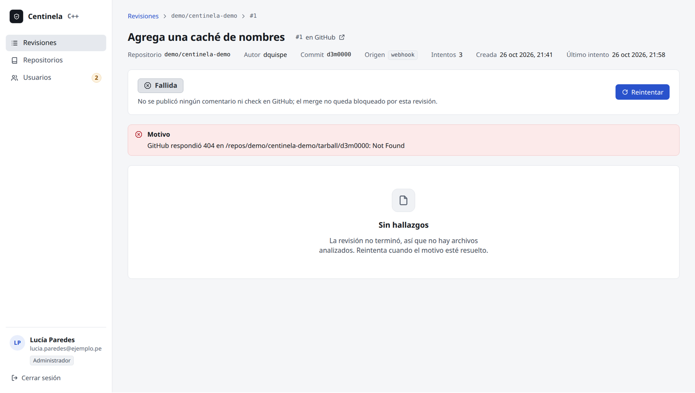

La revisión fallida dice el motivo exacto, aclara que no se publicó nada en GitHub y ofrece reintentar.

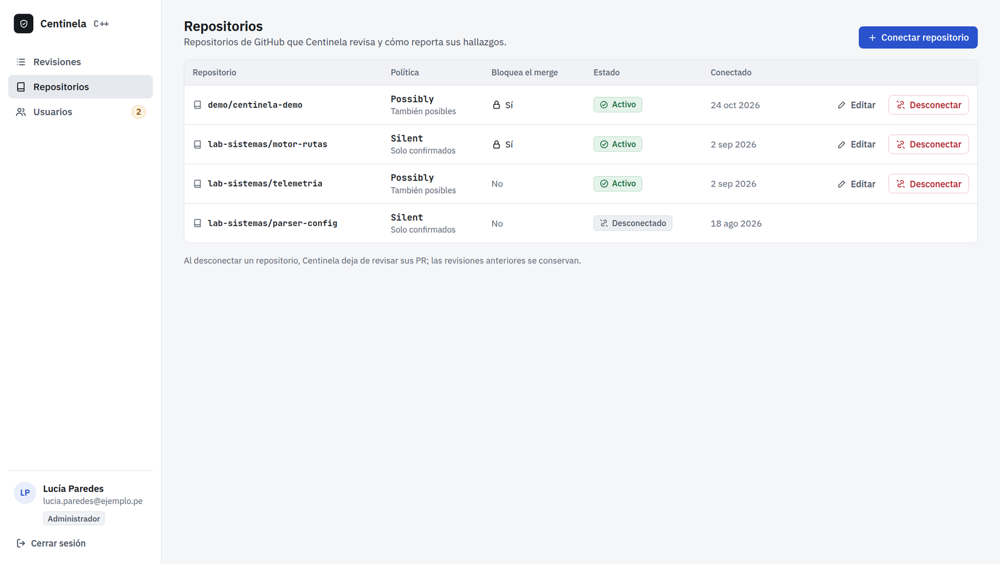

Cada repositorio con su política (`Silent` o `Possibly`), si bloquea el merge, su estado y la fecha de conexión. El desarrollador ve la misma tabla sin acciones.

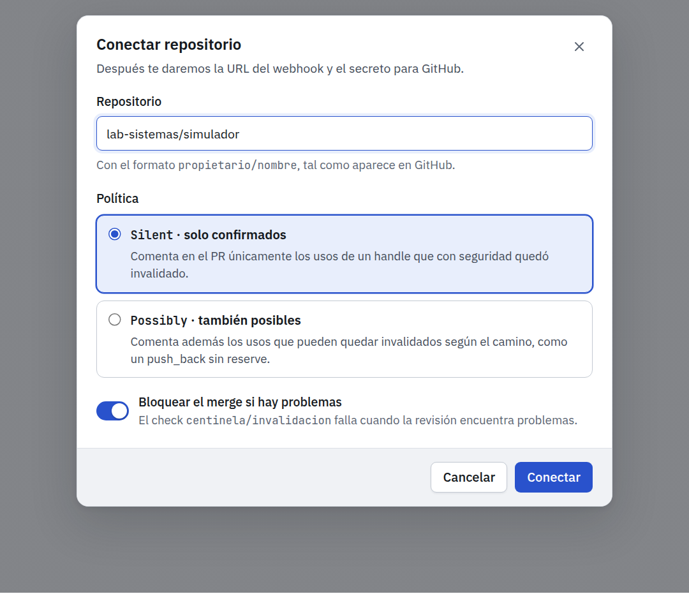

Nombre `propietario/nombre`, política y bloqueo del merge. Si el repositorio ya está conectado, el error se muestra en el campo.

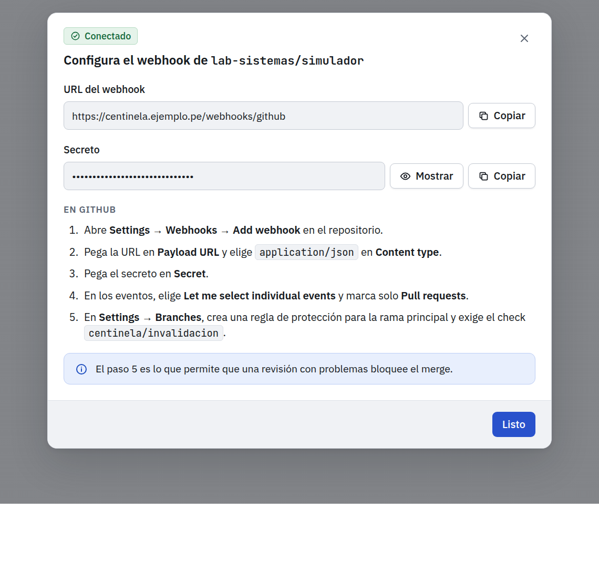

Se muestra al conectar: la URL y el secreto para pegarlos en GitHub y los pasos para configurarlo, incluido exigir el check en la regla de protección de la rama.

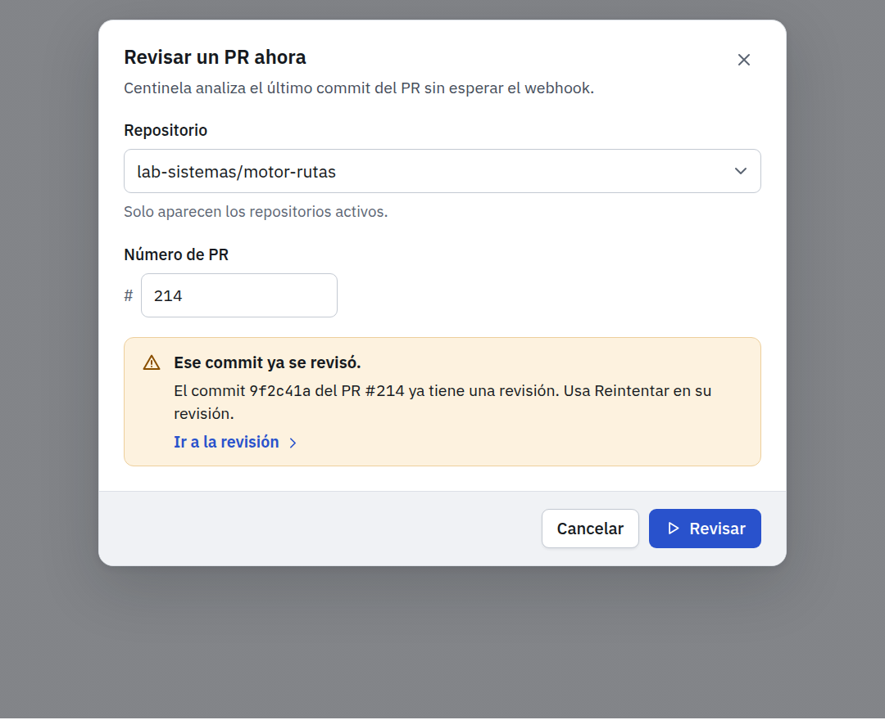

Repositorio y número del *pull request*. Si ese commit ya se revisó, lo dice y enlaza a la revisión existente en lugar de duplicarla.

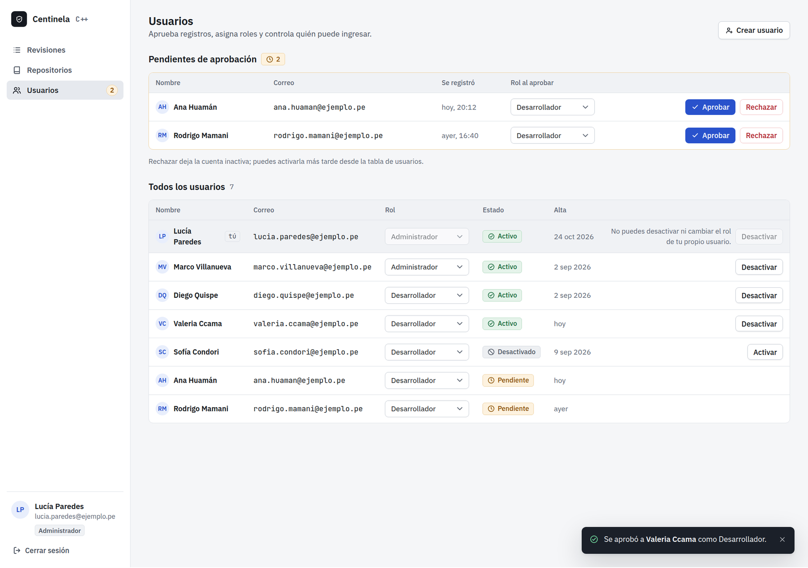

Arriba, los registros pendientes con el rol que tendrán al aprobarse; abajo, todas las cuentas con su estado: Pendiente, Activo o Desactivado (un registro rechazado queda desactivado y se puede activar después). Nadie puede desactivarse ni cambiarse el rol a sí mismo.

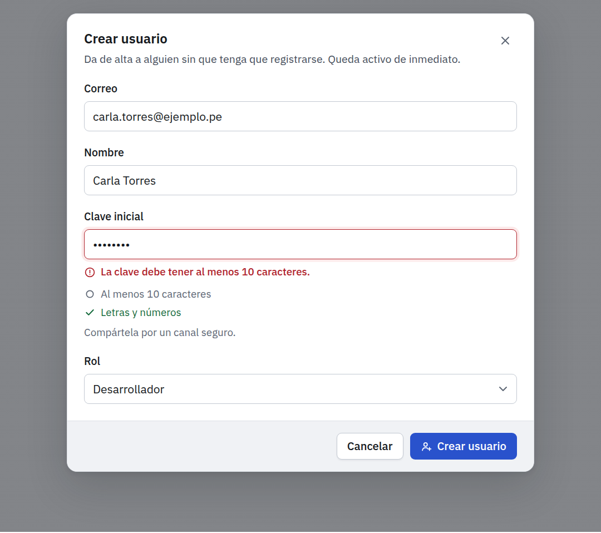

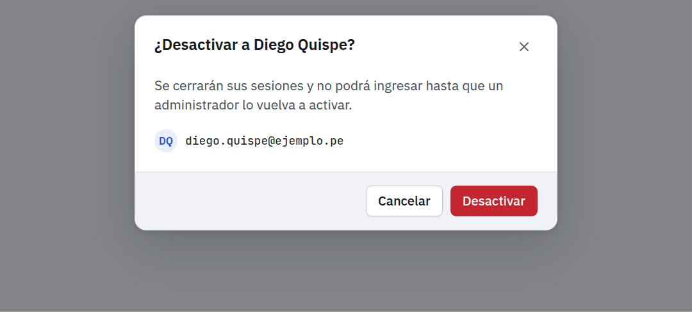

Las acciones que quitan acceso piden confirmación y dicen la consecuencia; lo mismo al desconectar un repositorio.
