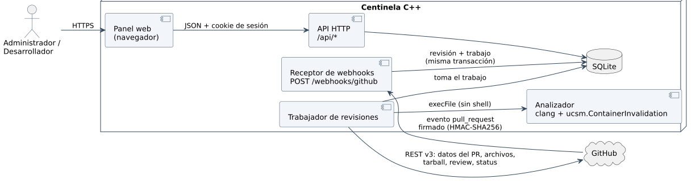

# 6.6 Diagrama de interfaz de servicios

El panel y GitHub entran por interfaces distintas y con autenticación
distinta (cookie de sesión y firma HMAC). Ninguna de las dos analiza código
mientras responde: las dos solo escriben en la base, y el *webhook* deja la
revisión y su trabajo en la misma transacción. El trabajador toma el trabajo,
descarga el commit de GitHub, ejecuta clang con el checker y publica el
resultado.
