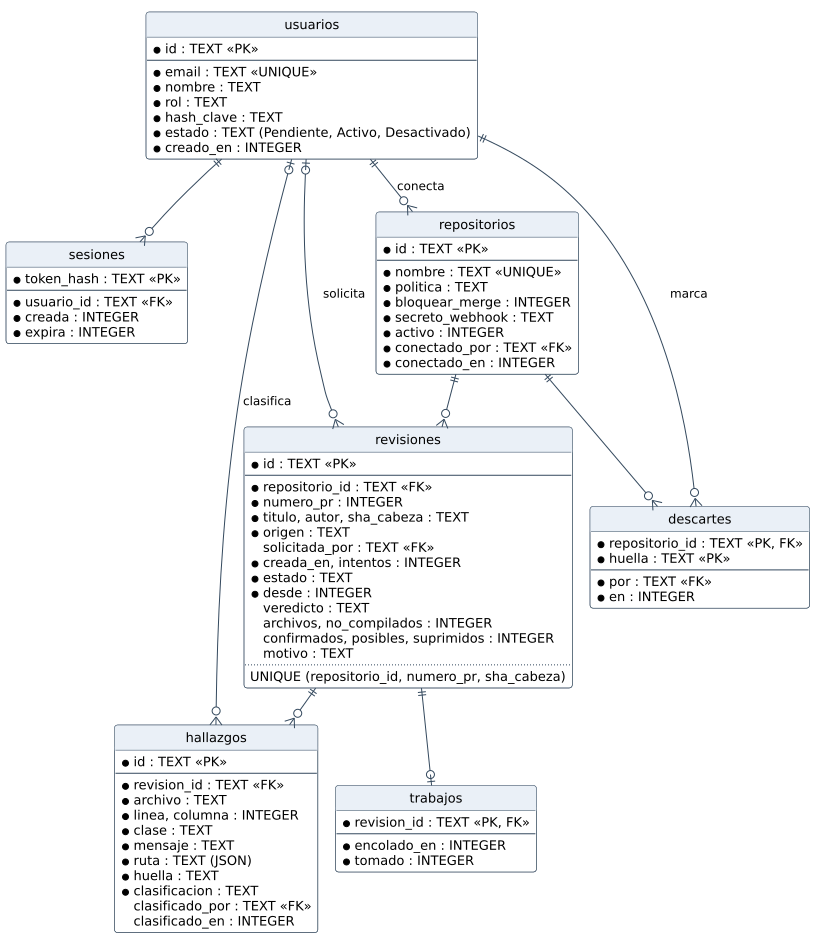

# 6.9 Modelo de base de datos

## Tipo de almacenamiento

Base de datos relacional **SQLite**, en un archivo del servidor
(`CENTINELA_BD`, en un volumen de Docker). Se eligió porque el servicio es de
un solo equipo y un solo proceso: no necesita un servidor de base de datos
aparte, admite transacciones y claves foráneas, y se respalda copiando un
archivo. Las consultas pasan por un adaptador (`@centinela/sqlite`), así que
cambiar a PostgreSQL no toca el dominio. La versión del esquema va en
`PRAGMA user_version` (hoy, la 3) y una base anterior se migra sola al abrirla,
en una transacción.

## Estructura del modelo de datos

| Tabla | Clave | Datos principales | Relaciones |
|---|---|---|---|
| `usuarios` | `id` | correo (único), nombre, rol, hash scrypt de la clave, estado (`Pendiente`, `Activo`, `Desactivado`), fecha de alta | — |
| `sesiones` | `token_hash` | usuario, creada, expira | → `usuarios` |
| `repositorios` | `id` | nombre `propietario/nombre` (único), política, bloquear merge, secreto del *webhook*, activo, fecha | — |
| `revisiones` | `id` | repositorio, PR (número, título, autor, sha), origen, quién la pidió, intentos, estado y sus columnas (veredicto, resumen, motivo) | → `repositorios`, `usuarios` |
| `hallazgos` | `id` | revisión, archivo, línea, columna, clase, mensaje, ruta (JSON), huella, clasificación, quién y cuándo la clasificó | → `revisiones`, `usuarios` |
| `descartes` | `repositorio_id` + `huella` | falsos positivos marcados: quién y cuándo | → `repositorios`, `usuarios` |
| `trabajos` | `revision_id` | revisión por analizar | → `revisiones` |

Reglas de integridad que impone la base:

| Regla | Cómo |
|---|---|
| un commit de un PR se revisa una sola vez | `UNIQUE (repositorio_id, numero_pr, sha_cabeza)` |
| el estado decide qué columnas tienen valor | `CHECK`: veredicto si y solo si está publicada; motivo si y solo si falló |
| quien clasificó y cuándo van juntos | `CHECK ((clasificado_por IS NULL) = (clasificado_en IS NULL))` |
| el estado de una cuenta es uno de tres | `CHECK (estado IN ('Pendiente', 'Activo', 'Desactivado'))` |
| no hay hallazgos ni sesiones huérfanos | claves foráneas con `PRAGMA foreign_keys = ON` |
| la revisión y su trabajo existen juntos | se insertan en la misma transacción |
| la clave nunca se guarda | solo el hash scrypt; de la sesión, solo el sha256 del token |

La construcción de la base (diseño lógico y físico, pruebas y despliegue) está
en la sección 7.2.
