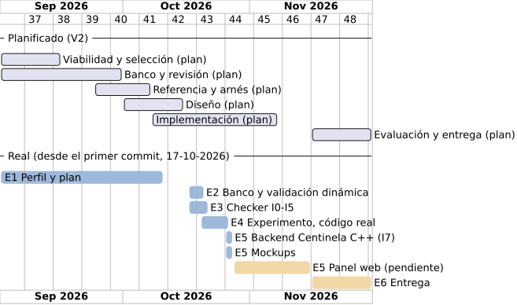

# Apéndices

## Apéndice A. Cronograma

El cronograma compara lo planificado con lo ejecutado por entregable de la
EDT. Lo real se toma de los *commits* y de las fechas de los archivos del
repositorio (2.5.4).

Tabla: Cronograma del proyecto por entregable

| Entregable | Actividad | Planificado | Real | Horas |
|---|---|---|---|---|
| E1 | Perfil y planificación | 1–15 sep | sep – 10 oct | 40 |
| E2 | Banco de casos y validación dinámica | sep | 17–20 oct | 80 |
| E3 | Checker, incrementos I0 a I5 | 8 oct – 7 nov | hasta el 21 oct | 120 |
| E4 | Experimento y código real (I6) | 16–30 nov | 20–26 oct | 50 |
| E5 | Servicio Centinela C++ (I7): backend, *mockups*, panel web y pruebas | no planificado | 26–28 oct | 150 |
| E5 | Prueba con GitHub real | no planificado | 10 nov | incluida en E5 |
| E6 | Informe final, artículo y presentación | 16–30 nov | 16–30 nov | 30 |
| | **Total** | | | **470** |



## Apéndice B. Estándares

Tabla: Estándares aplicados en el proyecto

| Estándar | Ámbito | Dónde se aplica |
|---|---|---|
| ISO/IEC 14882:2017 (C++17) | semántica de invalidación de cada operación | cada regla de `norma/matriz.json` cita su cláusula (4.2.3) |
| SEI CERT C++ CTR51-CPP | uso de iteradores, referencias y punteros válidos | alcance del checker (4.2.3) |
| Convenciones de codificación de LLVM | estilo del código del plugin | `-Wall -Wextra -Werror=switch` (7.1) |
| ISO/IEC 25010:2011 | modelo de calidad del producto | organización de las pruebas no funcionales (8.4) |
| OWASP ASVS 4.0.3 (V2 y V3) | autenticación y sesiones | RNF-S01 y pruebas de seguridad (8.4.6) |
| RFC 2104 (HMAC) | firma de los *webhooks* | verificación HMAC-SHA256 de cada evento (RNF-S02) |
| RFC 6265 (cookies) | sesión del panel | cookie `httpOnly` y `SameSite=Strict` (RNF-S01) |
| WCAG 2.1, nivel AA | accesibilidad del panel | axe-core y prueba de contraste (8.4.5) |
| API REST y *webhooks* de GitHub | integración con los repositorios | cliente probado contra un GitHub simulado (6.8) |
| SARIF 2.1 | formato de los avisos del analizador | lectura de la salida de CSA (4.2.4) |
| Versionado semántico | numeración de las versiones del servicio | MAJOR, MINOR y PATCH (7.3) |
| ISO/IEC/IEEE 26514:2022 | información para usuarios | documentación por destinatario (8.6) |
| ITIL 4 | gestión del servicio | prácticas de soporte (8.7) |
| ISO/IEC/IEEE 14764:2022 | mantenimiento del software | tipos de mantenimiento (8.7) |
| Ley N.º 29733 | protección de datos personales | datos mínimos de cada usuario (1.5.6) |
| APA 7.ª edición | citas y referencias | todo el informe |

## Apéndice C. Repositorio y reproducción

El código, los datos de la evaluación, el libro y este informe están en el
repositorio público `github.com/jasrod12ucsm/checker`. Con Docker y Docker
Compose instalados, las órdenes siguientes reproducen los resultados del
informe.

```bash
git clone https://github.com/jasrod12ucsm/checker.git && cd checker
docker compose build                            # imagen con LLVM 21
docker compose run --rm verificar               # checker
docker compose run --rm sistema-pruebas         # servicio y panel
docker compose run --rm sistema-no-funcionales  # no funcionales
docker compose up sistema-demo                  # demostración
./video/demo.sh 1                               # guion, paso 1 de 7
```

Tabla: Entregables del proyecto

| Entregable | Ubicación |
|---|---|
| Servicio Centinela C++ y su imagen Docker | `sistema/`, `docker-compose.yml` |
| Checker `ucsm.ContainerInvalidation` | `plugin/` (`libContainerInvalidation.so`) |
| Norma como datos | `norma/matriz.json` |
| Banco de 750 casos y su sello | `test/`, etiqueta `banco-1` |
| Resultados de la evaluación | `test/experimento/`, `test/codigo_real/` |
| Libro del proyecto | `libro/` (fuente) y `corpus_book/` (generado) |
| Informe del proyecto | `bench/informe/` |
| Artículo IEEE | `articulo/paper_centinela.tex` |
