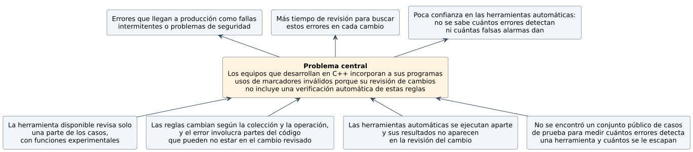
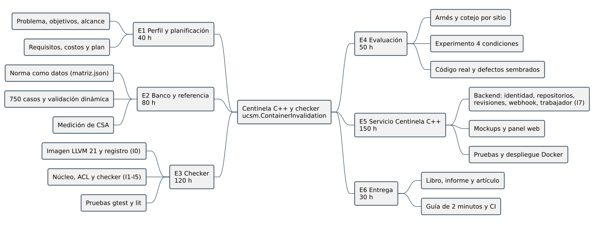

# Capítulo 1 — Introducción y objetivos

## 1.1 Introducción

C++ es un lenguaje que se usa para construir programas en los que la velocidad y el uso de la memoria son importantes, como bases de datos, navegadores, videojuegos o sistemas embebidos. Para lograr esa velocidad, el lenguaje deja en manos del programador varias comprobaciones que otros lenguajes hacen automáticamente. Cuando el programador se equivoca, el programa no siempre falla de inmediato: puede funcionar en las pruebas y fallar después, en manos de los usuarios.

Muchos equipos de desarrollo trabajan con plataformas como GitHub, donde cada cambio al código se propone, se revisa y, si se aprueba, se incorpora al proyecto. Estas plataformas permiten, además, que herramientas automáticas revisen cada cambio antes de su incorporación (GitHub, 2026b). Los desarrolladores prefieren que esas herramientas muestren sus resultados dentro de su forma habitual de trabajo y con pocas falsas alarmas (Christakis y Bird, 2016).

Este informe presenta un proyecto que aplica esa idea a un tipo de error frecuente y difícil de detectar en programas escritos en C++. El capítulo 1 plantea el problema, los objetivos y la solución propuesta; el capítulo 2 presenta los fundamentos, la metodología y el plan; el capítulo 3, el análisis económico; el capítulo 4, los requerimientos; el capítulo 5, la arquitectura; el capítulo 6, las pantallas, la API y la base de datos; el capítulo 7, la construcción del software; y el capítulo 8, sus pruebas.

## 1.2 Planteamiento del problema

Muchos programas importantes, como bases de datos, navegadores o videojuegos, están escritos en C++. En estos programas es común guardar datos en colecciones, como listas o tablas, y acceder a un dato concreto mediante una especie de marcador que indica dónde está. El problema aparece cuando la colección cambia: al agregar o quitar elementos, algunos marcadores dejan de apuntar a donde debían. Si el programa los sigue usando, puede leer datos equivocados, fallar sin motivo aparente o abrir una puerta a ataques. El estándar de codificación segura SEI CERT considera este error de severidad alta (Software Engineering Institute, 2024).

Este error es difícil de detectar por dos razones. La primera es que depende de reglas distintas para cada tipo de colección y cada operación. Por ejemplo, agregar un elemento a una colección puede invalidar los marcadores en un caso y no en otro, según el espacio que tenga reservado. La segunda es que el lugar donde se crea el marcador, el lugar donde se modifica la colección y el lugar donde se usa el marcador suelen estar en partes distintas del programa.

En los equipos de desarrollo, los cambios al código se revisan antes de incorporarlos al proyecto, mediante lo que en GitHub se llama *pull request*. Quien revisa ve principalmente las líneas que cambiaron. Si el error depende de código que está fuera de esas líneas, no se ve en la revisión. Las pruebas automáticas tampoco lo garantizan, porque el programa puede funcionar bien en las pruebas y fallar después.

Existen herramientas que revisan el código de forma automática, pero no resuelven bien este caso. La más usada para C++ de código abierto, Clang Static Analyzer, revisa solo una parte de estos marcadores, y lo hace con funciones que todavía están en fase experimental (LLVM Project, 2026a). Además, estas herramientas se ejecutan por separado: sus resultados no aparecen en la revisión del cambio, que es donde el equipo decide qué se incorpora.

Como consecuencia, los equipos pueden incorporar a sus programas errores de este tipo que luego aparecen en producción como fallas que ocurren a veces y son difíciles de reproducir, o como problemas de seguridad.

### Árbol de problemas

Tabla: Relaciones del árbol de problemas

| Nivel | Elemento |
|---|---|
| Efecto | Errores que llegan a producción como fallas intermitentes o problemas de seguridad. |
| Efecto | Más tiempo de revisión para buscar estos errores en cada cambio. |
| Efecto | Poca confianza en las herramientas automáticas, porque no se sabe cuántos errores detectan ni cuántas falsas alarmas dan. |
| Problema central | Los equipos que desarrollan en C++ incorporan a sus programas usos de marcadores inválidos porque su revisión de cambios no incluye una verificación automática de estas reglas. |
| Causa | Las reglas cambian según la colección y la operación, y el error involucra partes del código que pueden no estar en el cambio revisado. |
| Causa | La herramienta disponible revisa solo una parte de los casos, con funciones experimentales. |
| Causa | No se encontró un conjunto público de casos de prueba que permita medir cuántos errores detecta una herramienta y cuántos se le escapan. |
| Causa | Las herramientas automáticas se ejecutan aparte y sus resultados no aparecen en la revisión del cambio. |

### Formulación del problema

¿Cómo detectar automáticamente, en cada revisión de cambios de un equipo que desarrolla en C++ y antes de incorporar el cambio, los usos inválidos de marcadores a elementos de colecciones, con más aciertos que las herramientas disponibles y sin aumentar las falsas alarmas?

## 1.3 Descripción del proyecto

El proyecto desarrolla Centinela C++, un sistema web que revisa automáticamente los *pull requests* de C++ de una organización en GitHub. El sistema permite registrarse e ingresar con usuario y clave, asigna los roles de administrador y desarrollador, conecta los repositorios de la organización, recibe sus eventos mediante *webhooks* firmados y mantiene una cola de revisiones. Al terminar cada revisión, publica un comentario en cada línea con un uso invalidado y el estado del commit, que el equipo puede exigir antes de la integración. Un panel web y una API HTTP permiten consultar las revisiones y clasificar los hallazgos. El servicio está escrito en TypeScript sobre Node.js y Fastify, guarda sus datos en SQLite y se despliega con Docker.

El análisis lo realiza un motor construido como *checker* de Clang Static Analyzer (CSA), `ucsm.ContainerInvalidation`, que se carga como complemento (*plugin*) de LLVM/Clang 21. El motor sigue cada marcador a un elemento de una colección, que en C++ puede ser un iterador, una referencia o un puntero (en adelante, *handle*), hasta su colección o contenedor, y aplica las reglas de invalidación de la norma, registradas como datos en `norma/matriz.json` junto con la cláusula que las respalda. Para verificar el motor se construyó un banco de 750 casos derivado de la norma, con su validación dinámica y un arnés que compara los resultados con los de CSA.

El software se construyó en incrementos (sección 7.6). Los primeros prepararon la imagen de LLVM 21 y el registro del *plugin* (I0); los siguientes, el núcleo de reglas, los handles, las posiciones, las garantías y las notas de ruta del motor (I1 a I5), y su evaluación con el banco y en código real (I6); el último, el servicio Centinela C++ (I7). Cada incremento se cerró con pruebas automáticas.

Tabla: Ejes de construcción del banco

| Eje | Contenido | Finalidad |
|---|---|---|
| A | Contenedor (10 de la biblioteca estándar) | Distinguir garantías de invalidación. |
| B | Operación y condiciones | Identificar la regla aplicable. |
| C | Iterador, referencia o puntero | Medir los tres tipos de handle. |
| D | Forma sintáctica (recta, bucle, condición, función auxiliar) | Medir la sensibilidad a formas de código comparables. |
| E | Garantía previa: ninguna, `reserve` suficiente o handle devuelto por la mutación | Medir falsas alarmas en el buen uso de operaciones que pueden invalidar. |

## 1.4 Objetivos de la investigación

### Objetivo general

Desarrollar Centinela C++, un sistema web con autenticación y roles que revise automáticamente los *pull requests* de C++ de una organización en GitHub y señale en la línea afectada los usos de iteradores, referencias y punteros invalidados según la norma de C++17, mediante un motor de análisis construido sobre Clang Static Analyzer.

### Objetivos específicos

- OE1. Especificar los requerimientos funcionales y no funcionales del sistema y de su motor de análisis a partir del flujo de revisión de *pull requests* en GitHub y de las reglas de invalidación de C++17.
- OE2. Diseñar la arquitectura del sistema, sus casos de uso, sus interfaces y su modelo de datos.
- OE3. Construir el motor de análisis como *checker* de Clang Static Analyzer y verificar, sobre un banco de casos derivado de la norma y validado en ejecución, que detecta más usos invalidados que la configuración de referencia sin aumentar las falsas alarmas.
- OE4. Construir el servicio web con registro, sesiones y roles, conexión de repositorios mediante *webhooks* firmados, revisión de cada *pull request* con el motor, comentarios en línea, estado del commit y clasificación de hallazgos.
- OE5. Verificar el sistema mediante pruebas funcionales y no funcionales en su entorno de ejecución.

### Matriz objetivo resultado capítulo

Tabla: Trazabilidad de objetivos y resultados

| Objetivo | Resultado | Capítulo que lo desarrolla |
|---|---|---|
| OE1 | Cinco requerimientos funcionales y diez no funcionales del servicio (RF-S01 a RF-S05, RNF-S01 a RNF-S10); diecisiete funcionales y ocho no funcionales del motor (RF-01 a RF-17, RNF-01 a RNF-08), cada uno con la prueba que lo demuestra. | 4 |
| OE2 | Casos de uso, arquitectura lógica y física, paquetes, clases, estados, pantallas, API y modelo de datos. | 5 y 6 |
| OE3 | Motor `ucsm.ContainerInvalidation` con 101 mutaciones y 348 reglas de la norma como datos; banco de 750 casos validado en 852 ejecuciones sin contradicciones; el motor detecta 342 de 342 usos inválidos del banco sin falsas alarmas, frente a 80 de 342 de la configuración de referencia; 781 unidades de código real analizadas sin caídas. | 2, 4 y 7 |
| OE4 | Servicio Centinela C++ con registro sin usuarios predefinidos, roles, repositorios, *webhook* firmado, cola de revisiones, comentarios en línea, estado del commit, clasificación de hallazgos y panel web. | 4, 5, 6 y 7 |
| OE5 | 279 pruebas automáticas (155 del servicio y 124 del panel), 11 recorridos de extremo a extremo en 4 navegadores y pruebas de carga, estrés, volumen, configuración, usabilidad y seguridad (41 de 41). | 8 |

## 1.5 Solución propuesta

### Justificación e importancia

Desde el punto de vista práctico, el sistema lleva la verificación al *pull request*, que es el momento en que el equipo decide qué cambios se integran, y presenta cada hallazgo en la línea afectada sin que los desarrolladores tengan que instalar ni ejecutar un analizador. La posibilidad de exigir el estado del commit antes de la integración permite que el equipo convierta la verificación en una regla de su proceso.

Desde el punto de vista técnico, esta clase de defecto depende de reglas específicas por contenedor y operación que la configuración de referencia de CSA no modela, en particular para referencias y punteros. El motor toma esas reglas de la norma, registradas como datos, de modo que cada aviso puede rastrearse hasta su cláusula.

Desde el punto de vista académico, el banco de 750 casos etiquetados desde la norma, validados en ejecución y sellados permite medir este y otros detectores con un procedimiento reproducible. No se afirma que sea la primera evaluación de este tipo.

Desde el punto de vista económico, el capítulo 3 evalúa el sistema como un servicio por suscripción, con precios tomados de un producto comparable y parámetros de fuentes públicas; los escenarios dependen de la adopción, que no se ha medido.

### Descripción de la solución

Centinela C++ recibe el evento del *pull request* por un *webhook* firmado con HMAC-SHA256, registra la revisión y su trabajo en una misma transacción y responde de inmediato. Un proceso trabajador toma el trabajo, descarga el commit, ejecuta Clang con el motor sobre cada archivo C++ modificado y publica en GitHub una revisión con un comentario por hallazgo y el estado `centinela/invalidacion` del commit. El panel web y la API permiten administrar usuarios y repositorios, consultar revisiones y clasificar hallazgos; un hallazgo marcado como falso positivo deja de reportarse en ese repositorio.

El motor registra en el estado del análisis cada handle con su contenedor y su posición, consulta en cada operación la tabla de reglas generada desde `norma/matriz.json` y, si el handle quedó invalidado, emite un aviso en el uso con la ruta que lo explica. Con la política `Silent` informa solo los usos confirmados; con `Possibly`, también los que dependen de la capacidad.

### Aporte

- Para el cliente, un servicio que incorpora la detección de usos invalidados a la revisión de *pull requests*, con roles, trazabilidad de cada revisión y la opción de exigir el resultado antes de la integración.
- En lo técnico, un motor que modela las reglas de la norma para iteradores, referencias y punteros en diez contenedores, con las reglas registradas como datos verificables.
- En lo empírico, la medición de CSA y del motor sobre el mismo banco y en código real.
- En lo instrumental, el banco de 750 casos, su validación dinámica, el arnés y un libro del proyecto que permite reproducir los resultados.

### Alcances

Tabla: Delimitación por componente

| Componente | Incluido | Excluido |
|---|---|---|
| Servicio Centinela C++ | Registro sin usuarios predefinidos, ingreso con sesión, roles de administrador y desarrollador, repositorios de GitHub, *webhook* firmado, cola de revisiones, comentarios en línea y estado del commit, clasificación de hallazgos, panel web y API HTTP. | Varias organizaciones en una instancia (*multi-tenant*), facturación, proveedores distintos de GitHub (GitLab, Bitbucket). |
| Checker | Seguimiento y diagnóstico de las reglas de invalidación de la norma para 10 contenedores y los tres tipos de handle. | Uso después de liberación en general, contenedores de terceros. |
| Banco | 750 casos con etiqueta, cláusula y sitio esperado, validados en ejecución. | Casos cuya etiqueta no pueda justificarse con la norma. |
| Arnés | Cuatro condiciones, registros, cotejo por sitio y métricas. | Estudios de adopción con usuarios. |
| Datos | Base SQLite del servicio; archivos JSON versionados de la evaluación. | Datos de terceros fuera de los repositorios que el cliente conecta. |

Tabla: Contenedores cubiertos

| Familia | Contenedores | Mutaciones modeladas |
|---|---|---|
| Secuencias | `std::vector`, `std::deque`, `std::list`, `std::forward_list` | 59 |
| Asociativos ordenados | `std::map`, `std::multimap`, `std::set`, `std::multiset` | 25 |
| Asociativos no ordenados | `std::unordered_map`, `std::unordered_set` | 17 |

El desarrollo se hizo en GNU/Linux con la imagen Docker `checker:llvm21`, que fija LLVM/Clang 21.1.8 y libstdc++ 13, entre septiembre y noviembre de 2026.

### Limitaciones

En cuanto al análisis, CSA explora los caminos del programa con límites de profundidad y de expansión de funciones, de modo que una llamada cuyo efecto no se conoce o una capacidad que no puede determinarse pueden producir omisiones o avisos posibles. El motor tampoco conoce el contenido de los contenedores, por lo que puede seguir un camino que no ocurre en la ejecución; ese es el origen del único aviso posible observado en código real (sección 7.7).

En cuanto al banco, se trata de un conjunto sintético escrito por el equipo con formas de código acotadas, por lo que se complementó con código real y con defectos sembrados. Los resultados son válidos para el banco, las reglas y las versiones evaluadas.

En cuanto al servicio, cada instancia atiende a una sola organización (*single-tenant*) y solo a repositorios de GitHub, y requiere una URL pública con HTTPS para recibir los *webhooks*. Cada archivo modificado se analiza sin la base de compilación del proyecto (`compile_commands.json`), con rutas de inclusión heurísticas; un archivo que no compila se informa como no analizado y no como libre de defectos (RN-S05). El análisis de cada archivo tiene un tiempo máximo, y el contador de intentos fallidos de ingreso se mantiene en memoria, por lo que se reinicia con el servicio.

En cuanto al alcance, quedan fuera el análisis general de *aliasing* y el análisis interprocedural sin límites; se incluyen los casos concretos que el banco puede etiquetar.

### Tratamiento de datos y privacidad

Centinela C++ trata datos personales de los usuarios de la organización cliente, como el correo, el nombre, el hash de la clave y las sesiones, y procesa código fuente privado. En el Perú, este tratamiento se rige por la Ley N.º 29733, Ley de Protección de Datos Personales (Congreso de la República del Perú, 2011). El sistema solicita únicamente el correo, el nombre y la clave, y no incluye usuarios predefinidos. La clave se almacena solo como hash scrypt con sal aleatoria (Percival y Josefsson, 2016), y de cada sesión se guarda solo el hash de su token, que viaja en una cookie `httpOnly` y `SameSite=Strict` (RNF-S01). El código del cliente se descarga en una carpeta temporal que se elimina al terminar el análisis y no se envía a servicios externos; el token de GitHub se configura en una variable de entorno, fuera del repositorio. Cada petición comprueba en el servidor el permiso del rol, y el secreto del *webhook* solo es visible para el administrador.

El banco y los experimentos no contienen datos personales, y el código real analizado pertenece a proyectos públicos de licencia abierta.

## 1.6 Síntesis del diseño metodológico

Tabla: Diseño metodológico del proyecto

| Elemento | Definición |
|---|---|
| Tipo y enfoque | Proyecto de desarrollo de software, con verificación cuantitativa del motor de análisis y pruebas del sistema. |
| Diseño | Para el motor, comparación de cuatro configuraciones sobre los mismos casos de prueba; la principal compara CSA solo con CSA más el motor (`Possibly`). Para el servicio, pruebas de aceptación de cada caso de uso y pruebas no funcionales. |
| Unidad principal | En el motor, el lugar del código donde se usa un marcador; en el servicio, cada caso de uso. |
| Instrumentos | Matriz normativa, banco de casos, registro de ejecución en SARIF, cotejo por sitio y pruebas automáticas del servicio. |
| Indicadores | Aciertos, falsas alarmas y omisiones del motor (precisión, exhaustividad y F1); tiempo y memoria; criterios de aceptación de los casos de uso; resultados de las pruebas no funcionales. |
| Desarrollo de software | Modelo incremental (Sommerville, 2020) en ocho incrementos (I0 a I7), cada uno cerrado con pruebas automáticas. |
| Desarrollo detallado | Apartado 2.3. |

## 1.7 Stakeholders y roles

Tabla: Matriz de poder e interés

| Stakeholder | Poder / interés | Rol |
|---|---|---|
| Organización cliente (equipo que desarrolla en C++) | Alto / alto | Decide adoptar Centinela C++, provee el repositorio de GitHub y la URL donde se despliega. |
| Administrador del equipo | Alto / alto | Primera cuenta: conecta repositorios, configura la política y el bloqueo del *merge*, aprueba usuarios. |
| Desarrollador de C++ | Medio / alto | Recibe los comentarios en su *pull request*, consulta revisiones, pide revisiones y marca falsos positivos. |
| GitHub | Alto / medio | Proveedor externo: envía los *webhooks* y recibe comentarios y estados por su API. |
| Docente y asesoría | Alto / alto | Revisión académica, alcance y aceptación de entregables. |
| Equipo del proyecto | Alto / alto | Diseño, desarrollo, banco, medición y operación del servicio. |
| Comunidad LLVM | Bajo / medio | Posible destinataria del checker y del banco; sin compromiso de aceptación. |

## 1.8 Síntesis de antecedentes

Tabla: Antecedentes relevantes para el alcance

| Antecedente | Relación con el proyecto |
|---|---|
| Balogh (2018) | Diseño del modelado de iteradores en CSA, base de los *checkers* experimentales que se midieron. |
| Higgs (2020) | Detección de invalidación con consultas de CodeQL: otra vía para el mismo defecto. |
| Kashyap et al. (2019) | Generación de bancos de errores para evaluar detectores. |
| Zhang et al. (2023) | Pruebas de analizadores con transformaciones que preservan la semántica (eje D del banco). |
| Teodorescu y Lucanu (2024) | Marco de análisis de uso después de liberación en C++. |
| Christakis y Bird (2016) | Lo que los desarrolladores esperan de un analizador: avisos accionables, integrados en su flujo. |

Christakis y Bird (2016) reportaron que los desarrolladores prefieren recibir los avisos dentro de su flujo de trabajo y con pocas falsas alarmas. Centinela atiende lo primero al publicar el aviso en el *pull request*, y el banco permite medir lo segundo antes del despliegue. La revisión detallada se presenta en la sección 2.2.

## 1.9 Síntesis del estado del arte

Tabla: Enfoques considerados

| Enfoque | Ventaja para el problema | Restricción |
|---|---|---|
| Checker de CSA | Estado a lo largo de los caminos de análisis. | Complejidad del modelado y límites del motor. |
| Herramienta con LibTooling | Control total del ejecutable. | El seguimiento de estado por caminos hay que construirlo. |
| Consultas de CodeQL | Relaciones entre usos y operaciones en toda la base de código. | Extracción de la base y modelo de consultas propios. |
| Instrumentación dinámica (ASan, modo de depuración de libstdc++) | Observa el error en una ejecución concreta. | Solo ve lo que se ejecuta; sirvió como oráculo del banco. |
| Revisión en el *pull request* con un servicio (bot o GitHub App) | El aviso llega donde el equipo decide el *merge*. | Necesita un servicio desplegado y permisos sobre el repositorio. |

## 1.10 Estándares, técnicas y herramientas

La norma ISO/IEC 14882:2017 es la fuente semántica de las reglas y del banco, y la regla CTR51-CPP la referencia de codificación segura. El servicio sigue OWASP ASVS 4.0 en autenticación y sesiones (OWASP Foundation, 2021), HTTP y cookies según sus RFC (Fielding et al., 2022; Barth, 2011) y la verificación de *webhooks* de GitHub con HMAC (Krawczyk et al., 1997; GitHub, 2026a). El checker sigue las convenciones de LLVM (LLVM Project, 2026b) y su salida se lee en SARIF 2.1.0 (OASIS, 2020). El diseño del servicio aplica el diseño guiado por el dominio (Evans, 2003; Wlaschin, 2018) y la arquitectura de puertos y adaptadores (Cockburn, 2005). Las herramientas se detallan en 2.3.9.

## 1.11 Síntesis de requisitos y casos de uso

Los requisitos se desarrollan en el capítulo 4 y los casos de uso en la sección 5.1. El servicio Centinela C++ tiene cinco requerimientos funcionales (RF-S01 a RF-S05) y diez no funcionales (RNF-S01 a RNF-S10), y su motor de análisis, diecisiete funcionales (RF-01 a RF-17) y ocho no funcionales (RNF-01 a RNF-08). Los actores son el administrador y el desarrollador de la organización cliente, que ingresan con usuario y clave, y GitHub, que envía los eventos. Cada caso de uso tiene un criterio de aceptación comprobado por una prueba automática.

## 1.12 Análisis de alternativas de solución

Se tomaron dos decisiones: cómo llevar el análisis al equipo (el producto) y con qué construir el detector (el motor). Cada alternativa se puntuó de 1 a 5 en cada criterio; el total es la suma ponderada.

Tabla: Matriz de decisión del producto

| Criterio | Peso | Servicio web propio (Centinela) | Acción de CI en el repositorio | Herramienta de línea de comandos |
|---|---|---|---|---|
| Aviso en la línea del *pull request* y bloqueo del *merge* | 30 % | 5 | 4 | 1 |
| Usuarios, roles y clasificación de hallazgos persistente | 25 % | 5 | 1 | 1 |
| Configuración única para todos los repositorios del equipo | 20 % | 5 | 2 | 1 |
| Esfuerzo de construcción y operación | 15 % | 2 | 4 | 5 |
| Independencia de un proveedor de CI | 10 % | 4 | 2 | 5 |
| **Total ponderado** | 100 % | **4,45** | **2,65** | **2,00** |

Una acción de integración continua se ejecuta en cada repositorio por separado y no conserva usuarios ni clasificaciones de hallazgos, y una herramienta de línea de comandos depende de que un desarrollador la ejecute. El servicio web tiene un mayor costo de construcción y operación, pero es la única alternativa que cubre los casos de uso del equipo.

Tabla: Matriz de decisión del motor

| Criterio | Peso | Checker de CSA | LibTooling | CodeQL |
|---|---|---|---|---|
| Seguimiento de estado y caminos | 35 % | 5 | 2 | 3 |
| Integración con la configuración de referencia | 25 % | 5 | 1 | 1 |
| Viabilidad dentro del curso | 25 % | 3 | 2 | 3 |
| Reproducibilidad y licencia | 15 % | 5 | 5 | 3 |
| **Total ponderado** | 100 % | **4,50** | **2,20** | **2,50** |

El *checker* de CSA es la única alternativa que permite comparar el motor con CSA cambiando un solo factor. Su viabilidad se comprobó en el incremento I0, con el registro del *plugin* en LLVM 21.

## 1.13 Síntesis de viabilidad técnica y económica

Tabla: Brechas técnicas y cómo se cerraron

| Necesidad | Cómo se cerró | Evidencia |
|---|---|---|
| Plataforma LLVM/Clang | Imagen `checker:llvm21` con LLVM 21.1.8 de apt.llvm.org (D-02). | `Dockerfile`; prueba `lit` de registro (I0). |
| API y estado de CSA | *Plugin* con núcleo puro y cáscara sobre CSA. | 40 pruebas del núcleo y 5 archivos `lit`. |
| Etiquetado normativo | Norma como datos con su cláusula, validada en ejecución. | 852 ejecuciones, 0 contradicciones. |
| Evaluación automática | Arnés con SARIF y cotejo por sitio. | 750 casos × 4 condiciones; 11 leyes probadas. |
| Servicio web | Backend TypeScript con arquitectura por capas. | 279 pruebas (servicio y panel); demostración de punta a punta con clang real; pruebas del capítulo 8. |

La viabilidad técnica se comprobó con el software construido y probado. La económica se evalúa en el capítulo 3 con un modelo de suscripción: la inversión estimada es de S/ 22 665,18, y a una tasa de 16,59 % el VAN es de S/ 29 142,80 en el escenario base, de S/ 126 352,54 en el optimista y de −S/ 18 008,06 en el pesimista. El resultado depende, por tanto, del número de organizaciones que adopten el servicio.

## 1.14 Compromisos del proyecto (*trade-offs*)

Tabla: Tensiones y decisiones de alcance

| Tensión | Variable protegida | Decisión |
|---|---|---|
| Un servicio para muchas organizaciones frente a uno por organización | Seguridad del código del cliente y plazo. | Una instancia por organización (*single-tenant*); el *multi-tenant* queda fuera. |
| Cobertura frente a tiempo | Etiquetas revisadas y comparación reproducible. | Diez contenedores con la norma completa como datos, antes que más formas de código. |
| Exhaustividad frente a precisión | Confianza del desarrollador en los avisos. | Dos políticas: `Silent` (solo confirmados) y `Possibly`; el repositorio elige. |
| Análisis completo del proyecto frente a análisis del cambio | Tiempo de respuesta en el *pull request*. | Se analizan los archivos cambiados; lo que no compila se informa. |
| Detalle técnico frente a lectura | Claridad para el usuario. | La ruta del aviso explica obtención, invalidación y uso en la línea. |

## 1.15 Síntesis de gestión y presupuesto

La organización, el cronograma y los costos se desarrollan en 2.4, 2.5 y 3.2. La EDT ordena el trabajo en seis entregables.

Tabla: EDT de entregables

| Código | Entregable | Actividades principales | Horas estimadas |
|---|---|---|---|
| E1 | Perfil y planificación | Problema, objetivos, alcance, requisitos y costos. | 40 |
| E2 | Banco y referencia | Norma como datos, 750 casos, validación dinámica, medición de CSA. | 80 |
| E3 | Motor de análisis | Imagen LLVM 21, núcleo, handles, posiciones, garantías, rutas y pruebas. | 120 |
| E4 | Evaluación | Arnés, experimento en cuatro condiciones, código real y defectos sembrados. | 50 |
| E5 | Servicio Centinela C++ | Backend, *mockups*, panel web, pruebas y despliegue con Docker. | 150 |
| E6 | Entrega | Libro del proyecto, informe, artículo, guía de reproducción y CI. | 30 |

La reserva de contingencia es la suma del valor monetario esperado de cada riesgo (EMV = probabilidad × impacto) y se calcula en 2.5.3.
