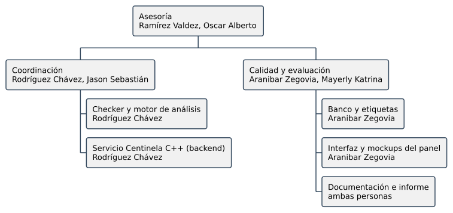
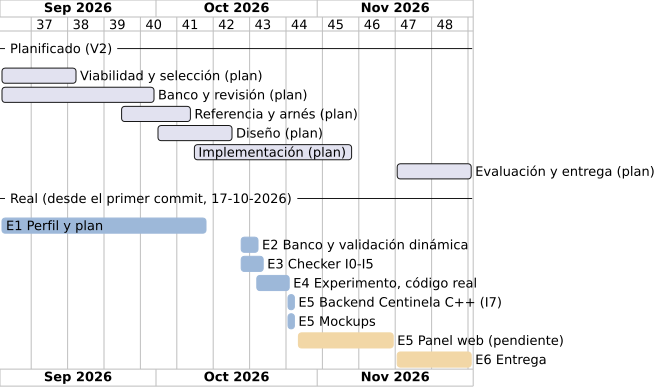

# Capítulo 2 — Marco teórico, metodología y plan del proyecto

## 2.1 Fundamentos teóricos

Este capítulo explica los conceptos necesarios para entender Centinela C++, su checker y su evaluación. Los primeros apartados tratan del sistema y de la gestión; los del medio, del análisis estático y de la invalidación; los últimos, de los servicios web, la seguridad y la arquitectura con que se construyó el servicio.

### Teoría general de sistemas

Centinela C++ es un sistema de componentes que interactúan: GitHub avisa de un *pull request*, el servicio guarda la revisión, el trabajador descarga el código, el motor de CSA lo analiza, el checker decide la validez de cada handle y el servicio devuelve el resultado a GitHub y al panel. Un cambio en un componente puede cambiar el resultado global: una etiqueta mal puesta en el banco altera las métricas aunque el checker funcione según su diseño, y un *webhook* sin firma comprometería todo el flujo aunque el análisis fuera perfecto.

Por esta razón, además de probar cada componente, se probó el sistema completo con una demostración de punta a punta que recibe un *webhook*, analiza con Clang y publica el resultado en un GitHub simulado (sección 7.7). La gestión del proyecto también se apoyó en la retroalimentación, ya que cada incremento produjo evidencia que orientó la decisión siguiente.

### Principios de ingeniería de sistemas

La ingeniería de requisitos transforma el problema en comportamientos verificables; el diseño establece cómo los componentes los realizan; la verificación comprueba que el software hace lo especificado, y la validación, que lo especificado atiende el problema. En este proyecto son actividades distintas verificar que el checker se registra en clang, validar en ejecución que las etiquetas del banco son correctas y aceptar un caso de uso del servicio con su criterio «dado, cuando, entonces». Cada requerimiento del capítulo 4 declara la prueba que lo demuestra.

### Teorías de gestión de proyectos

La gestión se organizó por entregables (EDT), con responsables, dependencias, esfuerzo y riesgos, y siguió el modelo de desarrollo incremental (Sommerville, 2020), en el que el producto se construye como una serie de versiones que se validan antes de continuar. El primer incremento integró el motor con la plataforma (I0); los siguientes, sus reglas y pruebas (I1 a I5) y su evaluación (I6); y el último, el servicio (I7). Un incremento se daba por terminado cuando sus pruebas automáticas pasaban en la imagen Docker, y cada ampliación del alcance se registró como decisión (sección 5.8).

### Análisis estático de programas

El análisis estático examina el código sin ejecutarlo. Puede razonar sobre ejecuciones posibles, pero impone aproximaciones y límites: ningún analizador práctico explora todos los caminos de un programa. En CSA, un *checker* identifica un tipo de problema con la información que le da el motor; la ausencia de un aviso solo significa que el análisis no reportó ese problema, no que el programa no lo tenga (LLVM Project, 2026a, 2026c).

### Interpretación abstracta y ejecución simbólica

Una abstracción representa las propiedades relevantes de un programa sin todos los detalles de una ejecución. La ejecución simbólica usa símbolos en lugar de valores y acumula condiciones a lo largo de cada camino; por ejemplo, una rama puede aportar que el tamaño de un vector es menor que su capacidad. El checker registra en el estado de cada camino los handles, sus contenedores y las operaciones. Cuando la información no alcanza para decidir si hubo invalidación, por ejemplo, si un `push_back` reubicó o no los elementos, el handle queda en estado «puede estar invalidado» y la política del motor decide si se emite un aviso; en ningún caso se asume que sigue válido.

### Análisis interprocedural y resúmenes de función

El análisis intraprocedural examina una función; el interprocedural relaciona funciones. Una invalidación puede ocurrir en una función distinta de la del uso. El proyecto reutiliza el *inlining* del motor de CSA y no construye un análisis interprocedural propio; la configuración de *inlining* se registra con cada experimento, y en código real se usa el modo `all`, porque con el modo por defecto una de las semillas no se detectaba (D-22).

### Aliasing y límites de decidibilidad

Hay *aliasing* cuando dos expresiones pueden designar el mismo objeto. Importa si una operación modifica un contenedor a través de un nombre y el handle se obtuvo a través de otro. El problema general es indecidible (Landi, 1992; Ramalingam, 1994), pero eso no impide resolver casos concretos: el checker asocia el handle a la región de memoria del contenedor, de modo que las copias y los alias que el motor resuelve llegan al mismo contenedor.

### Modelo de memoria de C++ y contenedores de la biblioteca estándar

Los contenedores administran el almacenamiento de sus elementos con garantías distintas: `std::vector` es contiguo y reubica todo al crecer; `std::list` guarda cada elemento en un nodo que no se mueve; los contenedores no ordenados usan una tabla de dispersión que puede reconstruirse (*rehash*). Una referencia es un alias del lenguaje, no una variable que guarda una dirección, y un iterador no equivale siempre a un puntero crudo. El modelo del checker conserva esas diferencias porque la regla de invalidación depende de ellas (International Organization for Standardization, 2017).

### Invalidación de iteradores y referencias como clase de defecto normada

La norma fija, operación por operación, qué handles quedan invalidados. La validez de un iterador puede perderse sin que se libere memoria, así que invalidación y uso después de liberación son conceptos relacionados pero distintos. Una regla para `push_back` en un vector no se generaliza a `insert` en el medio. Por eso cada regla de `norma/matriz.json` cita su cláusula de C++17, y cada caso del banco registra contenedor, operación, condiciones, tipo de handle y cláusula (International Organization for Standardization, 2017; Software Engineering Institute, 2024).

### Seguridad de tiempo de vida: el modelo *Owner* y *Pointer*

El modelo de seguridad de tiempo de vida distingue los objetos que poseen almacenamiento (*Owner*) de los que acceden a él sin poseerlo (*Pointer*), y explica por qué un acceso puede quedar sin objeto válido detrás (Sutter, 2019). El checker no implementa ese perfil: usa solo la asociación handle–contenedor y las reglas de la norma que necesita.

### Arquitectura del Clang Static Analyzer

CSA representa el análisis como un grafo (`ExplodedGraph`) cuyos nodos son posiciones del programa con un estado (`ProgramState`); las regiones de memoria se representan con `MemRegion`, y los *checkers* reciben eventos del motor (*callbacks*) antes y después de cada llamada, en cada acceso y cuando un valor muere. El checker guarda su propia información en el estado —cada handle con su contenedor, su posición y su validez— y la actualiza en esos eventos. Se construyó como *plugin* cargable, sin modificar LLVM (LLVM Project, 2026c).

### Solidez frente a completitud

Una sobreaproximación puede avisar de posibilidades que no ocurren; una subaproximación puede omitir posibilidades reales. Ningún analizador práctico es sólido y completo a la vez (Livshits et al., 2015). El checker distingue válido, invalidado y «puede estar invalidado»: la política `Silent` avisa solo lo invalidado; `Possibly`, también lo posible. El efecto de cada política se midió por separado.

### Métricas de evaluación de detectores

Un verdadero positivo (VP) es un aviso que corresponde a un uso inválido esperado; un falso positivo (FP), un aviso sin defecto; un falso negativo (FN), un uso inválido sin aviso; un verdadero negativo (VN), un sitio válido sin aviso. La precisión es la proporción de avisos correctos; la exhaustividad, la proporción de usos inválidos detectados; F1, su media armónica. Su interpretación depende del banco y del protocolo; no es una garantía de seguridad del código analizado.

Precisión = VP / (VP + FP). Exhaustividad = VP / (VP + FN). F1 = 2VP / (2VP + FP + FN).

### Falsos positivos y adopción de herramientas

Un aviso útil permite localizar y entender el problema; las falsas alarmas cuestan tiempo y confianza, y los desarrolladores abandonan las herramientas que las producen (Christakis y Bird, 2016; Guo et al., 2023). Centinela responde con tres medidas: el checker se midió sin falsas alarmas en el banco antes de desplegarlo, cada aviso trae la ruta que lo explica, y el equipo puede marcar un falso positivo para que no se repita en el repositorio.

### Pruebas metamórficas y sensibilidad a la forma sintáctica

Una transformación que preserva el comportamiento produce una variante del mismo escenario; comparar los avisos de ambas mide la sensibilidad del analizador a la forma del código (Klinger et al., 2019; Zhang et al., 2023). El eje D del banco aplica esta idea: el mismo defecto escrito en línea recta, en un bucle, bajo una condición o a través de una función auxiliar. Las variantes de un caso forman una familia y no se tratan como observaciones independientes.

### Servicios web y API REST

Un servicio web expone operaciones a través de HTTP. El estilo REST organiza esas operaciones como recursos identificados por URL y manipulados con los métodos de HTTP (Fielding, 2000): `GET` consulta sin cambiar nada, `POST` crea, `PATCH` modifica parcialmente y `DELETE` elimina; el código de estado de la respuesta dice el resultado (Fielding et al., 2022). Centinela expone así sus recursos —sesión, usuarios, repositorios, revisiones y hallazgos— en JSON (sección 6.5), y responde `202 Accepted` cuando el trabajo, como un análisis, queda en cola para hacerse después.

### *Webhooks* y autenticación de mensajes con HMAC

Un *webhook* es una llamada HTTP que un sistema hace a otro cuando ocurre un evento; GitHub lo usa para avisar que se abrió o actualizó un *pull request* (GitHub, 2026a). Como cualquiera puede enviar una petición a una URL pública, el receptor debe comprobar que el mensaje viene de GitHub y no fue alterado. Para eso GitHub firma el cuerpo con HMAC-SHA256 usando un secreto compartido (Krawczyk et al., 1997); el receptor recalcula la firma y la compara en tiempo constante, para no filtrar información por el tiempo de respuesta.

### Autenticación, sesiones y almacenamiento de claves

Autenticar es comprobar quién es el usuario; autorizar, qué puede hacer. Una clave nunca se guarda en claro: se guarda el resultado de una función de derivación deliberadamente costosa, como scrypt, con una sal aleatoria por usuario, de modo que una base filtrada no revele las claves (Percival y Josefsson, 2016). Tras el ingreso, el servidor entrega un token de sesión aleatorio en una cookie; los atributos `HttpOnly`, `SameSite=Strict` y `Secure` impiden que la lea un *script*, que viaje en peticiones de otros sitios y que viaje sin cifrar (Barth, 2011). OWASP ASVS 4.0 reúne estas prácticas como requisitos verificables (OWASP Foundation, 2021); el servicio cumple los de autenticación y sesiones listados en RNF-S01.

### Diseño guiado por el dominio y arquitectura de puertos y adaptadores

El diseño guiado por el dominio organiza el software alrededor de los conceptos del negocio y de su lenguaje, separados en contextos delimitados (Evans, 2003); modelarlo con tipos hace que los estados ilegales no se puedan representar (Wlaschin, 2018). La arquitectura de puertos y adaptadores (hexagonal) deja ese núcleo sin dependencias de la base de datos, la web o los servicios externos: el núcleo declara puertos (interfaces) y los adaptadores los implementan (Cockburn, 2005). Centinela C++ tiene tres contextos —identidad, repositorios y revisiones—, un núcleo que no importa Fastify, SQLite ni Node, y adaptadores para HTTP, SQLite, GitHub, criptografía y clang; una prueba de arquitectura impide que una capa importe lo que no debe (RNF-S05).

## 2.2 Antecedentes del proyecto

Los antecedentes se eligieron por su relación con el defecto, la plataforma y la evaluación. Se distingue lo que una fuente aporta como idea de lo que puede demostrar sobre la versión actual del analizador, que se midió directamente.

### Antecedentes de la investigación

**Balogh (2018).** Presenta el diseño del modelado de iteradores en CSA, que dio origen a los *checkers* experimentales `alpha.cplusplus` de iteradores. Sirvió para entender cómo CSA asocia un iterador a su contenedor. Al ser de 2018, no describe la versión 21; su comportamiento actual se midió con el banco.

**Higgs (2020).** Detecta invalidación de iteradores con consultas de CodeQL sobre la relación entre obtener, modificar y usar. Es la vía alternativa al enfoque de este proyecto y se consideró en la matriz de decisión del motor (1.12).

**Kashyap et al. (2019).** Generan bancos de errores a medida para evaluar detectores. Orientó la construcción de un instrumento que mida lo detectado y lo omitido; a diferencia de su generación automática, el banco de este proyecto se deriva de la norma y se valida en ejecución.

**Zhang et al. (2023).** Statfier prueba analizadores estáticos con transformaciones que preservan la semántica y encontró errores en analizadores conocidos. Orientó el eje D del banco: la misma condición de invalidación en varias formas de código.

**Teodorescu y Lucanu (2024).** Proponen un marco de análisis estático de uso después de liberación en C++. Es el antecedente más cercano en seguridad temporal; su defecto es distinto, porque una invalidación no siempre libera memoria.

**Christakis y Bird (2016).** Estudian qué esperan los desarrolladores de un analizador: avisos accionables, pocas falsas alarmas e integración en su flujo de trabajo. Fundamentan que Centinela lleve el aviso al *pull request*.

### Estado del arte

La documentación de CSA lista los *checkers* de iteradores en el grupo experimental (LLVM Project, 2026a); este proyecto los activó en la condición de referencia y midió que detectan 80 de 342 usos inválidos por caso y ninguno sobre referencias o punteros. El análisis de tiempo de vida de Clang, las consultas de CodeQL y la instrumentación dinámica son enfoques relacionados con entradas y garantías distintas; solo CSA se comparó en el experimento. Del lado del flujo de trabajo, GitHub permite que un servicio externo comente un *pull request* y publique el estado de un commit que una regla de protección exige antes del *merge* (GitHub, 2026b); Centinela usa ese mecanismo. La contribución se formula sobre los resultados propios; no se afirma novedad mundial.

### Resumen de antecedentes

Tabla: Antecedentes y decisiones que orientan

| Fuente | Aporte | Decisión que orientó |
|---|---|---|
| Balogh (2018) | Modelado de iteradores en CSA. | Usar CSA como plataforma y como referencia. |
| Higgs (2020) | Detección con CodeQL. | Alternativa evaluada en la matriz del motor. |
| Kashyap et al. (2019) | Bancos de errores para detectores. | Banco con respuesta esperada conocida. |
| Zhang et al. (2023) | Transformaciones que preservan la semántica. | Eje D del banco (formas sintácticas). |
| Teodorescu y Lucanu (2024) | Uso después de liberación en C++. | Separar invalidación de liberación. |
| Christakis y Bird (2016) | Lo que esperan los desarrolladores. | Aviso en el *pull request* y clasificación de falsos positivos. |

## 2.3 Metodología técnica y herramientas

El proyecto separó la construcción del software de su verificación. El motor de análisis se verificó comparándolo con CSA sobre un mismo banco de casos de prueba, con la misma imagen y las mismas opciones, de modo que la única diferencia entre las configuraciones fue la activación del motor. El servicio se verificó con los criterios de aceptación de sus casos de uso y con pruebas no funcionales (capítulo 8).

### Enfoque de la investigación

El proyecto tiene un enfoque de desarrollo tecnológico: construye un sistema para resolver un problema concreto y verifica su funcionamiento con mediciones. En el motor se registraron avisos, conteos, tiempos y memoria; en el servicio, los resultados de las pruebas funcionales y no funcionales. Cada falso positivo y cada omisión del motor se revisó y explicó.

### Tipo de investigación

Se trata de un proyecto aplicado, porque el sistema responde a una necesidad concreta de los equipos que desarrollan en C++ y se evaluó con resultados observables.

### Nivel de investigación

La verificación del motor describe primero el comportamiento de CSA sobre el banco y después compara CSA con CSA más el motor, cambiando solo la activación del motor. La verificación del servicio comprueba que cada caso de uso cumple su criterio de aceptación.

### Diseño de la investigación y procedimiento experimental

Cada caso del banco se analizó en cuatro configuraciones: `Reference`, que es CSA con sus *checkers* de iteradores y contenedores; `Experimental-Silent` y `Experimental-Possibly`, que agregan el motor con cada una de sus políticas; y `Plugin-Possibly`, que usa el motor sin los *checkers* experimentales de CSA. La comparación principal es `Reference` frente a `Experimental-Possibly`.

El procedimiento siguió el orden de los incrementos: comprobación de la plataforma (I0), registro de la norma como datos y generación del banco, validación de las etiquetas por ejecución, medición de CSA, construcción del motor, comparación, prueba en código real y con defectos sembrados, y finalmente construcción del servicio y su demostración de punta a punta.

El banco y el motor fueron construidos por el mismo equipo, con las mismas formas de código, por lo que no se reservó una parte del banco para una evaluación final. Para compensar esta limitación, el motor se probó además en cuatro proyectos reales que el equipo no escribió y con defectos sembrados en ellos (sección 7.7). Como el análisis es determinista, el banco completo se analizó una vez por configuración.

### Universo, población y muestra

Para la verificación del motor, el universo son los programas C++ que usan los contenedores de la biblioteca estándar. El banco no es una muestra aleatoria de ese universo, sino un conjunto de casos derivado de la norma, por lo que no permite estimar con qué frecuencia aparecen estos defectos en el software real. Para el código real se eligieron cuatro proyectos públicos de distinto tamaño y estilo (ninja, leveldb, yaml-cpp y RocksDB), cada uno en una versión fija.

La unidad de evaluación del motor es el lugar donde se usa un handle. Cada etiqueta se justifica con una cláusula de la norma y con las condiciones del caso; cuando un caso tiene varios handles, su etiqueta es la combinación de las de cada uno. En el servicio, la unidad de evaluación es el caso de uso.

### Procedimientos para el cumplimiento de los objetivos

Tabla: Procedimientos y evidencia

| Objetivo | Actividades | Evidencia |
|---|---|---|
| OE1 | Analizar el flujo de revisión de *pull requests* y las reglas de la norma; redactar los requerimientos con su prueba. | Capítulo 4. |
| OE2 | Definir los casos de uso; diseñar la arquitectura, los paquetes, las clases, las pantallas, la API y el modelo de datos. | Capítulos 5 y 6, *mockups*. |
| OE3 | Registrar la norma como datos; generar y validar el banco; construir el motor; compararlo con CSA; probarlo en código real y con defectos sembrados. | `norma/matriz.json`, `test/corpus_truth.json`, 852 ejecuciones, *plugin*, `test/experimento/`, `test/codigo_real/`. |
| OE4 | Modelar el dominio; construir el servicio, sus adaptadores y el panel web; desplegar con Docker. | `sistema/`, demostración de punta a punta. |
| OE5 | Ejecutar las pruebas funcionales y no funcionales del sistema. | Capítulo 8, pruebas Vitest y de navegador. |

### Métodos y técnicas

Se emplearon la derivación de casos de prueba desde la norma; la validación de sus etiquetas por ejecución, con el modo de depuración de libstdc++ y con AddressSanitizer y UndefinedBehaviorSanitizer (LLVM Project, s. f.); la construcción incremental guiada por pruebas; las pruebas de propiedades (leyes) del núcleo y del arnés; el cotejo automático de cada aviso con el lugar esperado; la comparación de configuraciones sobre los mismos casos; y criterios de aceptación «dado, cuando, entonces» para cada caso de uso del servicio.

### Instrumentos

Tabla: Instrumentos e indicadores

| Instrumento | Contenido | Indicador |
|---|---|---|
| Matriz normativa | Cada mutación con su regla y su cláusula. | 101 mutaciones, 348 reglas. |
| Banco de casos | Caso, etiqueta, cláusula y sitio de uso. | 750 casos revisados y validados. |
| Registro de ejecución | Versión, comandos, tiempo, memoria y salida SARIF. | Reproducción e incidencias. |
| Registro de cotejo | Aviso normalizado frente a sitio esperado. | VP, FP, FN y VN. |
| Informe comparativo | Métricas por condición, contenedor, operación y handle. | Precisión, exhaustividad y F1. |
| Pruebas del servicio | Casos de uso como pruebas automáticas. | Criterios de aceptación en verde; cobertura de líneas y ramas. |

### Herramientas

Tabla: Herramientas usadas

| Herramienta | Versión | Para qué |
|---|---|---|
| LLVM/Clang y CSA | 21.1.8 (apt.llvm.org) | Plataforma del checker y configuración de referencia. |
| C++ | C++17 | Checker y casos del banco. |
| CMake y Ninja | de la imagen | Construcción del *plugin* (LLVM no se compila: se instala). |
| GoogleTest y `lit` | 1.14 / de LLVM | Pruebas unitarias y de integración del checker. |
| Python | 3.12, sin dependencias externas | Generación del banco, arnés y cálculo de métricas. |
| Node.js y TypeScript | 22 / 5.9 | Servicio Centinela C++. |
| Fastify | 5.12 | Servidor HTTP del servicio. |
| SQLite (better-sqlite3) | 12 | Base de datos del servicio. |
| zod | 4 | Validación de datos en las fronteras. |
| Vitest | 3.2 | Pruebas y cobertura del servicio. |
| Docker y Docker Compose | — | Imagen reproducible y despliegue. |
| Git, GitHub y GitHub Actions | — | Versiones e integración continua. |
| AddressSanitizer | de LLVM 21 | Oráculo dinámico del banco. |
| PlantUML y mdbook | — | Diagramas y libro del proyecto. |
| Claude Design | — | *Mockups* del panel web. |

### Plan de análisis de los datos

Se conservó la salida SARIF original de cada ejecución. Cada aviso se asignó a la función del caso y al handle sobre el que recae (cotejo por sitio). Un aviso sobre un uso inválido se contó como verdadero positivo (VP); un aviso sin defecto, como falso positivo (FP); un uso inválido sin aviso, como falso negativo (FN); y un uso válido sin aviso, como verdadero negativo (VN). Los avisos posibles sobre casos `POLICY` se cuentan aparte. Las métricas se calcularon globalmente y por contenedor, operación, tipo de handle, forma y garantía; una métrica cuyo denominador es cero se registra como no definida, nunca como cero.

Los errores de compilación, las caídas del analizador y los tiempos agotados se registraron como incidencias y no como VN; en la comparación no hubo ninguno. El tiempo y la memoria se midieron en cada ejecución, y el costo adicional del motor se comparó con la referencia mediante la mediana (RNF-04 y RNF-05). Como el análisis es determinista, no se repitieron las mediciones de tiempo: su variación entre ejecuciones no cambia ningún resultado.

### Calidad, ética y trazabilidad

Cada caso del banco tiene su cláusula, cada regla del motor proviene de la misma matriz y cada requerimiento declara la prueba que lo demuestra. El banco se selló con su resumen sha256 (`banco-1`), y cada ejecución de la comparación verifica el sello. Los resultados favorables y los adversos se informan del mismo modo; por ejemplo, el aviso posible en ninja y los errores que el código real reveló están documentados. Se respetaron las licencias de los proyectos analizados y no se usaron datos personales en la evaluación.

### Riesgos y estrategias de mitigación

Tabla: Riesgos del proyecto

| ID | Riesgo | Categoría | Mitigación |
|---|---|---|---|
| R1 | Construcción o integración fallida con LLVM | Técnico | Imagen con LLVM instalado y prueba de registro en I0. |
| R2 | Etiquetas incorrectas | Técnico | Norma como datos con cláusula y validación dinámica. |
| R3 | Modelado demasiado amplio | Gestión | Incrementos con alcance mínimo y decisiones registradas. |
| R4 | Falsas alarmas | Técnico | Casos de buen uso en el banco; políticas `Silent` y `Possibly`; clasificación de falsos positivos. |
| R5 | Tiempo insuficiente | Gestión | EDT con horas; el panel web va después del backend probado. |
| R6 | Cambios de versión de LLVM o libstdc++ | Técnico | Imagen fija; versiones registradas en cada experimento. |
| R7 | Fuga del token de GitHub o del secreto del *webhook* | Seguridad | Token en variable de entorno; secreto solo para el administrador; firma HMAC. |
| R8 | Límites de uso de la API de GitHub | Técnico | Cola de revisiones; reintento de la revisión fallida. |
| R9 | URL pública no disponible | Operación | Revisión manual desde el panel; `/salud` para monitorear. |
| R10 | Archivos del cliente que no compilan aislados | Técnico | Se informan como no analizados (RN-S05), nunca como limpios. |

## 2.4 Organización del proyecto

### Estructura organizativa adoptada

Estructura funcional de dos integrantes con una asesoría. Cada integrante es responsable de áreas definidas, y la otra persona revisa sus entregables.

### Organigrama del proyecto

Tabla: Responsabilidades y objetivos

| Rol | Responsable | Funciones | Objetivo |
|---|---|---|---|
| Asesoría | Ramírez Valdez, Oscar Alberto | Revisar método, alcance y entregables. | Todos |
| Coordinación | Rodríguez Chávez, Jason Sebastián | Alcance, cronograma, cambios e integración. | Todos |
| Motor de análisis | Rodríguez Chávez, Jason Sebastián | Plataforma, núcleo, *checker* y pruebas. | OE3 |
| Servicio (backend) | Rodríguez Chávez, Jason Sebastián | Requerimientos, arquitectura, dominio, API, *webhook*, trabajador y despliegue. | OE1, OE2 y OE4 |
| Banco y evaluación | Aranibar Zegovia, Mayerly Katrina | Norma, casos, etiquetas, validación dinámica y comparación. | OE3 |
| Interfaz y pruebas | Aranibar Zegovia, Mayerly Katrina | *Mockups*, panel web y pruebas del sistema. | OE2, OE4 y OE5 |
| Documentación | ambas personas | Libro del proyecto, informe y artículo. | Todos |

## 2.5 Plan del proyecto

### Plan de gestión de los recursos humanos

Cada entregable tiene un responsable y una revisión cruzada. El aprendizaje de la API de CSA, de LLVM y del *stack* del servicio se trató como actividad con horas propias, no como recurso ya dominado.

Tabla: Competencias y evidencia

| Competencia | Evidencia | Cómo se adquirió |
|---|---|---|
| C++ y contenedores | Casos que compilan y etiquetas explicadas. | Norma C++17 y validación dinámica. |
| API de CSA | *Plugin* registrado y checker probado. | Prototipo en I0 y documentación de LLVM. |
| Automatización | Arnés de cuatro condiciones con cotejo. | Leyes del arnés probadas. |
| Desarrollo web seguro | Servicio con autenticación, roles y *webhook* firmado. | OWASP ASVS y pruebas de la API. |

### Plan de gestión de la calidad

La prevención consistió en fijar versiones en la imagen, escribir la norma como datos y hacer que los estados ilegales no se puedan representar en los tipos. La evaluación, en pruebas automáticas en cada incremento, revisión de etiquetas y CI. Las fallas internas se corrigieron antes de cada entrega con una prueba que las reproduce.

Tabla: Costos de calidad

| Categoría | Actividad | Estimación |
|---|---|---|
| Prevención | Revisión normativa, imagen fija, tipos que impiden estados ilegales. | Incluida en las horas de E2, E3 y E5. |
| Evaluación | Pruebas, cotejo, CI y reproducción. | Incluida en las horas de E3, E4 y E5. |
| Fallas internas | Corrección antes de entregar (por ejemplo, los errores destapados por el código real). | Incluida en las horas de E4. |
| Fallas externas | Corrección después de la entrega. | Mantenimiento anual del capítulo 3. |

### Plan de gestión de los costos

La estimación es paramétrica (horas por tarifa). La tarifa del equipo es de S/ 35 por hora. Es cercana a lo que le cuesta una hora de trabajo al empleador de un ingeniero de sistemas con el sueldo máximo que publica Ponte en Carrera, S/ 5 000 mensuales (Agencia Peruana de Noticias Andina, 2023); al sumar gratificaciones, CTS y aporte a EsSalud, ese costo es de S/ 38,03 por hora (sección 3.3.1). La tarifa de la asesoría, S/ 80 por hora, es un supuesto del equipo. Ambas valorizan el tiempo invertido; no son salarios pagados.

Tabla: Costo paramétrico por EDT

| Entregable | Horas | Tarifa S/ | Costo S/ |
|---|---|---|---|
| E1 Perfil y planificación | 40 | 35 | 1 400,00 |
| E2 Banco y referencia | 80 | 35 | 2 800,00 |
| E3 Checker | 120 | 35 | 4 200,00 |
| E4 Evaluación | 50 | 35 | 1 750,00 |
| E5 Servicio Centinela C++ | 150 | 35 | 5 250,00 |
| E6 Entrega | 30 | 35 | 1 050,00 |
| **Total del equipo** | **470** | | **16 450,00** |

La reserva de contingencia es la suma del EMV de los riesgos. El impacto se estimó como las horas de retrabajo que causaría el riesgo, a S/ 35 por hora.

Tabla: Reserva de riesgos por valor monetario esperado

| Riesgo | Probabilidad | Impacto (h) | Impacto S/ | EMV S/ |
|---|---|---|---|---|
| R1 Construcción o integración fallida | 0,10 | 80 | 2 800 | 280,00 |
| R2 Etiquetas incorrectas | 0,30 | 40 | 1 400 | 420,00 |
| R3 Modelado demasiado amplio | 0,20 | 60 | 2 100 | 420,00 |
| R4 Falsas alarmas | 0,20 | 30 | 1 050 | 210,00 |
| R5 Tiempo insuficiente | 0,30 | 80 | 2 800 | 840,00 |
| R6 Cambios de versión | 0,10 | 30 | 1 050 | 105,00 |
| R7 Fuga del token o del secreto | 0,05 | 100 | 3 500 | 175,00 |
| R8 Límites de la API de GitHub | 0,10 | 20 | 700 | 70,00 |
| R9 URL pública no disponible | 0,15 | 30 | 1 050 | 157,50 |
| R10 Archivos que no compilan | 0,40 | 20 | 700 | 280,00 |
| **Reserva de contingencia** | | | | **2 957,50** |

R2 se materializó en parte —27 etiquetas corregidas (D-18)— y se absorbió dentro de la reserva.

### Plan de gestión del cronograma

El cronograma inicial (septiembre a noviembre de 2026) se comparó con lo ejecutado. Lo real se toma de los *commits* y de las fechas de los archivos del repositorio; el primer *commit* es del 17 de octubre, y el trabajo anterior a esa fecha no quedó registrado en el repositorio.

Tabla: Cronograma planificado y real

| Actividad | Predecesora | Planificado | Real |
|---|---|---|---|
| Perfil y planificación (E1) | Ninguna | 1–15 sep | sep – 10 oct |
| Banco y validación dinámica (E2) | Selección de reglas | sep | 17–20 oct |
| Checker I0–I5 (E3) | Viabilidad | 8 oct – 7 nov | hasta el 21 oct |
| Experimento y código real (E4) | Banco sellado y checker | 16–30 nov | 20–26 oct |
| Backend Centinela C++ (E5, I7) | Checker probado | no planificado | 26–27 oct |
| *Mockups* del panel (E5) | API del backend | no planificado | 26–27 oct |
| Panel web (E5) | *Mockups* | no planificado | 28 oct |
| Pruebas funcionales y no funcionales (E5, capítulo 8) | Panel web | no planificado | 28 oct |
| Entrega (E6) | Todo lo anterior | 16–30 nov | 16–30 nov (pendiente) |

El servicio no formaba parte del plan inicial. Se incorporó como cambio de alcance (2.5.6) a pedido de la revisión académica, que solicitó que el producto fuera un sistema utilizable por el cliente, y el adelanto en el banco y el motor dejó el tiempo necesario para construirlo.

### Plan de gestión de los requisitos

Los códigos RF-S01 a RF-S05 y RNF-S01 a RNF-S10 (del servicio Centinela C++), RF-01 a RF-17 y RNF-01 a RNF-08 (del motor de análisis), RN-S01 a RN-S05, RN-001 a RN-007, INT-S01 a INT-S04 e INT-001 a INT-006 se definen una sola vez en el capítulo 4 y se reutilizan en los casos de uso (5.1), las interfaces (capítulo 6), los componentes (7.5) y el plan de incrementos (7.6). Cada requisito declara la prueba que lo demuestra; un cambio de requisito sigue 2.5.6 y se refleja en las pruebas automáticas (Vitest del servicio; GoogleTest y `lit` del checker) o en el experimento.

Tabla: Requisitos por necesidad, caso de uso y objetivo

| Necesidad | Requisitos | Casos de uso | Objetivo |
|---|---|---|---|
| Acceder al sistema | RF-S01 | CU-S01, CU-S02 | OE1, OE4 |
| Conectar repositorios | RF-S02 | CU-S03 | OE1, OE4 |
| Revisar *pull requests* | RF-S03 | CU-S04, CU-S05 | OE1, OE4 |
| Consultar revisiones | RF-S04 | CU-S06 | OE1, OE4 |
| Clasificar hallazgos | RF-S05 | CU-S07 | OE1, OE4 |
| Analizar código (motor) | RF-01 a RF-04 | CU-S04 | OE1, OE3 |
| Seguir handles (motor) | RF-05 a RF-07 | CU-S04 | OE1, OE3 |
| Aplicar la norma (motor) | RF-08 a RF-10 | CU-S04 | OE1, OE3 |
| Diagnosticar (motor) | RF-11, RF-12 | CU-S04, CU-S06 | OE1, OE3 |
| Medir el motor | RF-13 a RF-15 | verificación (7.4) | OE1, OE3 |
| Mantener el motor | RF-16, RF-17 | verificación (7.4) | OE1, OE3 |

### Plan de gestión de cambios

Un cambio de alcance se registra con motivo, impacto, responsable y decisión (sección 5.8). Las reglas no se eliminan después de ver malos resultados para favorecer las métricas; un cambio posterior al sellado del banco es una nueva versión del banco.

Tabla: Gestión de cambios

| Cambio | Regla de decisión | Ejemplo en el proyecto |
|---|---|---|
| Nuevo componente de producto | Aprobación del equipo y de la asesoría; replanificar horas y riesgos. | Servicio Centinela C++ (E5), tras la revisión académica de octubre. |
| Nueva política del checker | Se mide como condición distinta. | `Silent` y `Possibly`. |
| Nueva versión de LLVM o libstdc++ | Se repiten todas las condiciones. | Sensibilidad libstdc++ 13 frente a 16 (7.7). |
| Etiqueta corregida | Cláusula, motivo y nueva versión del banco. | 27 etiquetas (D-18), banco `banco-1`. |
