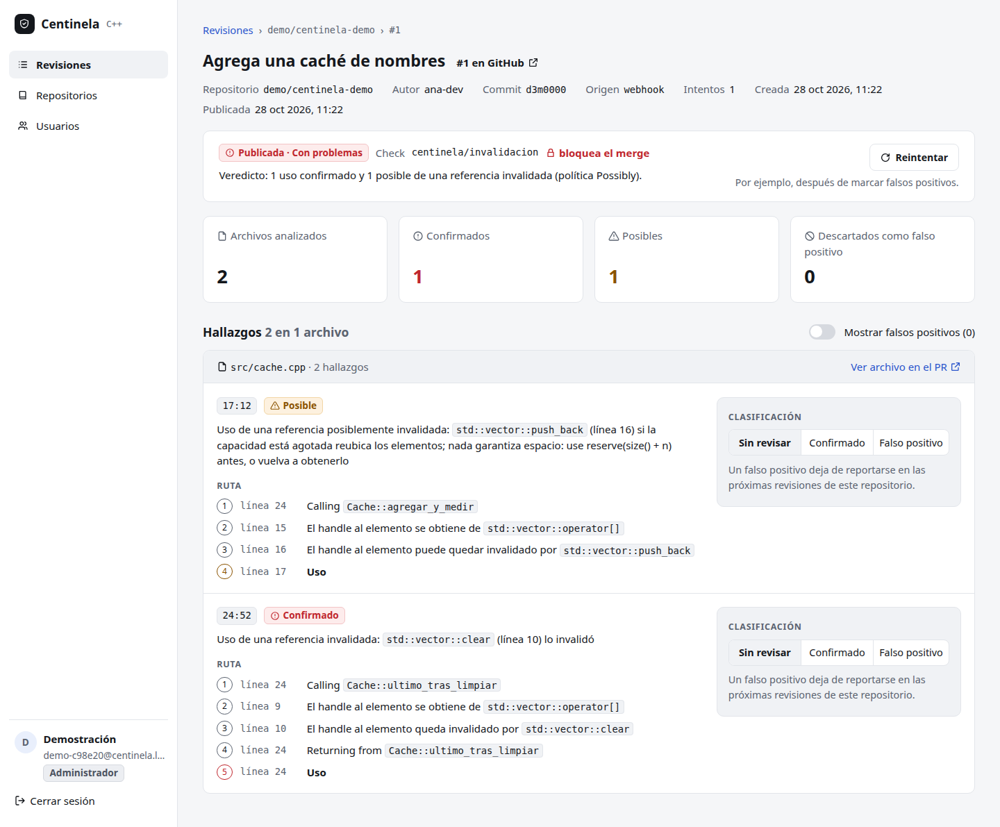
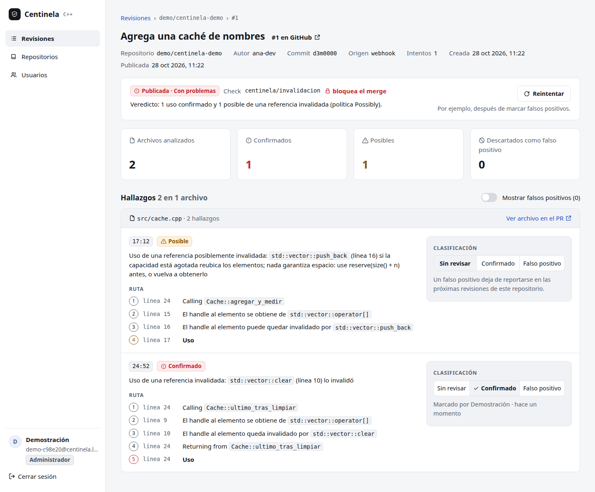
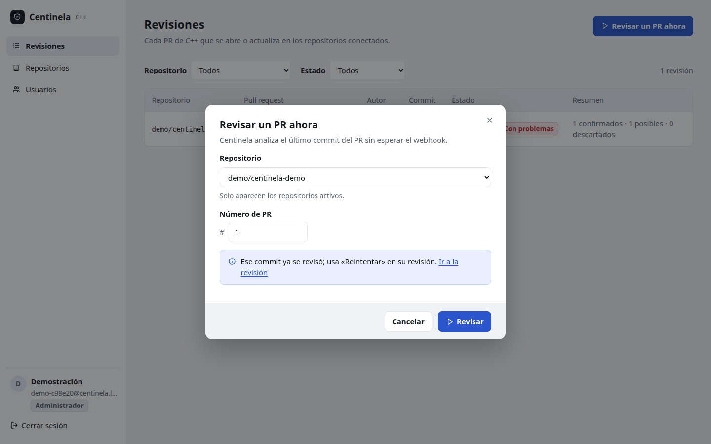
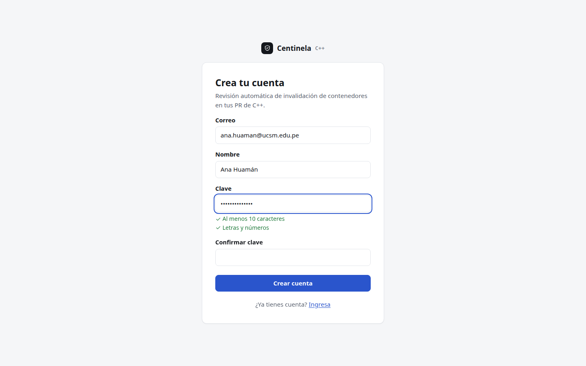
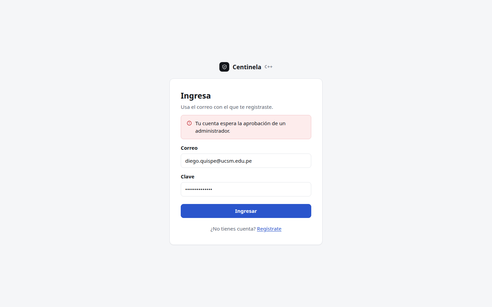
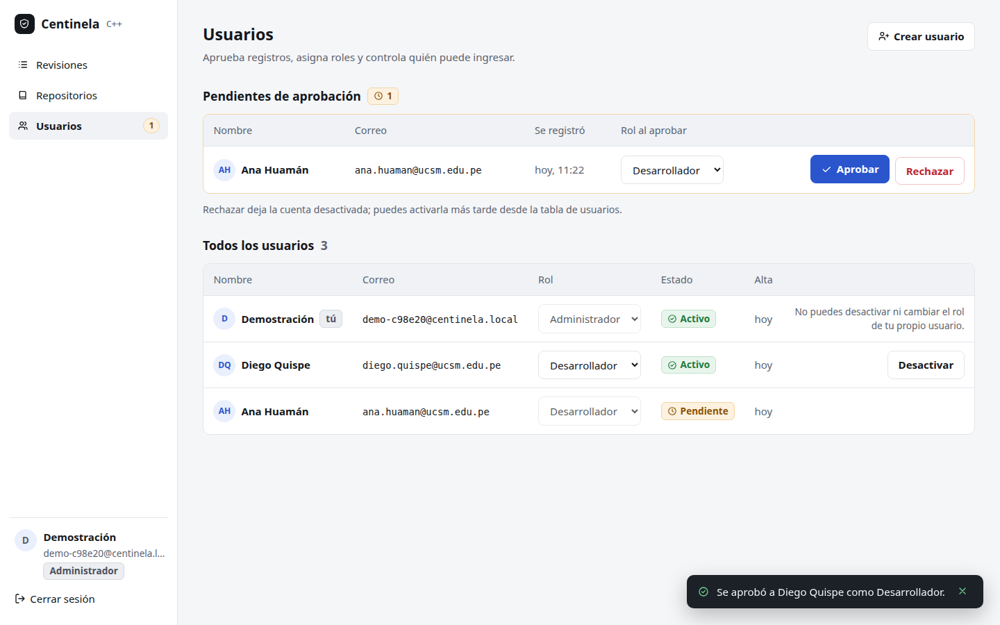
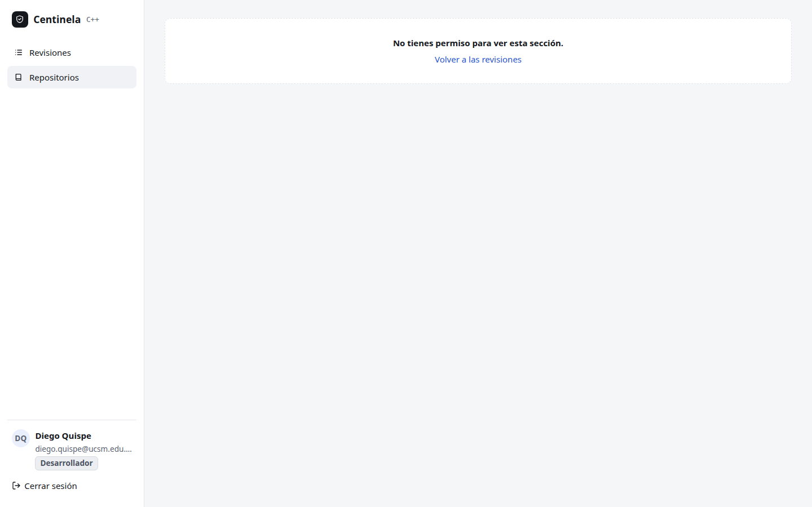

# 8.2 Pruebas funcionales

Las pruebas funcionales comprueban que el sistema hace lo que piden los
requisitos RF-S01 a RF-S05 y los casos de uso CU-S01 a CU-S07. Van de lo más
pequeño (una función) a lo más grande (una persona usando el panel en un
navegador, con un análisis real de `clang`).

Resultado de la corrida completa dentro de la imagen
(`docker compose run --rm sistema-pruebas`, 28-10-2026): **155 pruebas del
servicio en 20 archivos y 124 del panel en 9 archivos, 279 en verde, 0
fallidas**. Fuera de Docker se omite una (la que necesita `clang` 21 y el
plugin).

## 8.2.1 Pruebas unitarias

Prueban una unidad (una función o un tipo) sin nada externo: sin red, sin base
de datos, sin reloj. El dominio del servicio y el del panel son funciones
puras, así que casi todo se prueba así.

| Unidad | Archivo | Pruebas | Qué comprueba |
|---|---|---|---|
| Valores del núcleo | `kernel/src/valores.test.ts` | 4 | correo, texto acotado, positivo, identificadores |
| Garantías de tipos | `*/garantias.test.ts` | 4 | transiciones que **no deben compilar** (por ejemplo, publicar una revisión que no está en análisis) |
| Identidad | `contextos/identidad/src/identidad.test.ts` | 15 | registro, aprobación, roles, sesiones, política de claves |
| Repositorios | `contextos/repositorios/src/repositorios.test.ts` | 5 | conectar, configurar, desconectar |
| Revisiones | `contextos/revisiones/src/revisiones.test.ts` | 18 | estados de la revisión, veredicto, huella, supresión, estado del commit |
| Lectura de `clang` | `adaptadores/analizador/src/salida.test.ts` | 3 | traducir la salida de `clang` a avisos |
| Diff de GitHub | `adaptadores/github/src/parche.test.ts` | 2 | qué líneas cambió el PR |
| Configuración | `app/src/configuracion.test.ts` | 2 | variables de entorno válidas e inválidas |
| Dominio del panel | `frontend/src/dominio/dominio.test.ts` | 28 | permisos por rol, formularios, textos, fechas en hora de Lima |
| Contraste del panel | `frontend/pruebas/contraste.test.ts` | 27 | contraste WCAG de cada par de colores, en los dos temas (8.4.5) |

## 8.2.2 Pruebas de integración

Prueban cada adaptador contra la pieza real con la que habla, una por una.

| Integración | Archivo | Pruebas | Pieza real |
|---|---|---|---|
| Almacén | `adaptadores/sqlite/src/almacen.test.ts` | 11 | SQLite: restricciones `UNIQUE` y `CHECK`, cola, transacción, migración de la versión 1 a la 3, plan de consulta |
| Criptografía | `adaptadores/cripto/src/cripto.test.ts` | 5 | `node:crypto`: scrypt, token de sesión, firma HMAC de GitHub |
| Cliente de GitHub | `adaptadores/github/src/cliente.test.ts` | 6 | un servidor HTTP local con las respuestas de la API REST v3 |
| Analizador | `adaptadores/analizador/src/clang.test.ts` | 2 | `clang` 21.1.8 y el plugin, sobre `ejemplos/prueba.cpp` |
| Casos de uso | `producto/src/casos.test.ts` | 26 | todos los puertos juntos (con dobles de GitHub y `clang`) |
| Producto con SQLite | `pruebas/producto-sqlite.test.ts` | 1 | el flujo completo sobre SQLite real |
| Adaptador HTTP del panel | `frontend/src/api/http.test.ts` | 9 | respuestas 204, 401, red caída y respuesta fuera de contrato |
| Composición | `app/src/componer.test.ts` | 1 | servidor y trabajador arrancados juntos, sin usuarios |

## 8.2.3 Pruebas funcionales del sistema

Prueban cada requisito por la puerta por la que entra una persona: la API
HTTP (con Fastify, SQLite, scrypt y HMAC reales) y las pantallas del panel
montadas contra **el servicio real** en el mismo proceso.

| Requisito | Caso de uso | Por la API (`pruebas/api.test.ts`, 20) | Por el panel (`frontend/pruebas/`, 49) |
|---|---|---|---|
| RF-S01 Acceder | CU-S01, CU-S02 | registro sin nada predefinido, aprobación, cookies, 401/403/409/429, cabeceras de seguridad | `acceso.test.tsx` (13), `usuarios.test.tsx` (10) |
| RF-S02 Repositorios | CU-S03 | conectar, configurar, desconectar; el desarrollador no ve el secreto | `repositorios.test.tsx` (7) |
| RF-S03 Revisar | CU-S04, CU-S05 | *webhook* firmado y mal firmado, ping, revisar ahora | `revisiones.test.tsx` (14) |
| RF-S04 Consultar | CU-S06 | detalle con hallazgos y su ruta | `revisiones.test.tsx` |
| RF-S05 Clasificar | CU-S07 | clasificar, reintentar, falso positivo suprimido | `revisiones.test.tsx` |
| Fallas del camino | todos | 404, JSON mal formado | `fallas.test.tsx` (5): sin red, servicio caído, respuesta inválida |

Además, `arquitectura.test.ts` (16 en el servicio, 11 en el panel) comprueba
en cada corrida que cada capa importa solo lo que le corresponde.

## 8.2.4 Pruebas de extremo a extremo

Un recorrido de extremo a extremo hace lo que haría una persona, en un
navegador real, contra el sistema completo: el panel compilado, el servidor,
SQLite, el trabajador y `clang` con el checker dentro del contenedor
(`docker compose up sistema-demo`). Cada paso tiene una aserción: si el
panel no muestra lo esperado, el recorrido falla. El script
(`no-funcionales/navegadores.ts`) cuenta además las acciones de cada tarea,
que se usan como medida de eficiencia en 8.4.5.

| Recorrido | Caso de uso | Acciones | Chrome 144 | Chromium 156 | Firefox 155 | WebKit 26.6 |
|---|---|---:|---|---|---|---|
| E2E-01 Ingreso con clave equivocada y luego correcta | CU-S01 | 5 | ✔ | ✔ | ✔ | ✔ |
| E2E-02 Ver el detalle de la revisión real y su veredicto | CU-S06 | 1 | ✔ | ✔ | ✔ | ✔ |
| E2E-03 Clasificar un hallazgo como confirmado | CU-S07 | 1 | ✔ | ✔ | ✔ | ✔ |
| E2E-04 Marcar un falso positivo: se oculta y se puede volver a mostrar | CU-S07 | 4 | ✔ | ✔ | ✔ | ✔ |
| E2E-05 Revisar ahora un PR ya revisado: enlaza la revisión existente | CU-S05 | 5 | ✔ | ✔ | ✔ | ✔ |
| E2E-06 Conectar un repositorio y obtener su *webhook* | CU-S03 | 5 | ✔ | ✔ | ✔ | ✔ |
| E2E-07 Registrarse: la cuenta queda pendiente y no puede ingresar | CU-S01 | 8 | ✔ | ✔ | ✔ | ✔ |
| E2E-08 La administración aprueba la cuenta como desarrollador | CU-S02 | 2 | ✔ | ✔ | ✔ | ✔ |
| E2E-09 El desarrollador ingresa, revisa y no puede administrar | CU-S01, CU-S06 | 1 | ✔ | ✔ | ✔ | ✔ |
| E2E-10 Cerrar sesión protege el panel | CU-S01 | 1 | ✔ | ✔ | ✔ | ✔ |
| E2E-11 Desconectar el repositorio de prueba | CU-S03 | 3 | ✔ | ✔ | ✔ | ✔ |

Resultado: **44 de 44** (11 recorridos en 4 motores). WebKit se ejecutó dentro
de la imagen oficial `mcr.microsoft.com/playwright:v1.63.0-noble`, porque la
máquina anfitriona no tiene las bibliotecas que pide (`libevent`, `libavif`).
Los datos de cada paso, con su tiempo, están en
`resultados/navegadores.json` y `resultados/navegadores-webkit.json`.

## 8.2.5 Pruebas de aceptación

Una prueba de aceptación responde si el sistema sirve para lo que el cliente
pidió. Aquí cada caso de uso tiene su criterio «dado, cuando, entonces»
(capítulo 5.1) y cada criterio está automatizado en algún nivel de los
anteriores.

| Caso de uso | Dado | Cuando | Entonces | Evidencia | Estado |
|---|---|---|---|---|---|
| CU-S01 Registrarse e iniciar sesión | una instancia nueva | alguien se registra; luego otro | el primero administra y entra; el segundo queda pendiente y no entra | `api.test.ts`, `acceso.test.tsx`, E2E-07, E2E-01 | aceptado |
| CU-S02 Aprobar y gestionar usuarios | un registro pendiente | la administración lo aprueba como desarrollador | puede entrar con ese rol y no ve «Usuarios» | `usuarios.test.tsx`, E2E-08, E2E-09 | aceptado |
| CU-S03 Conectar un repositorio | la administración | conecta `dueño/nombre` | ve la URL y el secreto del *webhook*; el desarrollador no ve el secreto | `api.test.ts`, `repositorios.test.tsx`, E2E-06, seguridad 8.4.6 | aceptado |
| CU-S04 Revisar un PR automáticamente | un PR con un uso inválido en una línea cambiada | GitHub envía el *webhook* firmado | se comenta la línea y el commit queda en `failure`; con firma mala, 401 | `casos.test.ts`, demostración (2 comentarios, `failure`), estrés 8.4.2 (50 de 50 publicadas) | aceptado |
| CU-S05 Solicitar o reintentar | una revisión ya publicada de ese commit | se pide revisar el mismo PR | se rechaza y se enlaza la existente; una fallida se reintenta | `revisiones.test.tsx`, E2E-05 | aceptado |
| CU-S06 Consultar revisiones y hallazgos | una revisión publicada | se abre su detalle | trae cada hallazgo con archivo, línea, clase, mensaje y ruta | `api.test.ts`, E2E-02, CP-11 | aceptado |
| CU-S07 Clasificar un hallazgo | un hallazgo marcado como falso positivo | se reintenta la revisión | queda suprimido y el veredicto pasa a aprobada | `casos.test.ts`, `revisiones.test.tsx`, E2E-04, CP-12 | aceptado |

Estas son pruebas de aceptación **automatizadas, escritas por el equipo**. No
hubo una sesión de aceptación con un cliente externo: queda como el paso
previo a poner el servicio en producción (8.4.5).

## 8.2.6 Pruebas de regresión y de humo

**Regresión.** Cada *push* a `main` y cada *pull request* corre en GitHub
Actions (`.github/workflows/ci.yml`) las mismas pruebas, en la misma imagen:
plugin y gtests, banco del checker con su regla de regresión, las 279 pruebas
de Centinela, la demostración de punta a punta y las 41 comprobaciones de
seguridad contra el servicio en marcha. Si una falla, la construcción
falla. Las correcciones de este capítulo entraron cada una con la prueba que
impide que vuelva: el índice por fecha con el plan de consulta
(`almacen.test.ts`), las cabeceras de seguridad (`api.test.ts`) y el contraste
de los colores (`contraste.test.ts`).

**Humo.** La prueba de humo responde rápido si vale la pena seguir probando:
`GET /salud` responde `{"ok":true}` y la demostración
(`demo/demostrar.ts --salir`) registra una cuenta, conecta un repositorio,
recibe un *webhook* firmado, analiza con `clang` y publica dos comentarios y
el estado `failure`. Si eso no pasa, no se corre nada más.

**Exploratorias.** Al tomar las capturas y correr los recorridos se probó el
panel a mano, sin guion. Así aparecieron, antes de esta corrida, las celdas
de la tabla que partían el código del commit y las insignias en dos líneas, y
el correo largo que desbordaba el menú lateral; se corrigieron en el CSS.
