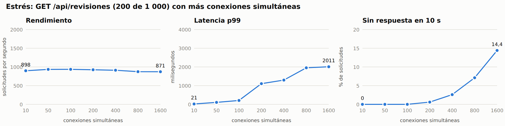
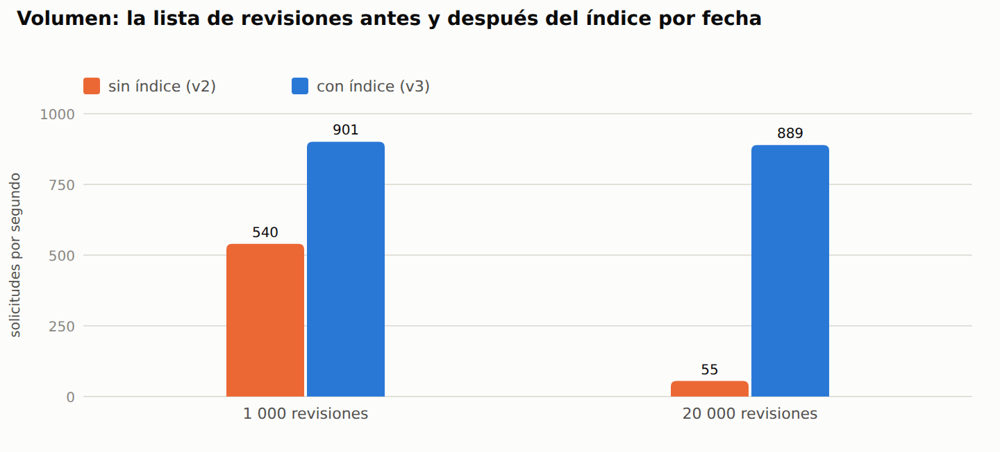
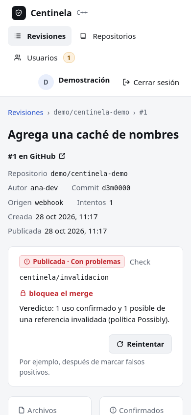
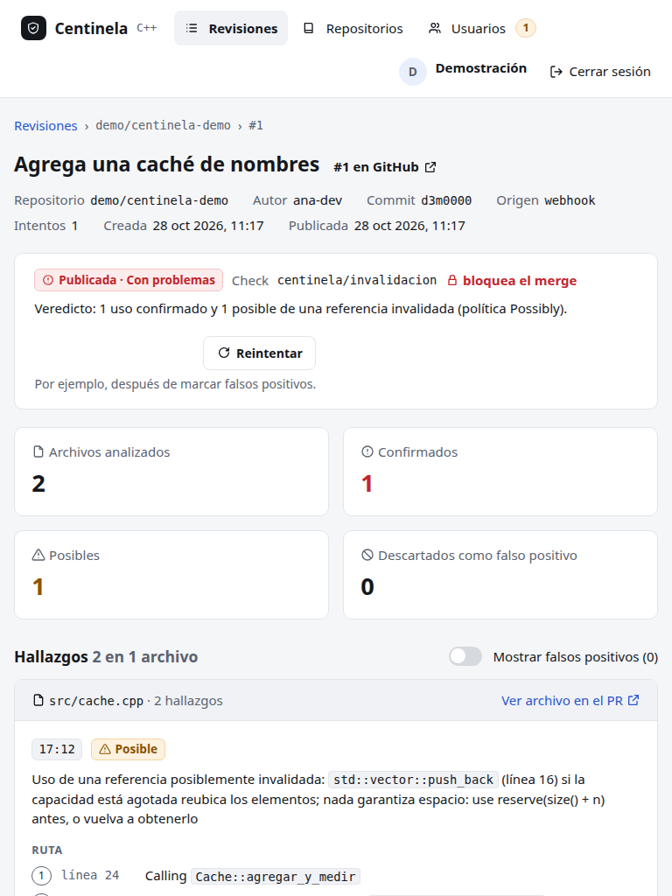
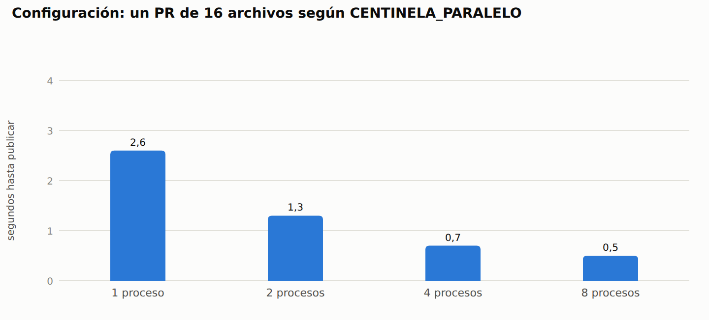

# 8.4 Pruebas no funcionales

Las pruebas no funcionales miden **cómo** se comporta el sistema, no qué
hace; se organizan por las características de calidad de ISO/IEC 25010
(International Organization for Standardization e International
Electrotechnical Commission, 2011): eficiencia, compatibilidad, usabilidad y
seguridad. Todas corren contra el servicio en marcha, desde fuera y por HTTP:
`no-funcionales/medir.ts` arranca para cada escenario un Centinela nuevo en
un proceso aparte, con su propia base SQLite en archivo, `clang` y el checker
reales, y un GitHub simulado (`github-varios.ts`) que sirve tantos *pull
requests* como haga falta. El generador de carga es autocannon 8.0.0. Cada
cifra de esta sección sale de `sistema/no-funcionales/resultados/*.json` del
28-10-2026, en la máquina de 8.1.

## 8.4.1 Pruebas de carga

**Objetivo.** Medir el rendimiento con el uso esperado: un equipo que tiene
el panel abierto (el panel vuelve a pedir la lista cada 3 segundos mientras
hay revisiones en curso) y GitHub que avisa de cada PR.

**Diseño.** 20 conexiones simultáneas sostenidas durante 20 segundos contra
cada ruta, con una base de 1 000 revisiones y 5 000 hallazgos. Criterio de
aceptación (RNF-S07): p99 menor que 200 ms y ninguna respuesta de error.

| Ruta | Solicitudes por segundo | p50 | p90 | p99 | Máximo | Solicitudes | Errores |
|---|---:|---:|---:|---:|---:|---:|---:|
| `GET /salud` | 87 936 | 0 ms | 0 ms | 0 ms | 16 ms | 1 758 513 | 0 |
| `GET /api/sesion` | 41 802 | 0 ms | 0 ms | 1 ms | 7 ms | 836 062 | 0 |
| `GET /api/revisiones` (las 200 más recientes) | 823 | 22 ms | 30 ms | 45 ms | 217 ms | 16 457 | 0 |
| `GET /api/revisiones/:id` (5 hallazgos) | 12 484 | 1 ms | 2 ms | 3 ms | 49 ms | 249 645 | 0 |
| `GET /api/repositorios` | 32 656 | 0 ms | 0 ms | 1 ms | 7 ms | 653 162 | 0 |
| `GET /` (panel web) | 14 709 | 1 ms | 2 ms | 3 ms | 12 ms | 294 171 | 0 |

**Resultado.** Aceptado: la ruta más lenta, la lista de revisiones, tiene un
p99 de 45 ms. 823 listas por segundo equivalen a unas 2 400 personas con el
panel abierto pidiendo la lista cada 3 segundos. Memoria residente del
servicio al terminar: 296 MB.

## 8.4.2 Pruebas de estrés

**Objetivo.** Encontrar el punto en que el servicio se satura y comprobar
qué pasa después: si se cae, si pierde datos o si solo se vuelve lento.

**Diseño.** Tres partes: (a) la lista de revisiones con 10, 50, 100, 200,
400, 800 y 1 600 conexiones simultáneas, 10 segundos cada escalón, con un
tiempo de espera de 10 s por solicitud; (b) el ingreso, que usa scrypt a
propósito para encarecer la fuerza bruta, con 20 conexiones; (c) una ráfaga
de **50 PR abiertos a la vez**, cada uno analizado de verdad por `clang` y el
checker.

| Conexiones | Solicitudes por segundo | p50 | p99 | Sin respuesta en 10 s |
|---:|---:|---:|---:|---:|
| 10 | 898 | 9 ms | 21 ms | 0 |
| 50 | 935 | 51 ms | 104 ms | 0 |
| 100 | 936 | 103 ms | 208 ms | 0 |
| 200 | 924 | 105 ms | 1 106 ms | 58 (0,6 %) |
| 400 | 912 | 102 ms | 1 297 ms | 244 (2,6 %) |
| 800 | 874 | 94 ms | 1 954 ms | 671 (7,1 %) |
| 1 600 | 871 | 96 ms | 2 011 ms | 1 470 (14,4 %) |

**Resultado.**

- El servicio se **satura en unas 930 solicitudes por segundo** de la lista,
  a partir de 50 conexiones: desde ahí, más conexiones solo alargan la cola.
  Es un solo proceso de Node.js, y la lista (validar y serializar 200 filas)
  ocupa la CPU 1,1 ms por solicitud.
- Desde **200 conexiones simultáneas** algunas solicitudes esperan más de
  10 s (0,6 % con 200, 14,4 % con 1 600). El rendimiento no se desploma
  (871 por segundo con 1 600) y el servicio **no se cayó**: siguió
  respondiendo y la prueba siguiente corrió sobre él.
- El ingreso aguanta **122 por segundo** (p50 146 ms): scrypt está calibrado
  para costar, y además a los 10 fallos el correo se bloquea (8.4.6).
- Ráfaga de 50 PR: los 50 *webhooks* se respondieron con **202 en 77 ms en
  total** (p99 de 77 ms), sin esperar el análisis (RNF-S03). Las **50
  revisiones se publicaron** (0 fallidas) en 9 s: 337 revisiones por minuto.
  GitHub recibió 50 revisiones con comentarios y 150 estados de commit
  (`pending` «En cola», `pending` «Analizando» y el final). Memoria máxima:
  244 MB.

Límite conocido: para más de unas 200 personas pidiendo a la vez hace falta
más de un proceso; como SQLite no se comparte entre réplicas, el camino es
PostgreSQL detrás del mismo adaptador (decisión ya prevista en 7.2).

## 8.4.3 Pruebas de volumen

**Objetivo.** Ver cómo responde con mucha información guardada y con PR
grandes.

**Diseño.** Tres bases sembradas por los puertos del almacén (no por SQL a
mano): vacía; 1 000 revisiones con 5 500 hallazgos; y **20 000 revisiones
con 100 500 hallazgos**, más una revisión con 500 hallazgos. Sobre cada una,
10 conexiones durante 10 s. Después, PR reales de 1, 10 y 40 archivos C++.

| Base | Hallazgos | Tamaño | Sembrar | Lista: sol/s | Lista p99 | Detalle de 500 hallazgos: sol/s | p99 | Memoria |
|---|---:|---:|---:|---:|---:|---:|---:|---:|
| vacía | 0 | 0,2 MB | — | 19 955 | 1 ms | — | — | 225 MB |
| 1 000 revisiones | 5 500 | 2,8 MB | 0,1 s | 901 | 22 ms | 354 | 52 ms | 195 MB |
| 20 000 revisiones | 100 500 | 55 MB | 1,4 s | 889 | 22 ms | 353 | 52 ms | 214 MB |

**Hallazgo y corrección.** La primera corrida dio, con 20 000 revisiones,
**55 listas por segundo y un p99 de 344 ms**, diez veces peor que con 1 000.
La causa: la lista general («las 200 más recientes de todos los
repositorios») no tenía índice por fecha, así que SQLite recorría y ordenaba
la tabla entera en cada solicitud. Se agregó el índice
`revisiones(creada_en DESC)` como **versión 3 del esquema**, con su
migración (una base existente lo recibe al abrirse) y una prueba que exige
que el plan de consulta use el índice. Con la versión 3, la lista responde
igual con 20 000 revisiones que con 1 000.

| Tamaño del PR | Hallazgos | Tiempo hasta publicar | Estado |
|---:|---:|---:|---|
| 1 archivo | 2 | 0,2 s | publicada |
| 10 archivos | 20 | 0,6 s | publicada |
| 40 archivos | 80 | 1,7 s | publicada |

La lista devuelve como máximo 200 revisiones, el detalle con 500 hallazgos
pesa 172 KB, y un cuerpo de 6 MB (el límite es 5 MB) se rechaza con **413**
sin procesarlo. Criterio RNF-S08 (con 20 000 revisiones y 100 000 hallazgos,
p99 de la lista menor que 500 ms): aceptado, 22 ms.

## 8.4.4 Pruebas de configuración

**Objetivo.** Comprobar que el sistema funciona igual en las configuraciones
en que se va a usar: navegadores y motores distintos, pantallas de celular,
tableta y escritorio, tema claro y oscuro, y los ajustes del propio servicio.

**Navegadores, pantallas y temas.** En cada navegador se recorrieron los 11
casos de 8.2.4 y, después, cada pantalla (Revisiones, Repositorios, Usuarios
y el detalle) en 390 × 844 (celular), 768 × 1024 (tableta) y 1440 × 900
(escritorio), en tema claro y oscuro: 24 combinaciones por navegador. En cada
una se exige que la página no tenga desplazamiento horizontal y que el título
esté visible.

Tabla: Compatibilidad por navegador, tamaño de pantalla y tema

| Navegador | Motor | Versión | Recorridos E2E | Pantallas × tamaños × temas |
|---|---|---|---|---|
| Google Chrome | Blink | 144.0.7559.132 | 11 de 11 | 24 de 24 |
| Chromium | Blink | 156.0.8078.47 | 11 de 11 | 24 de 24 |
| Firefox | Gecko | 155.0 | 11 de 11 | 24 de 24 |
| WebKit (motor de Safari) | WebKit | 26.6 | 11 de 11 | 24 de 24 |

**Hallazgo y corrección.** La primera corrida dio 22 de 24 en los motores
Blink: la pantalla Usuarios, en el celular, tenía **110 px de desplazamiento
horizontal**. La tabla estaba dentro de una caja con desplazamiento propio,
pero los rótulos ocultos para lectores de pantalla de sus celdas
(`.solo-lector`, con posición absoluta) se ubicaban respecto de la página y
no de la caja. Se corrigió con `position: relative` en `.tabla-caja`.

**Ajustes del servicio.**

| Ajuste | Valores | Resultado |
|---|---|---|
| `CENTINELA_PARALELO` (archivos que `clang` analiza a la vez), PR de 16 archivos | 1, 2, 4, 8 | 2,6 s, 1,3 s, 0,7 s y 0,5 s; los 32 hallazgos en los cuatro; memoria máxima entre 154 y 162 MB |
| Política del repositorio, el mismo PR | `Possibly`, `Silent` | `Possibly`: 16 confirmados y 16 posibles; `Silent`: los 16 confirmados y ningún posible |
| `CENTINELA_TIEMPO_MAXIMO_S` = 5, con 1 proceso y 40 archivos | — | la revisión tardó 6,5 s en total y se publicó: el límite es **por archivo** (cada invocación de `clang`), no por revisión |
| `CENTINELA_COOKIE_SEGURA` | `true`, `false` | con `true` la cookie lleva `Secure` (`api.test.ts`) |

El valor por defecto, 4, ya da casi todo lo que se gana: de 4 a 8 procesos
la revisión baja solo de 0,7 s a 0,5 s.

## 8.4.5 Pruebas de usabilidad

La usabilidad se evaluó con los cinco atributos de Nielsen (1993)
(aprendizaje, eficiencia, memorización, errores y satisfacción). Se midió lo que se puede
medir sin personas (accesibilidad, número de acciones por tarea, manejo de
errores) y se dejó dicho lo que necesita personas reales.

**Accesibilidad (WCAG 2.1 AA).** Las pautas de accesibilidad del W3C (World
Wide Web Consortium, 2018) piden, entre otras cosas, un contraste de 4,5:1
para el texto y no depender solo del color. axe-core 4.13.0 auditó las 7 pantallas
(ingreso, registro, revisiones, repositorios, usuarios, detalle de una
revisión y el diálogo del *webhook*) en los dos temas, con las reglas
`wcag2a`, `wcag2aa`, `wcag21a` y `wcag21aa`.

| Corrida | Violaciones | Reglas aprobadas por pantalla |
|---|---|---|
| Primera | **10**: 6 de `color-contrast` (el botón primario del tema oscuro, blanco sobre `#5b82f0`: 3,56:1) y 4 de `link-in-text-block` (los enlaces dentro de un texto solo se distinguían por el color) | — |
| Segunda | **1** de `color-contrast`: con el botón ya corregido, el enlace «Ver archivo en el PR» del tema oscuro, sobre `--superficie-2`, quedó en 4,43:1 | — |
| Tercera | **0** en las 14 auditorías | entre 19 y 27 |

Se corrigió el color primario del tema oscuro (`#6b8ff2`, con texto oscuro
encima: 6,1:1) y se subrayaron los enlaces dentro de un texto. Para que no
vuelva, `contraste.test.ts` calcula el contraste de los 13 pares de colores
que el panel usa, en los dos temas, y exige 4,5:1.

**Eficiencia y aprendizaje.** Acciones (clics y campos llenados) que pide
cada tarea, contadas por el recorrido E2E; el tiempo es el de la máquina, no
el de una persona.

| Tarea | Acciones | Tiempo en Chrome |
|---|---:|---:|
| Ingresar (con un error de clave en medio) | 5 | 0,4 s |
| Abrir el detalle de una revisión desde la lista | 1 | 0,1 s |
| Clasificar un hallazgo | 1 | < 0,1 s |
| Pedir la revisión de un PR | 3 | 0,2 s |
| Conectar un repositorio y quedarse con su *webhook* | 4 | 0,3 s |
| Aprobar un registro | 1, desde la sección Usuarios | 0,1 s |

**Revisión heurística (Nielsen, 1994).**

| Heurística | Cómo la cumple el panel |
|---|---|
| Visibilidad del estado | insignia de estado en cada revisión; «Se actualiza sola» mientras hay revisiones en curso; contador de registros por aprobar en el menú |
| Coincidencia con el mundo real | habla de *pull requests*, commits, líneas y archivos; los hallazgos se agrupan por archivo, como en GitHub |
| Control y libertad | `Escape` cierra cualquier ventana; un falso positivo se puede volver a «Sin revisar»; desconectar pide confirmación |
| Consistencia | los mismos tokens de color, botones e insignias en todas las pantallas (capítulo 6) |
| Prevención de errores | cada formulario valida antes de enviar y muestra todos los errores juntos; las reglas de la clave se marcan mientras se escribe |
| Reconocer antes que recordar | el menú muestra solo lo que el rol permite; el secreto del *webhook* se copia con un botón |
| Flexibilidad | acepta la URL de GitHub o `dueño/nombre`; acepta `#12` o `12` como número de PR |
| Diseño minimalista | una tarea por pantalla; el detalle técnico (la ruta del defecto) va dentro de cada hallazgo |
| Ayuda ante los errores | cada error dice qué pasó y qué hacer («Ese commit ya se revisó», con el enlace); sin red, ofrece «Reintentar» |
| Ayuda y documentación | los pasos para pegar el *webhook* en GitHub aparecen al conectar el repositorio |

**Lo que falta: personas reales.** No se hizo todavía una prueba con
usuarios, así que la **satisfacción** y la **memorización** no están
medidas. El protocolo previsto: 5 desarrolladores de C++ (con cinco personas se
encuentra la mayoría de los problemas; Nielsen y Landauer, 1993), las 6 tareas de la
tabla de eficiencia sin ayuda, midiendo el tiempo y los errores de cada una,
y el cuestionario SUS al final (Brooke, 1996; meta: 68 o más); la memorización se mide
repitiendo las tareas una semana después.

## 8.4.6 Pruebas de seguridad

**Diseño.** `medir.ts seguridad` ataca al servicio en marcha con 41
comprobaciones, agrupadas por las cinco propiedades que pide la práctica.
Corre también en el CI, de modo que una propiedad que se rompa hace fallar
la construcción.

| Propiedad | Comprobación | Esperado | Obtenido |
|---|---|---|---|
| Autenticación | las 7 rutas protegidas (`GET`/`POST`/`PATCH`/`DELETE`) sin sesión | 401 | 401 en las 7 |
| Autenticación | una cookie de sesión inventada | 401 | 401 |
| Autenticación | clave equivocada | 401 | 401 |
| Autenticación | 11 claves equivocadas seguidas para el mismo correo (fuerza bruta) | 429 | 429 |
| Autenticación | la cookie de sesión es `HttpOnly` y `SameSite=Strict` | sí | sí |
| Autenticación | la sesión cerrada ya no sirve | 401 | 401 |
| Autorización | una cuenta pendiente no puede ingresar | 403 | 403 |
| Autorización | el desarrollador lee revisiones | 200 | 200 |
| Autorización | el desarrollador lista usuarios, conecta un repositorio, cambia la política o se hace administrador | 403 | 403 en las 4 |
| Autorización | al desactivar una cuenta, su sesión abierta deja de servir | 401 | 401 |
| Integridad | *webhook* sin firma, con la firma de otro secreto, o con el cuerpo alterado después de firmar | 401 | 401 en los 3 |
| Integridad | *webhook* bien firmado; el mismo repetido no duplica la revisión | 202; 200 | 202; 200 |
| Integridad | inyección SQL en el nombre del repositorio y en el id de la revisión; política desconocida; tipos equivocados; JSON mal formado | 400 | 400 en los 5 |
| Integridad | la tabla `usuarios` sigue ahí después de la inyección | 200 | 200 |
| Integridad | un cuerpo de 6 MB (límite 5 MB) | 413 | 413 |
| Integridad | política de contenido (`default-src 'self'`), `X-Frame-Options: DENY` y `X-Content-Type-Options: nosniff` | presentes | presentes |
| Confidencialidad | ninguna respuesta incluye el hash ni la clave; un desarrollador no ve el secreto del *webhook* | no | no |
| Confidencialidad | un título de PR con HTML (``) se guarda y se devuelve como texto; el panel no lo interpreta, porque React escapa el texto y una prueba de aptitud prohíbe `dangerouslySetInnerHTML` | texto | texto |
| Confidencialidad | un error no expone rutas del servidor ni trazas | no | no |
| Disponibilidad | `GET /salud` después de todos los ataques | 200 | 200 |

Resultado: **41 de 41**. La disponibilidad bajo carga extrema está en 8.4.2:
con 1 600 conexiones el servicio se vuelve lento pero no se cae.

**Hallazgo y corrección.** La primera corrida mostró que las respuestas no
llevaban cabeceras de seguridad. Se agregaron a toda respuesta
(`CABECERAS_SEGURIDAD` en el adaptador HTTP): una política de contenido que
solo permite recursos del propio servicio y prohíbe enmarcar el panel,
`nosniff`, `Referrer-Policy: no-referrer` y `Cross-Origin-Opener-Policy`.
La política funciona: al auditar con axe hubo que permitirlo explícitamente,
porque la página rechazó el script inyectado.

**Dependencias.** `npm audit --omit=dev` (lo que se ejecuta en producción):
**0 vulnerabilidades**. En las herramientas de desarrollo hay 7 avisos (2
críticos en `vitest` 3.2.7 y su `tinypool`; 5 moderados, entre ellos `uuid`
dentro de autocannon). Afectan a quien corre las pruebas, no al servicio,
pero la imagen las incluye porque las pruebas corren dentro: se actualizará
a `vitest` 4 en el próximo incremento, que es un cambio de versión mayor.
