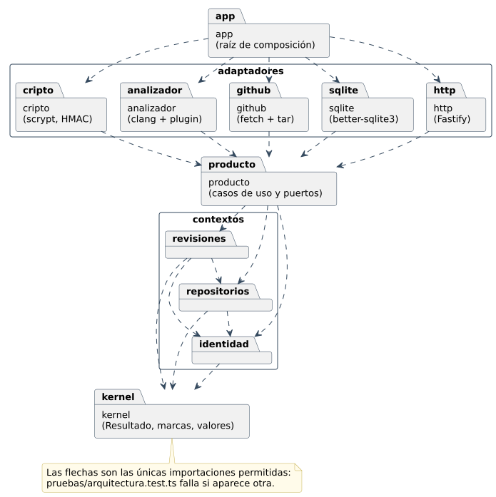

# Arquitectura: las guías de diseño en TypeScript

El motor se diseñó con cuatro guías (`bodega-arquitectura`, `rust-trinity`,
`modelado-funcional` y `donde-va`), escritas para Rust y llevadas a C++.
El servicio usa las mismas, llevadas a TypeScript. Esta tabla dice qué se
tradujo y cómo:

| Guía | En Rust | En el servicio (TypeScript) |
|---|---|---|
| Frontera por *crate* | un *crate* por capa; Cargo no deja importar lo que no está en `Cargo.toml` | un paquete npm (*workspace*) por capa, y una **prueba de aptitud** que lee las importaciones y falla si una capa importa lo que no debe |
| Cargar → decidir → efectos | el caso de uso lee, llama a una función pura y aplica efectos | igual: `casos-*.ts` lee del `Almacen`, llama a `solicitar`, `publicar`… y después guarda y llama a GitHub |
| Testigo de autorización | `Authorized<A>` con constructor privado | `Autorizado<P>`: clase con constructor privado y campo `#permiso`, que la vuelve nominal |
| `TryFrom` en las fronteras | conversión que puede fallar | esquemas `zod` en la entrada HTTP y en cada fila de la base |
| Errores en tres niveles | `enum` de dominio, de aplicación y de infraestructura | `ErrorIdentidad`, `ErrorRepositorios`, `ErrorRevisiones` → `ErrorProducto`; las excepciones quedan para infraestructura rota (`FilaCorrupta`, `ErrorGitHub`) |
| El código HTTP en un solo lugar | `IntoResponse` del adaptador | `adaptadores/http/src/errores.ts`, con un `switch` exhaustivo |
| Sin repositorio genérico | un puerto por necesidad | `Usuarios`, `Sesiones`, `Repositorios`, `Revisiones`, `Hallazgos`, `Descartes`, `Trabajos` |
| Unidad de trabajo y *outbox* | transacción + tabla de trabajos | `almacen.transaccion(...)`; la revisión y su trabajo se escriben juntos |
| Tipos que impiden errores | *newtypes*, `enum`, *type-state* | [Tipos que impiden errores](tipos.md) |



## La frontera, comprobada

[`sistema/pruebas/arquitectura.test.ts:17`](https://github.com/jasrod12ucsm/checker/blob/main/sistema/pruebas/arquitectura.test.ts#L17-L34)

```typescript
const DOMINIO = ["kernel", "identidad", "repositorios", "revisiones"];
const CAPAS: Record<string, Capa> = {
  kernel: { paquetes: ["kernel"], internos: [], externos: [] },
  identidad: { paquetes: ["contextos/identidad"], internos: ["kernel"], externos: [] },
  repositorios: { paquetes: ["contextos/repositorios"], internos: ["kernel", "identidad"], externos: [] },
  revisiones: { paquetes: ["contextos/revisiones"], internos: ["kernel", "identidad", "repositorios"], externos: [] },
  producto: { paquetes: ["producto"], internos: DOMINIO, externos: [] },
  sqlite: { paquetes: ["adaptadores/sqlite"], internos: [...DOMINIO, "producto"], externos: ["better-sqlite3", "zod", "node:fs"] },
  cripto: { paquetes: ["adaptadores/cripto"], internos: [...DOMINIO, "producto"], externos: ["node:crypto"] },
  github: {
    paquetes: ["adaptadores/github"],
    internos: [...DOMINIO, "producto"],
    externos: ["zod", "node:child_process", "node:fs/promises", "node:os", "node:path", "node:stream", "node:stream/promises", "node:stream/web"],
  },
  analizador: { paquetes: ["adaptadores/analizador"], internos: [...DOMINIO, "producto"], externos: ["node:child_process", "node:fs", "node:path"] },
  http: { paquetes: ["adaptadores/http"], internos: [...DOMINIO, "producto"], externos: ["fastify", "@fastify/cookie", "@fastify/static", "zod"] },
  app: { paquetes: ["app"], internos: [...DOMINIO, "producto", "sqlite", "cripto", "github", "analizador", "http"], externos: ["zod", "node:fs", "node:path", "node:crypto"] },
};
```

Si un contexto importa `fastify`, la prueba falla con el archivo y la
importación culpables.

## Cargar → decidir → efectos

El caso de uso de clasificar, entero: carga el hallazgo, decide con
`clasificar` (pura) y aplica los efectos en una transacción.

[`sistema/paquetes/producto/src/casos-revisiones.ts:240`](https://github.com/jasrod12ucsm/checker/blob/main/sistema/paquetes/producto/src/casos-revisiones.ts#L240-L253)

```typescript
    async clasificar(actor: Usuario, id: HallazgoId, nueva: Clasificacion): R<Hallazgo> {
      const por = autorizar(actor, "clasificar-hallazgos");
      if (!por.ok) return por;
      return a.transaccion(() => {
        const h = encontrado(a.hallazgos.porId(id), { tipo: "HallazgoNoEncontrado" });
        if (!h.ok) return h;
        const rev = a.revisiones.porId(h.valor.revisionId)!;
        const c = clasificar(por.valor, h.valor, nueva, d.reloj.ahora());
        a.hallazgos.guardar(c.hallazgo);
        if (c.descarte === "agregar") a.descartes.agregar(rev.repositorioId, c.hallazgo.huella, actor.id, d.reloj.ahora());
        if (c.descarte === "quitar") a.descartes.quitar(rev.repositorioId, c.hallazgo.huella);
        return ok<Hallazgo>(c.hallazgo);
      });
    },
```

## Un solo lugar para los códigos HTTP

[`sistema/paquetes/adaptadores/http/src/errores.ts:10`](https://github.com/jasrod12ucsm/checker/blob/main/sistema/paquetes/adaptadores/http/src/errores.ts#L10-L55)

```typescript
export function respuestaDe(e: ErrorProducto): Respuesta {
  switch (e.tipo) {
    case "ValorInvalido":
      return { estado: 400, mensaje: `El campo ${e.campo} ${e.motivo}.` };
    case "ClaveDebil":
      return { estado: 400, mensaje: `La clave ${e.motivo}.` };
    case "CredencialesInvalidas":
      return { estado: 401, mensaje: "Correo o clave incorrectos." };
    case "SesionInvalida":
      return { estado: 401, mensaje: "La sesión no es válida o venció. Vuelve a iniciar sesión." };
    case "FirmaInvalida":
      return { estado: 401, mensaje: "La firma del webhook no corresponde al secreto del repositorio." };
    case "UsuarioPendiente":
      return { estado: 403, mensaje: "Tu cuenta espera la aprobación de un administrador." };
    case "UsuarioDesactivado":
      return { estado: 403, mensaje: "Tu cuenta está desactivada: pide a un administrador que la reactive." };
    case "SinPermiso":
      return { estado: 403, mensaje: `No tienes permiso para ${e.permiso.replace("-", " ")}.` };
    case "UsuarioNoEncontrado":
      return { estado: 404, mensaje: "El usuario no existe." };
    case "RepositorioNoEncontrado":
      return { estado: 404, mensaje: "El repositorio no está conectado." };
    case "RevisionNoEncontrada":
      return { estado: 404, mensaje: "La revisión no existe." };
    case "HallazgoNoEncontrado":
      return { estado: 404, mensaje: "El hallazgo no existe." };
    case "EmailEnUso":
      return { estado: 409, mensaje: "Ya hay un usuario con ese correo." };
    case "NoPuedeModificarseASiMismo":
      return { estado: 409, mensaje: "No puedes desactivar ni cambiar el rol de tu propio usuario." };
    case "RepositorioYaConectado":
      return { estado: 409, mensaje: "El repositorio ya está conectado." };
    case "RepositorioDesconectado":
      return { estado: 409, mensaje: "El repositorio está desconectado." };
    case "RevisionEnCurso":
      return { estado: 409, mensaje: "La revisión de ese commit está en curso." };
    case "ShaYaRevisado":
      return { estado: 409, mensaje: "Ese commit ya se revisó; usa «Reintentar» en su revisión." };
    case "TransicionInvalida":
      return { estado: 409, mensaje: `Una revisión ${e.desde} no puede pasar a ${e.hacia}.` };
    case "ErrorGitHub":
      return { estado: 502, mensaje: `GitHub no respondió como se esperaba: ${e.detalle}` };
    default:
      return inalcanzable(e);
  }
}
```

El `default` llama a `inalcanzable(e)`, que recibe `never`: si se agrega un
error al dominio y no se le da un código aquí, el proyecto no compila.

## La raíz de composición

`app/src/componer.ts` es el único archivo que conoce todos los adaptadores.
Las pruebas pasan sus propios dobles con el segundo argumento.

[`sistema/paquetes/app/src/componer.ts:19`](https://github.com/jasrod12ucsm/checker/blob/main/sistema/paquetes/app/src/componer.ts#L19-L82)

```typescript
export function componer(c: Configuracion, sobre: Partial<Dependencias> = {}) {
  if (c.CENTINELA_BD !== ":memory:") mkdirSync(dirname(c.CENTINELA_BD), { recursive: true });
  const almacen = abrirAlmacen(c.CENTINELA_BD);
  const github = clienteGitHub({ api: c.CENTINELA_GITHUB_API, token: c.CENTINELA_GITHUB_TOKEN });
  const deps: Dependencias = {
    almacen,
    claves,
    secretos,
    github,
    fuentes: github,
    analizador: analizadorClang({
      ...OPCIONES_CLANG,
      clang: c.CENTINELA_CLANG,
      plugin: c.CENTINELA_PLUGIN,
      paralelo: c.CENTINELA_PARALELO,
      tiempoMaximoMs: c.CENTINELA_TIEMPO_MAXIMO_S * 1000,
    }),
    reloj: { ahora: () => instante(Date.now()) },
    ids: { nuevo: randomUUID },
    bitacora,
    urlPublica: c.CENTINELA_URL_PUBLICA,
    ...sobre,
  };
  const p = producto(deps);
  const servidor = crearServidor(p, {
    urlPublica: c.CENTINELA_URL_PUBLICA,
    cookieSegura: c.CENTINELA_COOKIE_SEGURA,
    ...(c.CENTINELA_FRONTEND === undefined ? {} : { frontend: c.CENTINELA_FRONTEND }),
  });

  let detenido = false;
  let enCurso: Promise<void> = Promise.resolve();
  /** El trabajador: procesa la cola mientras haya trabajos; si está vacía, espera el intervalo. */
  function trabajar() {
    enCurso = (async () => {
      while (!detenido) {
        let hubo = false;
        try {
          hubo = await p.revisiones.procesarSiguiente();
        } catch (e) {
          bitacora.error("el trabajador falló", { error: String(e) });
        }
        if (!hubo) await new Promise((ok) => setTimeout(ok, c.CENTINELA_INTERVALO_MS));
      }
    })();
  }

  async function arrancar() {
    const n = p.revisiones.recuperarInterrumpidas();
    if (n > 0) bitacora.info("revisiones interrumpidas marcadas como fallidas", { n });
    await servidor.listen({ port: c.CENTINELA_PUERTO, host: c.CENTINELA_HOST });
    trabajar();
    bitacora.info("Centinela C++ escuchando", { url: c.CENTINELA_URL_PUBLICA, puerto: c.CENTINELA_PUERTO });
  }

  async function detener() {
    detenido = true;
    await servidor.close();
    await enCurso;
    almacen.cerrar();
  }

  return { producto: p, servidor, arrancar, detener };
}
```
