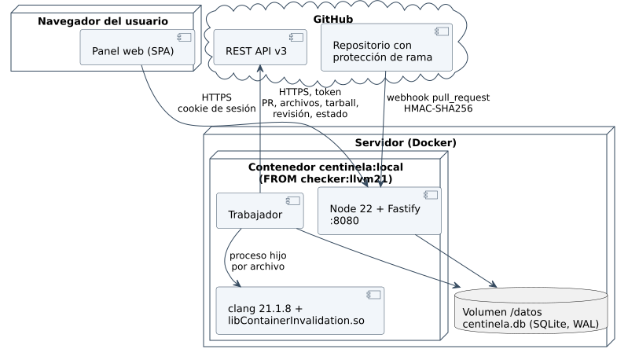

# Ponerlo en marcha con GitHub



## 1. Token de GitHub

En GitHub: *Settings → Developer settings → Fine-grained tokens*, con acceso
a los repositorios que se van a revisar y estos permisos:

| Permiso | Nivel | Para |
|---|---|---|
| Pull requests | Read and write | leer el PR y sus archivos; publicar la revisión |
| Commit statuses | Read and write | publicar `centinela/invalidacion` |
| Contents | Read-only | descargar el código del commit |

## 2. Configuración

```bash
cp sistema/.env.ejemplo sistema/.env     # y completar
docker compose build sistema
docker compose up -d sistema
```

| Variable | Por omisión | Qué es |
|---|---|---|
| `CENTINELA_GITHUB_TOKEN` | (obligatoria) | el token del paso 1 |
| `CENTINELA_URL_PUBLICA` | `http://localhost:8080` | la URL con la que GitHub y el navegador llegan al servicio |
| `CENTINELA_COOKIE_SEGURA` | `false` | `true` detrás de HTTPS |
| `CENTINELA_PARALELO` | `4` | archivos que `clang` analiza a la vez |
| `CENTINELA_TIEMPO_MAXIMO_S` | `120` | tiempo máximo por archivo |
| `CENTINELA_GITHUB_API` | `https://api.github.com` | otra API compatible (la demostración usa una simulada) |

GitHub tiene que poder llegar a `CENTINELA_URL_PUBLICA`. En una máquina de
desarrollo, un túnel (por ejemplo `cloudflared tunnel --url
http://localhost:8080`) da una URL pública con HTTPS.

## 3. Conectar el repositorio

1. Registrarse: Centinela no trae usuarios, y la primera cuenta que se
   registra queda como administradora. Las que se registren después esperan
   su aprobación en «Usuarios».
2. Conectar `propietario/nombre` (CU-S03).
3. En GitHub, *Settings → Webhooks → Add webhook*: la URL y el secreto que
   mostró Centinela, *Content type* `application/json`, evento *Pull
   requests*. GitHub envía un `ping`; Centinela lo verifica y responde 200.
4. Para que un problema bloquee el merge: *Settings → Branches → Branch
   protection rule* de la rama principal, *Require status checks to pass*,
   y elegir `centinela/invalidacion` (aparece después de la primera
   revisión).

## 4. Qué compila y qué no

Centinela analiza cada archivo C++ cambiado con `-std=c++17` y agrega como
rutas de inclusión la raíz, `include/`, `src/` y la carpeta del archivo. Un
archivo que necesita cabeceras generadas o dependencias externas no compila
así: Centinela lo informa como **no analizado** en el resumen (RN-S05) y no
lo da por limpio.
