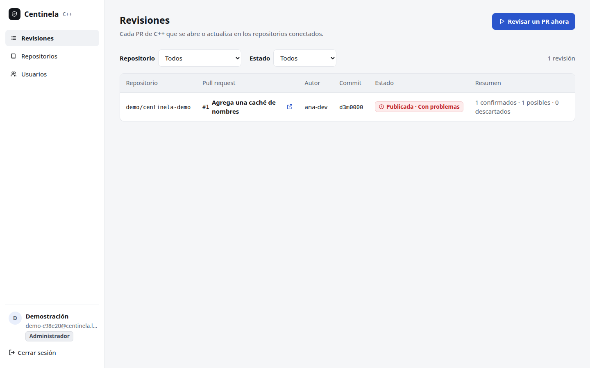
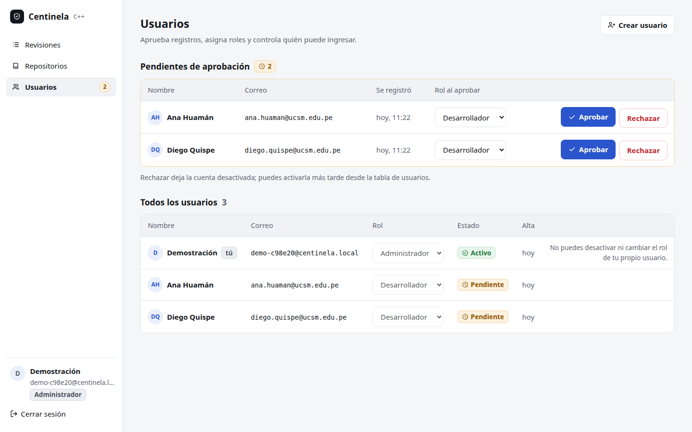

# El panel web

El panel es la cara de Centinela para las personas: una aplicación React
(`sistema/frontend`, paquete `@centinela/panel`) que el mismo servidor
Fastify sirve en `/`. No guarda nada propio: todo lo pide a la API HTTP con
la cookie de sesión, que el navegador manda sola y que el JavaScript no puede
leer (`httpOnly`).

```bash
cd sistema
npm run panel                  # compila el panel en frontend/dist
npm test -w @centinela/panel   # sus 97 pruebas
docker compose up sistema-demo # el panel con un análisis real en http://localhost:8080
```

## Las mismas reglas que el servicio, llevadas al navegador

Las habilidades de arquitectura del servicio (capas con dependencias hacia
adentro, tipos que impiden estados inválidos, errores como valores) se
aplicaron igual en el panel. Una prueba de aptitud
(`frontend/pruebas/arquitectura.test.ts`) las comprueba en cada corrida.

| Capa | Carpeta | Sabe de | No sabe de |
|---|---|---|---|
| Dominio | `src/dominio` | el modelo, los permisos por rol, las reglas de los formularios, los textos y las fechas (funciones puras) | React, el navegador, el reloj, la red |
| API | `src/api` | el puerto `Api` y su adaptador `apiHttp`: cada respuesta se valida con zod antes de volverse un tipo del dominio | React |
| Estado | `src/estado` | la sesión, el reloj y la API que recibe del contexto; la carga como unión `Cargando`, `Error` o `Listo` | el adaptador HTTP |
| Componentes | `src/componentes` | piezas visuales sin negocio: marco, modal, avisos, insignias | la API |
| Pantallas | `src/pantallas` | cada caso de uso; solo conocen el puerto `Api`, nunca `fetch` | el adaptador HTTP |
| Composición | `src/main.tsx` | el único lugar que elige `apiHttp(fetch)` | — |

Ninguna llamada lanza excepciones: `apiHttp` devuelve `Resultado<T, ErrorApi>`
con cuatro errores posibles (`Negocio`, `SinSesion`, `Red`, `RespuestaInvalida`),
y cada pantalla dice con palabras cuál ocurrió. Si la sesión vence o un
administrador desactiva la cuenta, la siguiente llamada devuelve al ingreso
con el aviso.

## Pantallas

Las capturas son del sistema real en marcha (`docker compose up sistema-demo`):
la revisión que se ve la hicieron `clang` 21.1.8 y el checker dentro del
contenedor sobre el PR de demostración.

| Pantalla | Caso de uso | Captura |
|---|---|---|
| Ingreso, con el error de clave equivocada | CU-S01 | `capturas/01-ingreso-error.png` |
| Lista de revisiones | CU-S06 | `capturas/02-revisiones.png` |
| Detalle de una revisión, con la ruta de cada hallazgo | CU-S06 | `capturas/03-detalle.png` |
| Hallazgo clasificado como confirmado | CU-S07 | `capturas/04-detalle-clasificado.png` |
| Revisar un PR ya revisado: enlaza la revisión existente | CU-S05 | `capturas/05-revisar-ahora-ya-revisado.png` |
| Repositorios, su webhook y conectar uno nuevo | CU-S03 | `capturas/06` a `08` |
| Registro y cuenta pendiente de aprobación | CU-S01 | `capturas/09` a `11` |
| Usuarios: pendientes y aprobación | CU-S02 | `capturas/12`, `13` |
| Lo que ve un desarrollador | CU-S01, CU-S06 | `capturas/14` a `16` |
| Tema oscuro y celular | — | `capturas/17`, `18` |






## Pruebas del panel

Las pruebas de pantalla no usan una API inventada: montan el **servicio
real** (producto, Fastify y sus reglas) en el mismo proceso, con un almacén
en memoria y GitHub y `clang` simulados, y le hablan por HTTP con un tarro de
cookies. Si el panel y el servicio no están de acuerdo en un campo, la prueba
falla.

| Archivo | Pruebas | Qué cubre |
|---|---|---|
| `src/dominio/dominio.test.ts` | 28 | permisos, formularios, textos, fechas en hora de Lima, agrupación de hallazgos |
| `src/api/http.test.ts` | 9 | el adaptador: 204, 401 → `SinSesion`, red caída, respuesta fuera de contrato |
| `pruebas/acceso.test.tsx` | 13 | CU-S01: registro sin nada predefinido, ingreso, sesión, rutas protegidas |
| `pruebas/usuarios.test.tsx` | 10 | CU-S02: aprobar, rechazar, desactivar, cambiar el rol, crear |
| `pruebas/repositorios.test.tsx` | 7 | CU-S03: conectar, secreto oculto, editar, desconectar, lo que no ve el desarrollador |
| `pruebas/revisiones.test.tsx` | 14 | CU-S05 a CU-S07: lista que se actualiza sola, revisar ahora, detalle, clasificar, reintentar |
| `pruebas/fallas.test.tsx` | 5 | sin red, respuesta inválida, servicio caído, ruta inexistente |
| `pruebas/arquitectura.test.ts` | 11 | las reglas de capas de la tabla de arriba |

Resultado: **97 pruebas en verde**; cobertura de líneas 99,5 %, de ramas
93,5 % y de funciones 96,5 % (umbrales: 90, 80 y 90). Los recorridos en
navegadores reales y la auditoría de accesibilidad están en el capítulo 8.
